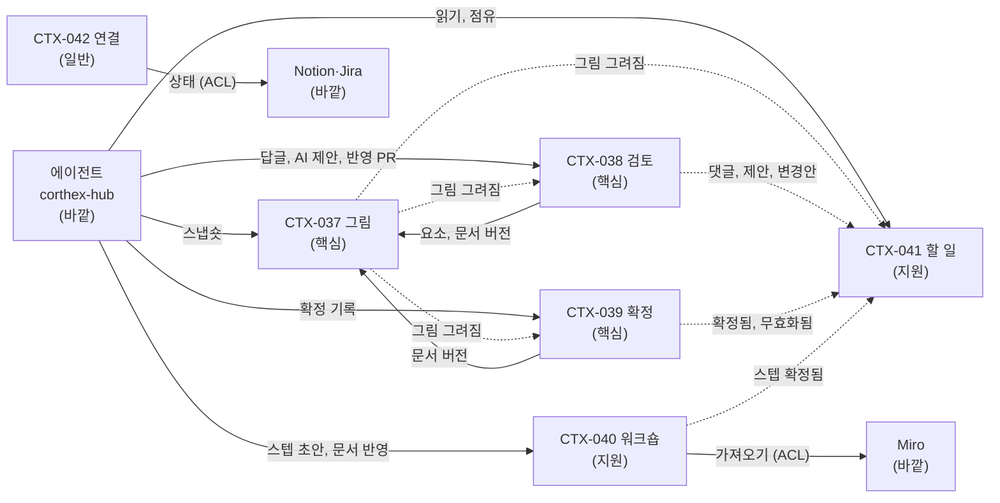

# NEXUS v3: 도메인 설계

[English](nexus.md)

이 문서는 [nexus.md](nexus.md)의 한국어 사본입니다. 원본은 영어입니다.

상태: 스텝 0~9를 한 번에 그렸고(one-pass draft), 체크포인트 1~3을 2026-11-23에 한 번에 통과했습니다. 컨텍스트 ID는 CTX-037~043, 용어 ID는 TERM-189~226입니다. 보관한 v2가 CTX-036, TERM-188까지 썼습니다.

프로젝트의 part가 `nexus` 하나이고 hub는 이름이 part로 시작하는 파일에만 part를 붙이므로, 이 문서 이름은 `nexus.md`, 한국어 사본은 `nexus.ko.md`입니다.

## 1. 서비스 개요

근거: 관리자의 2026-10-24, 2026-11-03, 2026-11-06, 2026-11-21 요청과 2026-11-22에 승인한 다시 만들기 추천 10개와 클릭 목업. 원문은 Git 밖 프로젝트 기록에 있습니다.

NEXUS는 한 사람이 프로젝트마다 CORTHEX 단계 산출물을 그 단계에 맞는 그림(DDD 보드, 사용자 흐름, ERD, 사이트맵, 화면 상태, 목업)이나 표로 보고, 그림 위에서 AI와 이야기하며 고치고, 그림마다 확정하는 작업대입니다. 원본은 Git의 단계 문서입니다. 그림은 문서에서 그려지고, 고친 것은 pull request로 다시 문서에 들어갑니다.

### 범위

| 구분 | 내용 | 근거 |
| --- | --- | --- |
| 넣음 | 단계마다 맞는 그림, 그림이 없는 단계는 표 | 2026-11-21 요청, 다시 만들기 추천 |
| 넣음 | 화면에서 추적 ID 숨김(복사할 때만 보임) | 2026-11-21 요청, ID 결정 |
| 넣음 | 그림 위 댓글, AI 제안을 그림 위에 겹쳐 보기, 받아들이기·거절하기 | 검토 결정 |
| 넣음 | 직접 편집: 01 보드는 자유 캔버스, 나머지 그림은 옮기기·이름 바꾸기·선 잇기 | 직접 편집 결정 |
| 넣음 | 그림마다 확정 버튼, 지난 확정 뒤 바뀐 곳 보기 | 확정 결정 |
| 넣음 | 이벤트 스토밍을 NEXUS 안에서, 예전 Miro 보드는 가져오기 | 이벤트 스토밍 결정 |
| 넣음 | 첫 화면은 사용자의 할 일 | 다시 만들기 추천 |
| 넣음 | Notion·Jira는 연결만(링크와 상태) | 다른 도구 결정 |
| 넣음 | 휴대폰은 보기와 댓글만 | 휴대폰 결정 |
| 뺌 | 여러 사람, 가입, 공개 게시 | "혼자 먼저" 결정. 2026-11-18의 공개 서비스 결정을 바꿈 |
| 뺌 | Notion·Jira 내용을 대신 다루기 | 다른 도구 결정 |
| 뺌 | 캔버스 엔진 직접 만들기(있는 것을 가져다 씀) | 다시 만들기 추천 |
| 뺌 | 단계 문서를 NEXUS가 직접 쓰기(문서는 에이전트가 pull request로) | 원본은 Git(CORTHEX 단계 계약) |
| 나중 | 단계 사이 따라가기, 빠진 것 찾기, 말로 그리기, AI가 MCP로 그림 읽기, 프로젝트 지도 | 다시 만들기 추천(다음 버전) |
| 나중 | 그림 사이 점검, NEXUS 밖으로 알림, 그림의 버전 기록 | 관리자의 2026-11-23 답 |

첫 버전은 01 DDD 보드와 05 ERD 두 그림부터 만들어 써 보고 넓힙니다. v2 코드는 시험을 통과한 부분(Git에서 단계 문서를 읽는 부분 등)만 옮깁니다.

### 사람과 바깥 시스템

- 사용자: NEXUS를 쓰는 단 한 사람, 관리자. PC에서는 모든 일을, 휴대폰에서는 보기와 댓글만 합니다.
- 에이전트: Claude Code·Codex 세션. corthex-hub로 스냅숏을 보내고, 할 일을 받아 답글·AI 제안·반영 PR·확정 기록을 합니다.
- Git 호스트(GitHub, 바깥 시스템): 단계 문서 원본과 반영 PR이 있는 곳.
- Notion·Jira(바깥 시스템): 프로젝트 기록과 일감. NEXUS는 링크와 상태만 읽습니다.
- Miro(바깥 시스템): 예전 이벤트 스토밍 보드. 가져오기만 합니다.
- 로그인 게이트(바깥 시스템, 지금은 Cloudflare Access): 사용자 로그인.

## 2. 이벤트 스토밍

- 보드: Git에는 없습니다. 이 초안은 프로젝트 기록의 비공개 페이지에서 봅니다. 스텝마다 탭이 하나입니다.
- 사람이 보는 곳: 단계 기본값은 Miro 보드입니다. 쓰지 않은 까닭: 관리자가 이벤트 스토밍을 NEXUS 안에서 하기로 했고, v3는 아직 없으며, 지금 운영 중인 NEXUS는 컨텍스트에 ID가 있는 도메인 문서만 그립니다. 통과 뒤 이 문서를 병합하고 스냅숏을 보내면 NEXUS가 DDD 보드를 그립니다.
- 진행 방식: one-pass draft(AI가 스텝 1~9를 한 번에 그림). 큰 방향이 2026-11-21~22에 정해졌고, 한 사람이 보며, 컨텍스트와 용어집까지 그려 오라는 요청이었습니다.
- 체크포인트 기록: 체크포인트 1~3을 2026-11-23에 프로젝트 기록에서 한 번에 통과. 질문 3개는 모두 추천안으로 답함(핫스팟 1, 2, 10).
- 사람의 보드 편집이나 댓글 없이 통과: approved as drawn(그린 대로 승인). 보드에서 고친 항목 0, 댓글 0, 답은 대화에서만.

### 타임라인

| Lane | Events |
| --- | --- |
| 프로젝트 | 프로젝트 공간 만들어짐 → 연결 더해짐 또는 연결 빠짐 → 프로젝트 공간 지워짐 |
| 문서에서 그림으로 | 스냅숏 받음 또는 스냅숏 거절됨 → 그림 그려짐 → 요소 옮겨짐 |
| 댓글과 AI 제안 | 댓글 달림 → 할 일 점유됨 → 답글 달림 또는 AI 제안 올라옴 → 제안 받아들여짐 또는 제안 거절됨 → 반영 PR 열림 → 반영됨 → 댓글 닫힘 |
| 직접 편집 | 이름 바뀜 또는 선 이어짐 → 편집 취소됨 또는 반영 PR 열림 → 반영됨 |
| 확정 | 그림 확정됨 → 확정 기록됨 → 확정 취소됨 또는 확정 무효화됨 |
| 이벤트 스토밍 워크숍 | 워크숍 열림 → Miro 보드 가져와짐 → 스텝 초안 그려짐 → 스티커 바뀜 → 스텝 확정됨 → 도메인 문서 반영됨 → 워크숍 닫힘 |
| 에이전트 점유와 자격 | 에이전트 자격 발급됨 → 할 일 점유됨 → 점유 풀림 → 에이전트 자격 폐기됨 |

각 레인의 한 줄 이야기:

- 프로젝트: 에이전트가 처음 스냅숏을 보내면 프로젝트 공간이 생기고, 사용자가 Notion·Jira 링크를 붙이고, 필요 없으면 지웁니다.
- 문서에서 그림으로: 에이전트가 기본 브랜치의 단계 문서를 보내면 NEXUS가 그림을 그리고, 사용자는 요소를 옮겨 보기 좋게 놓습니다.
- 댓글과 AI 제안: 사용자가 그림에 댓글을 달면 에이전트가 맡아 답하거나 고친 안을 그림 위에 겹쳐 올리고, 받아들이면 pull request로 문서에 들어갑니다.
- 직접 편집: 사용자가 이름을 바꾸거나 선을 이으면, 그 편집이 pull request로 문서에 들어갑니다.
- 확정: 사용자가 그림을 보고 확정하면 에이전트가 Git의 단계 기록에 남기고, 그 뒤 문서가 바뀌면 확정이 풀립니다.
- 이벤트 스토밍 워크숍: 01단계 보드에서 AI가 스텝 초안을 그리고 사용자가 자유롭게 고쳐 스텝마다 확정하면, AI가 도메인 문서로 옮깁니다.
- 에이전트 점유와 자격: 사용자가 에이전트에게 자격을 발급하고, 에이전트는 할 일을 점유하며, 쓰기 없이 두면 점유가 풀리고, 필요 없으면 사용자가 자격을 폐기합니다.

타임라인에 넣지 않은 것: 그림 보기, 할 일 보기, 바뀐 곳 보기, 연결 상태 보기, 로그인은 데이터를 바꾸지 않아 이벤트가 아닙니다. 읽기 모델로 4절에 있습니다.

## 3. 바운디드 컨텍스트와 패키지

| 컨텍스트 | 유형 | 애그리거트 | 패키지 |
| --- | --- | --- | --- |
| CTX-037 그림 | 핵심 | 프로젝트 공간, 그림, 레이아웃 | `diagram` |
| CTX-038 검토 | 핵심 | 댓글 스레드, 변경안 | `review` |
| CTX-039 확정 | 핵심 | 확정 | `confirmation` |
| CTX-040 워크숍 | 지원 | 워크숍 보드 | `workshop` |
| CTX-041 할 일 | 지원 | 점유 | `todo` |
| CTX-042 연결 | 일반 | 연결 | `toollink` |
| CTX-043 접근 | 일반 | 에이전트 자격 | `access` |

핵심 세 컨텍스트는 NEXUS가 직접 만드는 세 가지(Git 문서와 그림 연결, 댓글과 AI 제안, 확정)와 같습니다. 캔버스 편집 자체는 있는 라이브러리를 가져다 씁니다.

### 보관한 v2와 비교

| v2 (보관 태그 `archive/nexus-v2-2026-11-22`) | v3 초안 | 무엇이 달라졌나 |
| --- | --- | --- |
| Publishing | 그림 | 프로젝트 공간과 스냅숏을 이어받고, 그림 그리기와 레이아웃을 더함 |
| Review | 검토 | 이어받음. 그림 위 댓글, AI 제안 겹쳐 보기, 직접 편집을 변경안 하나로 묶음 |
| Checkpoint governance | 확정 | 이어받음. 단계 일괄 승인 대신 그림마다 버튼 |
| Identity and ownership | 접근(일반) | 줄임. 혼자 먼저라 사용자 로그인과 에이전트 자격만 |
| Continuity | 없음 | 뺌. v2를 보관하고 새로 시작 |
| 워크숍 | 워크숍 | 이어받음. 예전 Miro 보드 가져오기를 더함 |
| 관리 연결 | 연결 | 이어받음 |
| 편집 | 검토의 변경안 | 합침 |
| 그림 사이 점검 | 없음 | 첫 버전에서 빼고 나중에(관리자의 2026-11-23 답) |

관리자가 2026-11-22에 v2를 통째로 보관하고 새로 시작하기로 했으므로, v2의 승인 항목은 하나씩 따로 묻지 않고 위 표로 무엇을 이어받고 뺐는지만 보입니다.

## 4. 컨텍스트별 정리표

### CTX-037 그림

목적: 에이전트가 보낸 단계 문서로 단계마다 맞는 그림과 표를 그리고, 요소의 위치를 지킵니다.

| 주는 쪽 | 읽기 모델 | 명령 | 애그리거트 | 이벤트 |
| --- | --- | --- | --- | --- |
| 에이전트 |  | 스냅숏 보내기 | 프로젝트 공간 | 스냅숏 받음 또는 스냅숏 거절됨, 첫 스냅숏이면 프로젝트 공간 만들어짐도 |
| 정책: 스냅숏 받음이면 |  | 그림 그리기 | 그림 | 그림 그려짐 |
| 사용자(PC) | 그림 보기 | 요소 옮기기 | 레이아웃 | 요소 옮겨짐 |
| 사용자 | 프로젝트 목록 | 프로젝트 공간 지우기 | 프로젝트 공간 | 프로젝트 공간 지워짐 |

- 애그리거트 규칙: 프로젝트 공간: 새 스냅숏은 들고 있는 커밋에서 이어져야 하고, 아니면 거절됩니다. 첫 스냅숏과 덮어쓰기는 사용자의 "예"가 있어야 합니다(문서: CORTHEX NEXUS 작업 규칙). 프로젝트 공간은 사용자만 지웁니다(문서: CORTHEX NEXUS 작업 규칙). 스냅숏 받음과 프로젝트 공간 만들어짐은 한 트랜잭션입니다(추론).
- 애그리거트 규칙: 그림: 그림 하나는 스냅숏 하나의 단계 문서에서만 그려지고, 그림이 문서를 바꾸지 않습니다(추론: 원본은 Git). 화면에는 이름만 보이고 추적 ID는 복사할 때만 보입니다(2026-11-21 요청, ID 결정).
- 애그리거트 규칙: 레이아웃: 요소를 옮겨도 문서 뜻은 바뀌지 않고, 다시 그려도 위치가 남습니다(추론).
- Given–When–Then: Given 프로젝트 공간이 커밋 A를 들고 있고, When 에이전트가 A에서 이어진 커밋 B로 스냅숏 보내기를 하면, Then 스냅숏 받음과 그림 그려짐.
- Given–When–Then: Given 커밋 A를 들고 있고, When A에서 이어지지 않는 커밋 C를 보내면, Then 스냅숏 거절됨이고 그림은 그대로.
- Given–When–Then: Given 그려진 ERD, When 사용자가 테이블 하나를 옮기면, Then 요소 옮겨짐이고 문서와 확정은 그대로.
- 바깥 시스템: Git 호스트(에이전트를 거쳐)
- 관계: 에이전트가 스냅숏을 보냄. 그림이 다시 그려지면 검토·확정·할 일에 알림. 검토와 확정이 요소와 문서 버전을 물어봄.
- 핫스팟: 3, 4, 7

### CTX-038 검토

목적: 그림 위의 댓글과 답글, AI 제안과 직접 편집을 변경안으로 모아 받아들이고, pull request로 문서에 들어갔는지 확인합니다.

| 주는 쪽 | 읽기 모델 | 명령 | 애그리거트 | 이벤트 |
| --- | --- | --- | --- | --- |
| 사용자, 에이전트 | 그림 보기 | 댓글 달기 | 댓글 스레드 | 댓글 달림 |
| 사용자, 에이전트 | 그림 보기 | 답글 달기 | 댓글 스레드 | 답글 달림 |
| 에이전트 | 에이전트 할 일 | AI 제안 올리기 | 변경안 | AI 제안 올라옴 |
| 사용자(PC) | 그림 보기 | 제안 받아들이기 | 변경안 | 제안 받아들여짐 |
| 사용자(PC) | 그림 보기 | 제안 거절하기 | 변경안 | 제안 거절됨 |
| 사용자(PC) | 그림 보기 | 이름 바꾸기 | 변경안 | 이름 바뀜 |
| 사용자(PC) | 그림 보기 | 선 잇기 | 변경안 | 선 이어짐 |
| 사용자(PC) | 바뀐 곳 보기 | 편집 취소하기 | 변경안 | 편집 취소됨 |
| 에이전트 | 에이전트 할 일 | 반영 PR 알리기 | 변경안 | 반영 PR 열림 |
| 정책: 그림 그려짐에 반영 PR의 커밋이 들어 있으면 |  | 반영 확인하기 | 변경안 | 반영됨 |
| 사용자; 정책: 반영됨이면 | 그림 보기 | 댓글 닫기 | 댓글 스레드 | 댓글 닫힘 |

- 애그리거트 규칙: 변경안: AI 제안은 사용자만 받아들이거나 거절합니다(2026-11-22에 승인한 목업의 반영·거절, CORTHEX 원칙 5).
- 애그리거트 규칙: 변경안: 사용자의 직접 편집은 받아들인 변경안으로 봅니다(추론). 01 보드 밖에서는 이름 바꾸기와 선 잇기만 변경안이 되고, 옮기기는 레이아웃입니다(직접 편집 결정).
- 애그리거트 규칙: 변경안: 반영은 pull request가 병합되고 그 커밋의 스냅숏이 그려져야 끝납니다(추론: 원본은 Git).
- 애그리거트 규칙: 댓글 스레드: 요소의 추적 ID와 그때의 문서 버전에 붙습니다(추론).
- 애그리거트 규칙: 댓글 스레드: 제안이 거절되거나 편집이 취소되어도 스레드는 열린 채로 남아 사용자가 답하거나 닫고, 사용자는 언제든 스레드를 닫을 수 있습니다(추론).
- Given–When–Then: Given AI 제안이 겹쳐 보이는 ERD, When 사용자가 제안 받아들이기를 하면, Then 제안 받아들여짐이고 에이전트 할 일에 반영이 오릅니다.
- Given–When–Then: Given 받아들인 변경안과 열린 반영 PR, When 그 PR 커밋의 스냅숏이 그려지면, Then 반영됨과 댓글 닫힘.
- Given–When–Then: Given ERD의 테이블, When 사용자가 이름 바꾸기를 하면, Then 이름 바뀜이고 반영될 때까지 그림에 '반영 대기'로 보입니다.
- 바깥 시스템: 없음(에이전트를 거쳐 Git 호스트)
- 관계: 그림에 요소를 물어봄. 그림 그려짐을 받아 반영을 확인. 할 일에 댓글, AI 제안, 받아들인 변경안을 알림.
- 핫스팟: 3, 6

### CTX-039 확정

목적: 사용자가 그림이나 표 하나를 그때의 문서 버전으로 통과시키고, 그 확정을 Git의 단계 기록에 남깁니다.

| 주는 쪽 | 읽기 모델 | 명령 | 애그리거트 | 이벤트 |
| --- | --- | --- | --- | --- |
| 사용자(PC) | 그림 보기, 바뀐 곳 보기 | 그림 확정하기 | 확정 | 그림 확정됨 |
| 사용자(PC) | 그림 보기 | 확정 취소하기 | 확정 | 확정 취소됨 |
| 에이전트 | 에이전트 할 일 | 확정 기록하기 | 확정 | 확정 기록됨 |
| 정책: 그림 그려짐에서 확정한 그림의 문서가 바뀌었으면 |  | 확정 무효화하기 | 확정 | 확정 무효화됨 |

- 애그리거트 규칙: 확정: 사용자만 합니다. 에이전트는 확정하지 않습니다(2026-11-21 요청의 그림마다 확정, CORTHEX 원칙 5).
- 애그리거트 규칙: 확정: 확정할 때 보던 문서 버전에 묶입니다(추론, v2의 콘텐츠 버전 승인과 같음). 그 뒤 문서가 바뀌면 무효가 되어 다시 확정해야 합니다(관리자의 2026-11-23 답).
- 애그리거트 규칙: 확정: Git의 단계 기록에 들어가야 단계가 끝난 것으로 봅니다(문서: CORTHEX NEXUS 작업 규칙). 그림 하나의 확정이 단계 체크포인트 하나이고, 01 보드는 스텝 1-b·7·9가 각각입니다(추측).
- Given–When–Then: Given 문서 버전 B로 그려진 ERD, When 사용자가 그림 확정하기를 하면, Then 그림 확정됨(B)이고 에이전트 할 일에 확정 기록이 오릅니다.
- Given–When–Then: Given B로 확정된 ERD, When 문서 버전 C의 스냅숏이 ERD를 바꾸면, Then 확정 무효화됨이고 사용자 할 일에 다시 확정이 오릅니다.
- 바깥 시스템: 없음(에이전트를 거쳐 Git 호스트)
- 관계: 그림에 문서 버전을 물어봄. 그림 그려짐을 받아 무효화. 할 일에 그림 확정됨과 확정 무효화됨을 알림.
- 핫스팟: 2, 5, 9

### CTX-040 워크숍

목적: 01단계 이벤트 스토밍을 NEXUS의 자유 캔버스에서 하고, 스텝마다 확정한 것을 도메인 문서로 넘깁니다.

| 주는 쪽 | 읽기 모델 | 명령 | 애그리거트 | 이벤트 |
| --- | --- | --- | --- | --- |
| 사용자, 에이전트 |  | 워크숍 열기 | 워크숍 보드 | 워크숍 열림 |
| 사용자 |  | Miro 보드 가져오기 | 워크숍 보드 | Miro 보드 가져와짐 |
| 에이전트 | 에이전트 할 일 | 스텝 초안 그리기 | 워크숍 보드 | 스텝 초안 그려짐 |
| 사용자(PC) | 그림 보기 | 스티커 고치기 | 워크숍 보드 | 스티커 바뀜 |
| 사용자(PC) | 그림 보기 | 스텝 확정하기 | 워크숍 보드 | 스텝 확정됨 |
| 에이전트 | 에이전트 할 일 | 도메인 문서 반영 알리기 | 워크숍 보드 | 도메인 문서 반영됨 |
| 정책: 마지막 스텝 확정 뒤 도메인 문서 반영됨이면 |  | 워크숍 닫기 | 워크숍 보드 | 워크숍 닫힘 |

- 애그리거트 규칙: 워크숍 보드: 워크숍 동안은 보드가 원본이고, 스텝을 확정할 때마다 AI가 도메인 문서로 옮깁니다(문서: CORTHEX 01단계 규칙, 관리자의 2026-11-23 답). AI가 만든 스티커는 신뢰도 표시를 달고, AI는 사람이 만든 스티커를 지우지 않습니다(문서: CORTHEX 01단계 규칙). 컨텍스트 ID는 경계 체크포인트(스텝 7) 뒤에만 붙습니다(문서: CORTHEX 01단계 규칙).
- 스티커 고치기는 붙이기, 옮기기, 이름 바꾸기, 잇기, 떼기를 모두 말합니다.
- 바깥 시스템: Miro(가져오기, anticorruption layer)
- 관계: 에이전트가 corthex-hub로 스텝 초안을 그리고 도메인 문서 반영을 알림. 할 일에 스텝 확정됨을 알림. 마지막 스텝 뒤 자기 이벤트인 도메인 문서 반영됨으로 워크숍을 닫음.
- 핫스팟: 1, 8

### CTX-041 할 일

목적: 사용자와 에이전트가 각자 할 일을 한곳에서 보고, 에이전트 세션끼리 같은 일을 겹쳐 하지 않게 합니다.

| 주는 쪽 | 읽기 모델 | 명령 | 애그리거트 | 이벤트 |
| --- | --- | --- | --- | --- |
| 에이전트 | 에이전트 할 일 | 할 일 점유하기 | 점유 | 할 일 점유됨 |
| 에이전트; 정책: 60분 동안 쓰기가 없고 열린 pull request가 없으면 | 에이전트 할 일 | 점유 풀기 | 점유 | 점유 풀림 |

- 애그리거트 규칙: 점유: 할 일 하나는 세션 하나만 점유합니다. 열린 pull request가 있는 일은 pull request가 닫힐 때까지 점유가 이어집니다(문서: CORTHEX NEXUS 작업 규칙).
- 읽기 모델: 사용자 할 일(첫 화면: 확정할 그림, 답할 AI 제안과 질문), 에이전트 할 일(열린 댓글, 반영할 변경안, 기록할 확정, 쓸 도메인 문서).
- 관계: 그림·검토·확정·워크숍이 할 일을 알림. 에이전트가 읽고 점유함.

### CTX-042 연결

목적: 프로젝트와 단계에 Notion 페이지와 Jira 프로젝트 링크를 붙이고, 그 상태를 읽어 보여 줍니다. NEXUS는 Notion·Jira에 쓰지 않습니다(다른 도구 결정).

| 주는 쪽 | 읽기 모델 | 명령 | 애그리거트 | 이벤트 |
| --- | --- | --- | --- | --- |
| 사용자 | 프로젝트 목록 | 연결 더하기 | 연결 | 연결 더해짐 |
| 사용자 | 프로젝트 목록 | 연결 빼기 | 연결 | 연결 빠짐 |

- 애그리거트 규칙: 연결: 링크와 마지막으로 읽은 상태만 들고, 연결한 곳의 내용은 들지 않습니다(다른 도구 결정).
- 바깥 시스템: Notion, Jira(anticorruption layer)

### CTX-043 접근

목적: 사용자 로그인과 에이전트 자격을 확인합니다.

| 주는 쪽 | 읽기 모델 | 명령 | 애그리거트 | 이벤트 |
| --- | --- | --- | --- | --- |
| 사용자(PC) | 프로젝트 목록 | 에이전트 자격 발급하기 | 에이전트 자격 | 에이전트 자격 발급됨 |
| 사용자(PC) | 프로젝트 목록 | 에이전트 자격 폐기하기 | 에이전트 자격 | 에이전트 자격 폐기됨 |

- 애그리거트 규칙: 에이전트 자격: 에이전트 자격으로는 확정할 수 없습니다(CORTHEX 원칙 5).
- 애그리거트 규칙: 에이전트 자격: 사용자만 발급하고 폐기하며, 폐기한 자격은 다음 요청부터 거절됩니다(추론).
- 바깥 시스템: 로그인 게이트(conformist)
- 관계: 모든 컨텍스트가 요청마다 접근을 부릅니다.

## 5. 컨텍스트 사이 의존

| From | To | Kind | Pattern | Why | Data |
| --- | --- | --- | --- | --- | --- |
| 에이전트(corthex-hub) | CTX-037 | call (sync) | open host service, published language | 스냅숏 보내기 | 커밋, 단계 문서 |
| CTX-037 | CTX-039 | event (async) | customer and supplier | 확정한 그림의 문서가 바뀌면 무효화 | 그림 그려짐: 그림, 문서 버전 |
| CTX-037 | CTX-038 | event (async) | customer and supplier | 반영 PR이 들어왔는지 확인 | 그림 그려짐: 들어간 커밋 |
| CTX-037 | CTX-041 | event (async) | | 확정할 그림을 사용자에게 보여 주기 | 그림 그려짐 |
| CTX-038 | CTX-037 | call (sync) | conformist | 댓글과 편집을 요소에 붙이기 | 요소의 추적 ID, 문서 버전 |
| CTX-039 | CTX-037 | call (sync) | conformist | 확정할 그림의 문서 버전 | 그림, 문서 버전 |
| CTX-038 | CTX-041 | event (async) |  | 에이전트에게 일 넘기기, 사용자에게 AI 제안 보이기 | 댓글 달림, AI 제안 올라옴, 제안 받아들여짐, 이름 바뀜, 선 이어짐 |
| CTX-039 | CTX-041 | event (async) |  | 확정 기록 넘기기, 사용자에게 다시 확정 요청 | 그림 확정됨, 확정 무효화됨 |
| CTX-040 | CTX-041 | event (async) |  | 도메인 문서 쓰기 넘기기 | 스텝 확정됨 |
| 에이전트(corthex-hub) | CTX-041 | call (sync) | open host service | 할 일 읽기와 점유 | 할 일 목록, 점유 |
| 에이전트(corthex-hub) | CTX-040 | call (sync) | open host service | 스텝 초안 그리기, 도메인 문서 반영 알리기 | 스텝, 스티커, PR 주소 |
| 에이전트(corthex-hub) | CTX-038 | call (sync) | open host service | 답글, AI 제안, 반영 PR 알리기 | 댓글, 변경안, PR 주소 |
| 에이전트(corthex-hub) | CTX-039 | call (sync) | open host service | 확정 기록 알리기 | 확정, PR 주소 |
| CTX-042 | Notion, Jira | call (sync) | anticorruption layer | 상태 보여 주기 | 링크, 상태 |
| CTX-040 | Miro | call (sync) | anticorruption layer | 예전 보드 가져오기 | 스티커 글·색·위치 |
| 모든 컨텍스트 | CTX-043 | call (sync) |  | 사용자와 에이전트 확인 | 로그인, 에이전트 자격 |

그림 컨텍스트가 가운데에서 문서 버전을 쥐고, 검토와 확정은 그림을 물어보고(실선, 동기 호출) 그림이 다시 그려지면 알림을 받습니다(점선, 비동기 이벤트). 에이전트는 바깥에서 corthex-hub로만 들어옵니다. 접근은 모든 컨텍스트가 부르므로 그림에서 뺐습니다. 동기 호출로 된 순환은 없습니다. 검토와 그림, 확정과 그림 사이는 한쪽이 이벤트입니다.

## 6. 핫스팟

| 핫스팟 | 컨텍스트 | 상태 | 답이나 다음 할 일 |
| --- | --- | --- | --- |
| 1. 워크숍 동안 원본은 보드인가 문서인가 | CTX-040 | 답함 | 워크숍 동안은 보드(관리자의 2026-11-23 답) |
| 2. 확정한 뒤 문서가 바뀌면 확정을 풀까 | CTX-039 | 답함 | 풀고 다시 확정(관리자의 2026-11-23 답) |
| 3. 요소가 문서에서 사라지면 그 요소의 댓글은 어디에 남나 | CTX-038 | 답함 | 그림 전체 댓글로 옮기고 사라진 요소의 것으로 표시(02단계, REQ-033) |
| 4. corthex-hub의 지금 명령(push, todo, claim, comment, decide, reflect, status, record)을 v3도 그대로 받을까 | CTX-037, CTX-041 | 답함 | 그대로 받음(02단계, REQ-018) |
| 5. 휴대폰에서 확정 버튼도 되나 | CTX-039 | 답함 | 안 됨. 보기와 댓글만(02단계, REQ-068) |
| 6. 직접 편집을 하나씩 pull request로 낼까, 모아서 낼까 | CTX-038 | 답함 | 그림마다 모아서(02단계, REQ-032. 첫 릴리스 뒤의 Should 요구사항이고, 첫 릴리스에서도 에이전트는 PR 하나를 여러 변경안에 이을 수 있음, SPEC-024) |
| 7. 레이아웃(요소 위치)은 NEXUS에 둘까 Git에 둘까 | CTX-037 | 답함 | NEXUS(02단계, REQ-015. 표는 05단계에서) |
| 8. 지금 운영 NEXUS의 댓글·체크포인트 기록을 v3로 옮길까 | CTX-040, CTX-039 | 답함 | 옮기지 않음. 보관 태그와 Git 기록에 남음(02단계, REQ-019) |
| 9. 그림 하나의 확정이 단계 체크포인트 하나인가(01 보드는 스텝 1-b·7·9) | CTX-039 | 답함, 열린 질문 하나 | 단계의 모든 그림과 항목 표에 기록된 확정이 있으면 통과. 01 보드는 스텝 1-b·7·9의 단계 확정이 체크포인트(02단계, REQ-042, REQ-043). 워크숍이 열린 동안 01단계에 REQ-042를 어떻게 읽을지는 워크숍 릴리스의 열린 질문(요구사항 4절) |
| 10. v2의 그림 사이 점검, 알림, 버전 기록을 첫 버전에 넣을까 |  | 답함 | 나중에, 첫 버전에는 넣지 않음(관리자의 2026-11-23 답) |
| 11. 직접 편집 범위가 프로젝트 기록에 두 가지로 적혀 있음: 옮기기·이름·선 잇기까지, 또는 01 보드는 자유 캔버스이고 나머지는 옮기기·이름·선 잇기 | CTX-038, CTX-040 | 답함 | 관리자가 2026-11-22에 승인한 다시 만들기 결정을 따름: 01 보드는 자유 캔버스 |
| 12. AI가 추론한 그림·확정 규칙: 그림마다 확정, 그림 하나는 스냅숏 하나에서, 레이아웃은 문서 뜻을 안 바꿈 | CTX-037, CTX-039 | 02단계에서 다시 봄 | 요구사항에 그대로 옮겼고, 02단계 버전 동결이 승인함(REQ-001~REQ-066) |
| 13. 모든 컨텍스트의 명령 행 | CTX-037, CTX-038, CTX-039, CTX-040, CTX-041, CTX-042 | 02단계에서 다시 봄 | 요구사항에 그대로 옮겼고, 02단계 버전 동결이 승인함(REQ-001~REQ-066) |
| 14. 제안이 거절되거나 편집이 취소되어도 댓글 스레드는 열린 채 남고 사용자가 닫음 | CTX-038 | 답함 | 사용자가 닫을 때까지 스레드가 열려 있음(02단계, REQ-024, REQ-034) |

## 7. 용어집

| ID | 용어 | 정의 | 컨텍스트 | 코드 이름 | 쓰지 않을 말 |
| --- | --- | --- | --- | --- | --- |
| TERM-189 | 프로젝트 공간 | NEXUS 안에서 프로젝트 하나가 가진 스냅숏, 그림, 댓글, 확정, 레이아웃의 모음 | CTX-037 | `ProjectSpace` | 워크스페이스 |
| TERM-190 | 단계 | CORTHEX의 13단계 중 하나 | CTX-037 | `Stage` | 판, 페이즈 |
| TERM-191 | 단계 문서 | Git 기본 브랜치에 있는 단계 산출물의 원본 | CTX-037 | `StageDocument` | 원고, 소스 |
| TERM-192 | 스냅숏 | 에이전트가 기본 브랜치의 커밋 하나에서 단계 문서를 모아 NEXUS에 보낸 것 | CTX-037 | `Snapshot` | 게시본, 백업 |
| TERM-193 | 문서 버전 | 그림을 그린 단계 문서의 커밋 | CTX-037 | `DocumentVersion` | 판 |
| TERM-194 | 그림 | 단계 문서에서 그린 다이어그램: DDD 보드, 사용자 흐름, ERD, 사이트맵, 화면 상태, 목업 | CTX-037 | `Diagram` | 캔버스(편집 도구를 가리킬 때만) |
| TERM-195 | 항목 표 | 그림이 없는 단계(PRD, 기능 명세, API, WBS, QA)의 항목을 표로 보여 준 것 | CTX-037 | `ItemTable` | 목록 화면 |
| TERM-196 | 요소 | 그림 안의 하나: 스티커, 테이블, 화면, 연결선, 표의 행. 숨긴 추적 ID를 가짐 | CTX-037 | `Element` | 노드, 아이템 |
| TERM-197 | 추적 ID | 단계 사이를 잇는 ID(CTX-001 같은). 화면에는 숨기고 복사할 때만 보임 | CTX-037 | `traceId` | 번호 |
| TERM-198 | 레이아웃 | 그림에서 요소의 위치. 문서 뜻을 바꾸지 않음 | CTX-037 | `Layout` | 자리 |
| TERM-199 | 댓글 | 사용자나 에이전트가 그림, 요소, 표의 행에 남긴 글 | CTX-038 | `Comment` | 의견, 코멘트 |
| TERM-200 | 댓글 스레드 | 댓글 하나와 그 답글의 모음. 요소와 문서 버전에 붙음 | CTX-038 | `CommentThread` | 대화방 |
| TERM-201 | AI 제안 | 에이전트가 고친 안을 그림 위에 겹쳐 보여 준 것. 사용자가 받아들이거나 거절함 | CTX-038 | `Proposal` | 추천안 |
| TERM-202 | 직접 편집 | 사용자가 그림에서 바로 고친 것: 01 보드는 자유롭게, 나머지는 이름 바꾸기와 선 잇기 | CTX-038 | `DirectEdit` | 수동 수정 |
| TERM-203 | 변경안 | 받아들인 AI 제안이나 직접 편집처럼 문서에 넣을 변경 | CTX-038 | `ChangeSet` | 패치 |
| TERM-204 | 반영 | 변경안을 pull request로 단계 문서에 넣고, 그 커밋의 스냅숏이 그려진 것 | CTX-038 | `Reflection` | 적용, 동기화 |
| TERM-205 | 반영 PR | 변경안을 단계 문서에 넣는 pull request | CTX-038 | `reflectionPr` | 수정 PR |
| TERM-206 | 확정 | 사용자가 그림이나 항목 표 하나를 그때의 문서 버전으로 통과시키는 것. 단계 체크포인트 통과로 기록됨 | CTX-039 | `Confirmation` | 승인(단계 일괄 승인과 헷갈림), 잠금 |
| TERM-207 | 체크포인트 | CORTHEX 단계에서 사용자가 보고 통과시키는 때 | CTX-039 | `Checkpoint` | 확인 지점 |
| TERM-208 | 확정 무효화 | 확정한 뒤 문서가 바뀌어 다시 확정해야 하는 상태가 된 것 | CTX-039 | `invalidated` | 만료 |
| TERM-209 | 바뀐 곳 | 지난 확정 뒤 문서에서 바뀐 요소 | CTX-039 | `diff` | 차이점 |
| TERM-210 | 워크숍 | 01단계 이벤트 스토밍을 NEXUS 보드에서 하는 일 | CTX-040 | `Workshop` | 세션 |
| TERM-211 | 워크숍 보드 | 워크숍의 자유 캔버스. 워크숍 동안은 원본 | CTX-040 | `WorkshopBoard` | 작업 보드 |
| TERM-212 | 스텝 | 이벤트 스토밍의 0~9 단계. CORTHEX 단계와 구분하려고 스텝이라 부름 | CTX-040 | `Step` | 단계(13단계와 헷갈림) |
| TERM-213 | 스티커 | 이벤트 스토밍 보드의 메모 하나. 색이 종류를 나타냄 | CTX-040 | `Sticky` | 포스트잇, 카드 |
| TERM-214 | 신뢰도 표시 | AI 스티커 끝의 [확실]·[추론]·[추측] | CTX-040 | `confidence` | 꼬리표 |
| TERM-215 | 핫스팟 | 보드 위의 열린 질문, 위험, 이견, AI의 추측 | CTX-040 | `Hotspot` | 이슈 |
| TERM-216 | 할 일 | 사용자나 에이전트가 답하거나 처리할 것의 목록 | CTX-041 | `Todo` | 내 차례 |
| TERM-217 | 점유 | 에이전트 세션 하나가 할 일 하나를 정해진 시간 동안 혼자 맡는 것 | CTX-041 | `Claim` | 잠금, 승인 |
| TERM-218 | 연결 | 프로젝트나 단계에 붙인 Notion·Jira 링크와 그 상태 | CTX-042 | `ToolLink` | 연동(쓰기까지 하는 것으로 들림) |
| TERM-219 | 사용자 | NEXUS를 쓰는 단 한 사람, 관리자 | CTX-043 | `Owner` | 운영자 |
| TERM-220 | 에이전트 | corthex-hub로 NEXUS와 일하는 Claude Code·Codex 세션 | CTX-043 | `Agent` | 봇, AI 사용자 |
| TERM-221 | 에이전트 자격 | 에이전트가 NEXUS에 들어오는 폐기 가능한 자격. 확정 권한이 없음 | CTX-043 | `AgentCredential` | 사용자 세션 |
| TERM-222 | 그림 보기 | 그림이나 항목 표 하나를 댓글, AI 제안, 바뀐 곳과 함께 보여 주는 화면(읽기 모델) | CTX-037 | `DiagramView` | 뷰어 |
| TERM-223 | 프로젝트 목록 | 사용자의 프로젝트 공간과 그 단계, 연결을 모아 보여 주는 화면(읽기 모델) | CTX-037 | `ProjectList` | 대시보드 |
| TERM-224 | 바뀐 곳 보기 | 지난 확정 뒤 문서에서 바뀐 곳을 보여 주는 화면(읽기 모델) | CTX-039 | `DiffView` | 비교 화면 |
| TERM-225 | 사용자 할 일 | 첫 화면: 확정할 그림, 답할 AI 제안과 질문(읽기 모델) | CTX-041 | `OwnerTodo` | 받은 편지함 |
| TERM-226 | 에이전트 할 일 | 에이전트가 처리할 것: 열린 댓글, 반영할 변경안, 기록할 확정, 쓸 도메인 문서(읽기 모델) | CTX-041 | `AgentTodo` | 큐 |

같은 말이 두 뜻인 것은 일부러 나눴습니다. "단계"는 CORTHEX 13단계, "스텝"은 이벤트 스토밍 0~9입니다. "확정"은 그림 하나, "체크포인트"는 CORTHEX 단계의 때를 말합니다.

## 8. 체크포인트 기록

체크포인트 1~3을 한 번에 여쭸고, 2026-11-23에 프로젝트 기록에서 통과했습니다.

1. 추측으로 둔 것: 그림 하나의 확정이 단계 체크포인트 하나(01 보드는 스텝 1-b·7·9). 따로 답하지 않음, 핫스팟 9.
2. 질문 1~3: 모두 추천안으로 답함, 핫스팟 1, 2, 10.
3. 핵심 애그리거트 규칙: 4절의 그림·검토·확정 규칙, 그린 대로 승인, 핫스팟 12·13.

통과 뒤 고친 것: 이 단계의 첫 pull request 리뷰에서 나온 10건 중 7건을 여기서 고쳤습니다(할 일로 가는 이벤트, 도메인 문서 반영됨의 주인, 점유 풀림, 에이전트가 워크숍에 들어오는 경로, 점유와 자격 레인, 자격 명령, 댓글을 닫는 경우). 이 수정은 2026-11-23에 따로 체크포인트를 통과했습니다. 관리자가 체크포인트용으로 정한 대리인을 통해 추천안을 승인했고, 프로젝트 기록에 있습니다.

핫스팟 3~9와 14는 02단계 체크포인트에서 답했고, 12와 13은 02단계 버전 동결이 승인한 요구사항에 옮겼습니다. PR 96과 97 리뷰 뒤 6절에 그 답을 적었습니다. 이 수정은 2026-11-23 따로 체크포인트를 통과했고, 바꾸는 승인된 항목은 없습니다.

2026-11-23 기능 변경, 03·07·08·09단계 그림을 첫 릴리스에. 관리자가 사용자 흐름, 화면 상태, 목업을 첫 릴리스부터 그리기로 정했고, 그 원본은 hub가 보냅니다. 이 변경이 건드리는 승인 항목은 하나씩 여쭸고, 관리자가 체크포인트용으로 정한 대리인을 통해 승인했습니다. 답은 프로젝트 기록에 있습니다. 여기서는: TERM-194 그림과 1절이 단계 문서에서 그리는 그림에 사용자 흐름을 넣습니다. 문서가 바뀌므로 거기서 그린 DDD 보드는 확정 뒤 바뀜으로 보이고, 관리자가 다시 확정해야 합니다. 이 단계 몫은 2026-11-23에 같은 대리인을 통해 따로 체크포인트를 통과했습니다.

2026-11-24 기능 변경, 기다리는 것이 있는 동안 남는 지운 그림(기능 명세 6절). 이 단계는 바뀌지 않습니다. 도메인 설계에는 지운 그림을 나열하거나 여는 규칙이 없고, 이 변경이 소유자에게 닿게 두는 명령인 제안 거절하기와 편집 취소하기(CTX-038), 그리고 핫스팟 3의 답은 적힌 그대로입니다. 이 기록으로 문서가 바뀌므로, 그 문서로 그린 DDD 보드는 확정한 뒤 바뀐 곳을 보이고 다시 확정해야 합니다(SPEC-033). 2026-11-23 기능 변경 뒤와 같습니다. 이 몫은 2026-11-24에 같은 대리인을 통해 따로 체크포인트를 통과했어요.

이 단계가 빼거나 바꾸는 승인 항목: v2는 관리자의 2026-11-22 결정으로 통째로 보관했고 이어받은 것은 3절에 있습니다. 이 단계의 다른 승인 항목은 없습니다.

빠진 것 확인에 쓴 비슷한 제품 네 가지: GitHub pull request 리뷰, Figma 댓글과 버전 기록, IcePanel, Miro. 이들에 있고 이 초안에 없는 것은 NEXUS 밖으로 알려 주는 알림, 예전 그림을 보는 버전 기록, v2에 있던 그림 사이 점검입니다(질문 3).

## 9. 다음 행동

- 이 문서와 단계 기록을 문서만의 pull request로 병합한 뒤 스냅숏을 보내 NEXUS가 DDD 보드를 그리게 합니다.
- 그다음 02단계 PRD로 갑니다. 핫스팟 3~9, 12, 13은 02단계나 05단계에서 정합니다.
