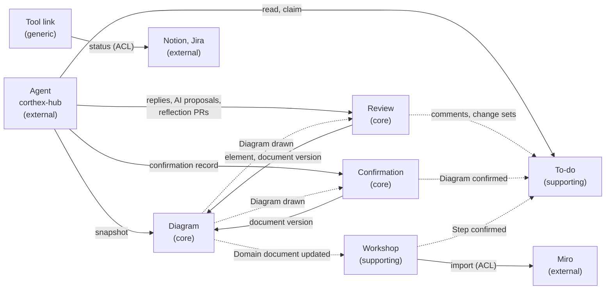

# NEXUS v3: domain design (draft)

[한국어](nexus.ko.md)

Status: draft. Steps 0 to 9 were drawn in one pass (one-pass draft), and checkpoints 1 to 3 are asked together. No checkpoint has passed yet, so the contexts and terms have no IDs. When the maintainer passes them, the contexts take IDs from CTX-037 and the terms from TERM-189 on; the archived v2 used IDs up to CTX-036 and TERM-188.

The project declares one part, `nexus`, and the hub gives a part only to a file whose name starts with it, so this document is `nexus.md` and its Korean copy `nexus.ko.md`.

## 1. Service overview

Sources: the maintainer's briefs of 2026-10-24, 2026-11-03, 2026-11-06 and 2026-11-21, and their approval on 2026-11-22 of the ten redesign recommendations and the clickable mockup. Their exact words stay in the project's records outside Git.

NEXUS is a workbench where one person sees each project's CORTHEX stage outputs as the picture that fits the stage (DDD board, ERD, sitemap, screen states, mockup) or as a table, talks about them with an AI on the picture, changes them there, and confirms each picture. The source is the stage documents in Git. Pictures are drawn from the documents, and changes go back into the documents through pull requests.

### Scope

| Kind | What | Source |
| --- | --- | --- |
| In | A picture that fits each stage, and a table for a stage without one | Brief of 2026-11-21; redesign recommendations |
| In | Trace IDs hidden on screen and shown only when copied | Brief of 2026-11-21; redesign decision on IDs |
| In | Comments on a picture, AI proposals laid over the picture, accept and reject | Redesign decision on review |
| In | Direct edit: a free canvas on the stage-01 board; move, rename and connect on the other pictures | Redesign decision on direct edit |
| In | A confirm button per picture, and a view of what changed since the last confirmation | Redesign decision on confirmation |
| In | Event storming inside NEXUS, with an import of the earlier Miro board | Redesign decision on event storming |
| In | The owner's to-do as the first screen | Redesign recommendations |
| In | Notion and Jira as links only, with their status | Redesign decision on other tools |
| In | View and comment only on a phone | Redesign decision on mobile |
| Out | Several people, sign-up, public publishing | Redesign decision "solo first", which replaces the public-service decision of 2026-11-18 |
| Out | Handling the content of Notion or Jira | Redesign decision on other tools |
| Out | A canvas engine of our own; an existing one is used | Redesign recommendations |
| Out | NEXUS writing stage documents itself; agents change them through pull requests | The source is Git (CORTHEX stage contract) |
| Later | Tracing between stages, finding gaps, drawing from speech, AI reading pictures over MCP, a project map | Redesign recommendations (next version) |

The first version starts with two pictures, the stage-01 DDD board and the stage-05 ERD, and widens after use. Only code that passed its tests, such as reading stage documents from Git, is carried over from v2.

### People and external systems

- Owner: the one person who uses NEXUS, the maintainer. Does everything on a PC; only views and comments on a phone.
- Agent: a Claude Code or Codex session. Sends snapshots through corthex-hub, takes to-dos, and posts replies, AI proposals, reflection pull requests and confirmation records.
- Git host (GitHub, external system): holds the stage documents and the reflection pull requests.
- Notion and Jira (external systems): project records and work items. NEXUS reads only their links and status.
- Miro (external system): the earlier event storming board. Import only.
- Sign-in gate (external system, now Cloudflare Access): signs the owner in.

## 2. Event storming

- Board: no board in Git. This draft is reviewed on a private page in the project's records, with one tab per step.
- Human view: the stage default is a Miro board. It was not used because the maintainer chose to run event storming inside NEXUS, v3 does not exist yet, and the running NEXUS draws a domain document only once its contexts have IDs. After the pass, this document is merged and pushed, and NEXUS draws its DDD board.
- Way of working: one-pass draft; the AI drew steps 1 to 9 at once. The direction was set on 2026-11-21 and 2026-11-22, one person reviews it, and the work was asked to come back with the contexts and the glossary.
- Checkpoint records: none yet.

### Timeline

| Lane | Events |
| --- | --- |
| Project | Project space created → Tool link added or Tool link removed → Project space deleted |
| From document to diagram | Snapshot received or Snapshot rejected → Diagram drawn → Element moved |
| Comments and AI proposals | Comment added → To-do claimed → Reply added or AI proposal posted → Proposal accepted or Proposal rejected → Reflection PR opened → Change reflected → Comment closed |
| Direct edit | Element renamed or Line connected → Edit cancelled or Reflection PR opened → Change reflected |
| Confirmation | Diagram confirmed → Confirmation recorded → Confirmation cancelled or Confirmation invalidated |
| Event storming workshop | Workshop opened → Miro board imported → Step draft drawn → Sticky notes changed → Step confirmed → Domain document updated → Workshop closed |

Each lane in one line:

- Project: the first snapshot from an agent creates the project space; the owner adds Notion or Jira links and deletes the space when it is no longer needed.
- From document to diagram: an agent sends the stage documents of the default branch, NEXUS draws the diagram, and the owner moves elements to lay it out.
- Comments and AI proposals: the owner comments on a diagram, an agent takes it and replies or lays a revised version over the diagram, and an accepted proposal goes into the document through a pull request.
- Direct edit: the owner renames an element or connects a line, and the edit goes into the document through a pull request.
- Confirmation: the owner confirms a diagram, an agent records it in the stage record in Git, and a later change to the document lifts the confirmation.
- Event storming workshop: on the stage-01 board the AI draws a step's draft, the owner changes it freely and confirms each step, and the AI moves it into the domain document.

Left out of the timeline: viewing a diagram, the to-do, the changes or a link's status, and signing in change no data, so they are not events. They are read models in section 4.

## 3. Bounded contexts and packages

| Context | Type | Aggregates | Package |
| --- | --- | --- | --- |
| Diagram | core | Project space, Diagram, Layout | `diagram` |
| Review | core | Comment thread, Change set | `review` |
| Confirmation | core | Confirmation | `confirmation` |
| Workshop | supporting | Workshop board | `workshop` |
| To-do | supporting | Claim | `todo` |
| Tool link | generic | Tool link | `toollink` |
| Access | generic | Agent credential | `access` |

The three core contexts are the three things NEXUS builds itself: diagrams linked to Git documents, comments with AI proposals, and confirmation. Canvas editing itself comes from an existing library.

### Compared with the archived v2

| v2 (archive tag `archive/nexus-v2-2026-11-22`) | v3 draft | What changed |
| --- | --- | --- |
| Publishing | Diagram | Takes over the project space and snapshots, and adds drawing and layout |
| Review | Review | Taken over. Comments on the picture, AI proposals laid over it and direct edits become one change set |
| Checkpoint governance | Confirmation | Taken over. A button per picture instead of one approval per stage |
| Identity and ownership | Access (generic) | Reduced. Solo first, so only the owner's sign-in and agent credentials |
| Continuity | none | Dropped. v2 is archived and v3 starts anew |
| Workshop | Workshop | Taken over. Adds the import of the earlier Miro board |
| Tool links | Tool link | Taken over |
| Editing | Change set in Review | Merged |
| Cross-check between pictures | none | Whether the first version leaves it out is checkpoint question 3 |

The maintainer decided on 2026-11-22 to archive v2 as a whole and start anew, so its approved items are not asked one by one; the table shows what carries over and what is dropped.

## 4. Context tables

### Diagram

Purpose: draw the picture and table that fit each stage from the stage documents an agent sends, and keep where the elements are.

| Given by | Read model | Command | Aggregate | Events |
| --- | --- | --- | --- | --- |
| Agent | | Send snapshot | Project space | Snapshot received, or Snapshot rejected, and Project space created for the first snapshot |
| Policy: when Snapshot received | | Draw diagram | Diagram | Diagram drawn |
| Owner (PC) | Diagram view | Move element | Layout | Element moved |
| Owner | Project list | Delete project space | Project space | Project space deleted |

- Aggregate rules: Project space: a new snapshot must descend from the commit it holds, or it is rejected. The first snapshot and an overwrite need the owner's yes (document: CORTHEX NEXUS work rules). Only the owner deletes a project space (document: CORTHEX NEXUS work rules). Snapshot received and Project space created are one transaction (inferred).
- Aggregate rules: Diagram: a diagram is drawn from the stage documents of one snapshot only, and a diagram never changes a document (inferred: the source is Git). The screen shows names; trace IDs appear only when copied (brief of 2026-11-21; redesign decision on IDs).
- Aggregate rules: Layout: moving an element never changes what the document means, and positions stay when the diagram is drawn again (inferred).
- Given–When–Then: Given a project space holding commit A, When an agent gives Send snapshot with commit B that descends from A, Then Snapshot received and Diagram drawn.
- Given–When–Then: Given a project space holding commit A, When an agent sends commit C that does not descend from A, Then Snapshot rejected and the diagram stays as it was.
- Given–When–Then: Given a drawn ERD, When the owner moves one table, Then Element moved, and the document and its confirmation stay as they were.
- External systems: Git host, through the agent
- Links: an agent sends snapshots; tells Review, Confirmation and Workshop when a diagram is drawn again; Review and Confirmation ask it for elements and document versions.
- Hotspots: 3, 4, 7

### Review

Purpose: gather comments and replies on a diagram, AI proposals and direct edits into change sets, accept them, and check that a pull request put them into the document.

| Given by | Read model | Command | Aggregate | Events |
| --- | --- | --- | --- | --- |
| Owner, Agent | Diagram view | Add comment | Comment thread | Comment added |
| Owner, Agent | Diagram view | Add reply | Comment thread | Reply added |
| Agent | Agent to-do | Post AI proposal | Change set | AI proposal posted |
| Owner (PC) | Diagram view | Accept proposal | Change set | Proposal accepted |
| Owner (PC) | Diagram view | Reject proposal | Change set | Proposal rejected |
| Owner (PC) | Diagram view | Rename element | Change set | Element renamed |
| Owner (PC) | Diagram view | Connect line | Change set | Line connected |
| Owner (PC) | Diff view | Cancel edit | Change set | Edit cancelled |
| Agent | Agent to-do | Report reflection PR | Change set | Reflection PR opened |
| Policy: when Diagram drawn holds the reflection PR's commit | | Check reflection | Change set | Change reflected |
| Owner; Policy: when Change reflected | Diagram view | Close comment | Comment thread | Comment closed |

- Aggregate rules: Change set: only the owner accepts or rejects an AI proposal (redesign mockup with accept and reject, approved on 2026-11-22; CORTHEX principle 5).
- Aggregate rules: Change set: the owner's direct edit counts as an accepted change set (inferred). Outside the stage-01 board, only renaming and connecting make a change set; moving is layout (redesign decision on direct edit).
- Aggregate rules: Change set: a reflection is done only when its pull request is merged and the snapshot of that commit is drawn (inferred: the source is Git).
- Aggregate rules: Comment thread: attached to an element's trace ID and to the document version of that time (inferred).
- Given–When–Then: Given an ERD with an AI proposal laid over it, When the owner gives Accept proposal, Then Proposal accepted, and the reflection appears in the agent's to-do.
- Given–When–Then: Given an accepted change set and an open reflection pull request, When the snapshot of that pull request's commit is drawn, Then Change reflected and Comment closed.
- Given–When–Then: Given a table in an ERD, When the owner gives Rename element, Then Element renamed, and the diagram shows it as waiting for reflection until it is reflected.
- External systems: none (the Git host through the agent)
- Links: asks Diagram for elements; follows Diagram drawn to check reflections; tells To-do about comments and accepted change sets.
- Hotspots: 3, 6

### Confirmation

Purpose: the owner passes one picture or table at its document version, and the confirmation is kept in the stage record in Git.

| Given by | Read model | Command | Aggregate | Events |
| --- | --- | --- | --- | --- |
| Owner (PC) | Diagram view, Diff view | Confirm diagram | Confirmation | Diagram confirmed |
| Owner (PC) | Diagram view | Cancel confirmation | Confirmation | Confirmation cancelled |
| Agent | Agent to-do | Record confirmation | Confirmation | Confirmation recorded |
| Policy: when Diagram drawn changes the document of a confirmed diagram | | Invalidate confirmation | Confirmation | Confirmation invalidated |

- Aggregate rules: Confirmation: only the owner confirms; an agent never does (brief of 2026-11-21, a confirmation per picture; CORTHEX principle 5).
- Aggregate rules: Confirmation: bound to the document version the owner was looking at (inferred, as v2's approval of a content version). When the document changes later, the confirmation becomes invalid and the diagram needs a new one (inferred; checkpoint question 2).
- Aggregate rules: Confirmation: a stage counts as passed only once the confirmation is in the stage record in Git (document: CORTHEX NEXUS work rules). One diagram's confirmation is one stage checkpoint, and the stage-01 board has one each at steps 1-b, 7 and 9 (guess).
- Given–When–Then: Given an ERD drawn at document version B, When the owner gives Confirm diagram, Then Diagram confirmed at B, and the record appears in the agent's to-do.
- Given–When–Then: Given an ERD confirmed at B, When the snapshot of document version C changes the ERD, Then Confirmation invalidated, and a new confirmation appears in the owner's to-do.
- External systems: none (the Git host through the agent)
- Links: asks Diagram for document versions; follows Diagram drawn to invalidate; tells To-do about Diagram confirmed.
- Hotspots: 2, 5, 9

### Workshop

Purpose: run stage-01 event storming on a free canvas in NEXUS, and hand each confirmed step to the domain document.

| Given by | Read model | Command | Aggregate | Events |
| --- | --- | --- | --- | --- |
| Owner, Agent | | Open workshop | Workshop board | Workshop opened |
| Owner | | Import Miro board | Workshop board | Miro board imported |
| Agent | Agent to-do | Draw step draft | Workshop board | Step draft drawn |
| Owner (PC) | Diagram view | Change sticky notes | Workshop board | Sticky notes changed |
| Owner (PC) | Diagram view | Confirm step | Workshop board | Step confirmed |
| Agent | Agent to-do | Report domain document update | Workshop board | Domain document updated |
| Policy: when Domain document updated after the last step is confirmed | | Close workshop | Workshop board | Workshop closed |

- Aggregate rules: Workshop board: during a workshop the board is the source, and the AI moves each confirmed step into the domain document (document: CORTHEX stage-01 rules; checkpoint question 1). The AI's sticky notes carry a confidence label, and the AI never removes a sticky note a person made (document: CORTHEX stage-01 rules). Contexts take IDs only after the boundary checkpoint at step 7 (document: CORTHEX stage-01 rules).
- Change sticky notes covers adding, moving, renaming, connecting and removing sticky notes.
- External systems: Miro (import, anticorruption layer)
- Links: tells To-do about Step confirmed; follows Domain document updated from Diagram to close the workshop.
- Hotspots: 1, 8

### To-do

Purpose: the owner and the agents each see their own to-dos in one place, and agent sessions never do the same work twice.

| Given by | Read model | Command | Aggregate | Events |
| --- | --- | --- | --- | --- |
| Agent | Agent to-do | Claim to-do | Claim | To-do claimed |
| Agent; Policy: when a claim has no write for 60 minutes | Agent to-do | Release claim | Claim | Claim released |

- Aggregate rules: Claim: one session claims one to-do at a time. Work with an open pull request stays claimed until the pull request closes (document: CORTHEX NEXUS work rules).
- Read models: Owner to-do, the first screen, with diagrams to confirm and AI proposals and questions to answer; Agent to-do, with open comments, change sets to reflect, confirmations to record and domain documents to write.
- Links: Review, Confirmation and Workshop tell it about to-dos; agents read and claim them.

### Tool link

Purpose: attach Notion page and Jira project links to a project or a stage, and show their status. NEXUS never writes to Notion or Jira (redesign decision on other tools).

| Given by | Read model | Command | Aggregate | Events |
| --- | --- | --- | --- | --- |
| Owner | Project list | Add tool link | Tool link | Tool link added |
| Owner | Project list | Remove tool link | Tool link | Tool link removed |

- Aggregate rules: Tool link: holds a link and the last status read from it; it never holds the linked content (redesign decision on other tools).
- External systems: Notion, Jira (anticorruption layer)

### Access

Purpose: check the owner's sign-in and the agents' credentials.

- Aggregate rules: Agent credential: an agent credential can never confirm (CORTHEX principle 5).
- External systems: sign-in gate (conformist)
- Links: every context calls Access on each request.

## 5. Dependencies between contexts

| From | To | Kind | Pattern | Why | Data |
| --- | --- | --- | --- | --- | --- |
| Agent (corthex-hub) | Diagram | call (sync) | open host service, published language | Send a snapshot | commit, stage documents |
| Diagram | Confirmation | event (async) | customer and supplier | Invalidate a confirmed diagram whose document changed | Diagram drawn: diagram, document version |
| Diagram | Review | event (async) | customer and supplier | Check whether a reflection pull request went in | Diagram drawn: commits it holds |
| Diagram | Workshop | event (async) | customer and supplier | Close the workshop after the last step | Domain document updated |
| Review | Diagram | call (sync) | conformist | Attach comments and edits to elements | element trace ID, document version |
| Confirmation | Diagram | call (sync) | conformist | The document version of the diagram to confirm | diagram, document version |
| Review | To-do | event (async) | | Hand work to an agent | Comment added, Proposal accepted, Element renamed, Line connected |
| Confirmation | To-do | event (async) | | Hand over the confirmation record | Diagram confirmed |
| Workshop | To-do | event (async) | | Hand over writing the domain document | Step confirmed |
| Agent (corthex-hub) | To-do | call (sync) | open host service | Read and claim to-dos | to-do list, claim |
| Agent (corthex-hub) | Review | call (sync) | open host service | Report replies, AI proposals and reflection pull requests | comment, change set, pull request address |
| Agent (corthex-hub) | Confirmation | call (sync) | open host service | Report the confirmation record | confirmation, pull request address |
| Tool link | Notion, Jira | call (sync) | anticorruption layer | Show status | link, status |
| Workshop | Miro | call (sync) | anticorruption layer | Import the earlier board | sticky note text, colour, position |
| Every context | Access | call (sync) | | Check the owner and agents | sign-in, agent credential |

The Diagram context holds the document version in the middle: Review and Confirmation ask it (solid line, synchronous call) and hear when it is drawn again (dashed line, asynchronous event). Agents come in from outside only through corthex-hub. Access is left out of the picture because every context calls it. There is no circle of synchronous calls: between Review and Diagram, and between Confirmation and Diagram, one direction is an event.

## 6. Hotspots

| Hotspot | Context | State | Answer or next step |
| --- | --- | --- | --- |
| 1. During a workshop, is the source the board or the document? | Workshop | open | Checkpoint question 1 (recommended: the board, during a workshop) |
| 2. When the document changes after a confirmation, is the confirmation lifted? | Confirmation | open | Checkpoint question 2 (recommended: lift it and confirm again) |
| 3. When an element leaves the document, where do its comments stay? | Review | open | Stage 02. Recommended: move them to the diagram's comments, marked as from a removed element |
| 4. Does v3 accept the current corthex-hub commands (push, todo, claim, comment, decide, reflect, status, record) as they are? | Diagram, To-do | open | Stage 02. The projects already on NEXUS send with these commands. Recommended: accept them as they are |
| 5. Can the confirm button work on a phone? | Confirmation | open | Stage 02. The decision "view and comment only on a phone" says no |
| 6. Does each direct edit go out as its own pull request, or several together? | Review | open | Stage 02. Recommended: several together in one pull request |
| 7. Is the layout (element positions) kept in NEXUS or in Git? | Diagram | open | Stage 05. Recommended: NEXUS, since it is not what the document means |
| 8. Are the comments and checkpoint records of the running NEXUS moved to v3? | Workshop, Confirmation | open | Stage 02. Recommended: do not move them; keep them in the archive tag and the Git records |
| 9. Is one diagram's confirmation one stage checkpoint (steps 1-b, 7 and 9 on the stage-01 board)? | Confirmation | open | Guess; ask at the checkpoint |
| 10. Do v2's cross-check between pictures, notifications and version history go into the first version? | | open | Checkpoint question 3 (recommended: later) |
| 11. The direct-edit scope was written two ways in the project's records: move, rename and connect only, or a free canvas on the stage-01 board with move, rename and connect elsewhere | Review, Workshop | answered | Follows the redesign decision the maintainer approved on 2026-11-22: a free canvas on the stage-01 board |
| 12. Diagram and Confirmation rules inferred by the AI: one confirmation per diagram, a diagram from one snapshot, a layout that never changes meaning | Diagram, Confirmation | review in stage 02 | Inferred; reviewed again in stage 02 even after the pass |

## 7. Glossary

| ID | Term | Definition | Context | Code name | Avoid |
| --- | --- | --- | --- | --- | --- |
| (after pass) | Project space | Everything one project has in NEXUS: its snapshots, diagrams, comments, confirmations and layouts | Diagram | `ProjectSpace` | workspace |
| (after pass) | Stage | One of the thirteen CORTHEX stages | Diagram | `Stage` | phase |
| (after pass) | Stage document | The source of a stage's output on the Git default branch | Diagram | `StageDocument` | manuscript |
| (after pass) | Snapshot | The stage documents of one default-branch commit that an agent sends to NEXUS | Diagram | `Snapshot` | published copy, backup |
| (after pass) | Document version | The commit of the stage documents a diagram was drawn from | Diagram | `DocumentVersion` | edition |
| (after pass) | Diagram | A picture drawn from stage documents: DDD board, ERD, sitemap, screen states, mockup | Diagram | `Diagram` | canvas (only for the editing tool) |
| (after pass) | Item table | The items of a stage without a picture (PRD, functional spec, API, WBS, QA) shown as a table | Diagram | `ItemTable` | list screen |
| (after pass) | Element | One thing in a diagram: a sticky note, a table, a screen, a line or a table row. It carries a hidden trace ID | Diagram | `Element` | node, item |
| (after pass) | Trace ID | An ID that links stages, such as CTX-001. Hidden on screen and shown only when copied | Diagram | `traceId` | number |
| (after pass) | Layout | Where the elements of a diagram are. It never changes what the document means | Diagram | `Layout` | placement |
| (after pass) | Comment | Text the owner or an agent leaves on a diagram, an element or a table row | Review | `Comment` | opinion |
| (after pass) | Comment thread | A comment and its replies, attached to an element and a document version | Review | `CommentThread` | chat room |
| (after pass) | AI proposal | A revised version an agent lays over a diagram, for the owner to accept or reject | Review | `Proposal` | recommendation |
| (after pass) | Direct edit | A change the owner makes on a diagram itself: anything on the stage-01 board, renaming and connecting elsewhere | Review | `DirectEdit` | manual fix |
| (after pass) | Change set | A change to put into a document, such as an accepted AI proposal or a direct edit | Review | `ChangeSet` | patch |
| (after pass) | Reflection | Putting a change set into the stage document through a pull request, done when the snapshot of that commit is drawn | Review | `Reflection` | apply, sync |
| (after pass) | Reflection PR | The pull request that puts a change set into a stage document | Review | `reflectionPr` | fix PR |
| (after pass) | Confirmation | The owner passing one diagram or item table at its document version, recorded as a stage checkpoint pass | Confirmation | `Confirmation` | approval (confused with a whole stage's approval), lock |
| (after pass) | Checkpoint | The point in a CORTHEX stage where the owner reviews and passes the work | Confirmation | `Checkpoint` | review gate |
| (after pass) | Confirmation invalidated | The state of a confirmed diagram whose document changed, so it needs a new confirmation | Confirmation | `invalidated` | expired |
| (after pass) | Diff | The elements that changed in the document since the last confirmation | Confirmation | `diff` | delta |
| (after pass) | Workshop | Running stage-01 event storming on a NEXUS board | Workshop | `Workshop` | session |
| (after pass) | Workshop board | The free canvas of a workshop; the source while the workshop runs | Workshop | `WorkshopBoard` | working board |
| (after pass) | Step | One of event storming's steps 0 to 9, called a step to keep it apart from a CORTHEX stage | Workshop | `Step` | stage (confused with the thirteen stages) |
| (after pass) | Sticky note | One note on an event storming board; its colour gives its kind | Workshop | `Sticky` | post-it, card |
| (after pass) | Confidence label | The certain, inferred or guess label at the end of an AI sticky note | Workshop | `confidence` | tag |
| (after pass) | Hotspot | An open question, risk, disagreement or AI guess on the board | Workshop | `Hotspot` | issue |
| (after pass) | To-do | The list of things the owner or an agent is to answer or handle | To-do | `Todo` | my turn |
| (after pass) | Claim | One agent session taking one to-do alone for a set time | To-do | `Claim` | lock, approval |
| (after pass) | Tool link | A Notion or Jira link attached to a project or stage, with its status | Tool link | `ToolLink` | integration (sounds as if it writes) |
| (after pass) | Owner | The one person who uses NEXUS, the maintainer | Access | `Owner` | admin, operator |
| (after pass) | Agent | A Claude Code or Codex session that works with NEXUS through corthex-hub | Access | `Agent` | bot, AI user |
| (after pass) | Agent credential | A revocable credential an agent uses to reach NEXUS. It cannot confirm | Access | `AgentCredential` | user session |
| (after pass) | Diagram view | The screen that shows one diagram or item table with its comments, AI proposals and changes (read model) | Diagram | `DiagramView` | viewer |
| (after pass) | Project list | The screen that lists the owner's project spaces with their stages and tool links (read model) | Diagram | `ProjectList` | dashboard |
| (after pass) | Diff view | The screen that shows what changed in the document since the last confirmation (read model) | Confirmation | `DiffView` | compare screen |
| (after pass) | Owner to-do | The first screen: diagrams to confirm and AI proposals and questions to answer (read model) | To-do | `OwnerTodo` | inbox |
| (after pass) | Agent to-do | What agents are to handle: open comments, change sets to reflect, confirmations to record and domain documents to write (read model) | To-do | `AgentTodo` | queue |

The same word with two meanings is split on purpose: a stage is one of the thirteen CORTHEX stages, and a step is one of event storming's steps 0 to 9. A confirmation is about one diagram; a checkpoint is a point in a CORTHEX stage.

## 8. Checkpoint (all at once)

Asked of the maintainer in the project's records:

1. Left as a guess: one diagram's confirmation is one stage checkpoint (steps 1-b, 7 and 9 on the stage-01 board).
2. Questions 1 to 3 with recommendations: hotspots 1, 2 and 10 above.
3. Core aggregate rules: the Diagram, Review and Confirmation rules in section 4.

Checked for gaps against four similar products: GitHub pull request review, Figma comments and version history, IcePanel and Miro. What they have and this draft does not: notifications outside NEXUS, version history to see earlier diagrams, and v2's cross-check between pictures (question 3).

## 9. Next actions

- With the maintainer's answers, close the answered hotspots. On the pass, give the contexts CTX-037 to CTX-043 and the terms TERM-189 on.
- Merge this document and the stage record through a documents-only pull request, then push the snapshot so that NEXUS draws the DDD board.
- Then stage 02, the PRD. Hotspots 3 to 8 are settled in stage 02 or 05.
