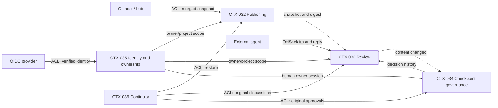

# NEXUS 재설계: 도메인 탐색

[English](rebuild.md)

상태: [설계 진행 승인](../decisions/rebuild-authorization.ko.md)에 따라 Step 9까지 작성했습니다. 실제 NEXUS 통과는 체크포인트 1만 있습니다. 새 경계와 표는 위임된 권한으로 작성한 AI 설계 결정입니다. 사용자님이 개별 검토하셨다고 기록하지 않으며 별도 단계 검토를 요청합니다.

## 1. 서비스 개요

NEXUS는 공개 서비스에서 개인이 여러 비공개 프로젝트를 관리하고 13단계 산출물을 시각적으로 검토하며, 특정 버전의 항목에 대해 외부 AI 에이전트와 대화하고 직접 체크포인트를 결정하는 제품입니다. Git 소스를 기준으로 삼습니다. 직접 그림 편집·팀·추가 연동은 후속 버전으로 정했습니다. 새 제품 QA와 데이터 복구 리허설을 통과할 때까지 기존 운영을 유지합니다.

입력: 사용자님의 2026-11-17 지시, 확인한 타임라인과 추천안 답변 두 개, 2026-11-18의 02 추천안 승인·설계 완료 지시입니다. 기존 구현과 PR 50·53·56은 참고 자료로 읽었습니다.

## 2. 이벤트 스토밍

기존 비공개 Miro 보드의 이전 프레임을 보존합니다. Step 2–9는 직전 프레임을 복사하고 외부 시스템·명령·쟁점·역할·애그리게이트·경계·정책·읽기 모델·최종 맵과 표를 추가합니다. 프레임 주소와 실제 동기화 결과는 기존 비공개 프로젝트 기록에 남깁니다. 추론한 새 메모에는 근거 수준을 표시합니다. AI는 사용자 체크포인트를 누르지 않습니다.

범례: 주황은 과거형 이벤트, 분홍은 외부 시스템, 파랑은 명령, 빨강은 열린 쟁점, 초록은 답변한 쟁점, 연노랑은 역할, 노랑은 애그리게이트, 보라는 정책, 연초록은 읽기 모델입니다. 워크숍 순서와 대안을 아래에 보존합니다. 조회·인증을 해당 타임라인의 비즈니스 이벤트로 만들지 않으며 지원용 인증 이벤트는 별도로 구분합니다.

## 3. 이벤트 타임라인

아래 순서와 대안은 Step 1-b를 옮긴 것입니다. 각 행은 독립적인 레인이며 아직 유저 플로우나 API 계약이 아닙니다. 보드의 이벤트 후보 21개를 Step 1-a에서 이 타임라인으로 복사했습니다.

| 레인 | 이벤트 |
| --- | --- |
| 프로젝트 연결 | 프로젝트가 연결되었다 → 첫 업로드 동의가 기록되었다 → 스냅샷이 게시되었다 → 스냅샷이 갱신되었다 |
| 단계 검토 | 단계 초안이 작성되었다 → 초안이 병합되었다 → 산출물이 게시되었다 → 체크포인트가 요청되었다 → 체크포인트가 통과되었다 또는 변경이 요청되었다 |
| 항목 대화 | 항목 질문이 기록되었다 → AI 응답이 기록되었다 → 결정이 기록되었다 → 수정 산출물이 게시되었다 |
| 버전 검토 | 승인 후 새 버전이 게시되었다 → 새 버전 검토가 요청되었다 → 새 버전 체크포인트가 통과되었다 |
| 데이터 이전·배포 | 기존 데이터가 백업되었다 → 기존 데이터가 복원되었다 → QA 결과가 기록되었다 → 새 버전이 배포되었다 또는 현재 버전이 유지되었다 → 검증 실패 후 이전 버전이 복원되었다 |

배포 레인의 마지막 이벤트는 전환 후 검증 실패 때만 발생합니다. 현재 운영 버전 유지는 명시적인 배포 판단 결과이며 새 배포가 아닙니다. 어떤 결과를 영구 감사 기록으로 남길지는 02에서 정의합니다.

프로젝트 목록·그림 열기, 검색, 프로젝트 전환은 조회이므로 제외합니다. 그 자체로 도메인 데이터를 변경하지 않습니다. 인증·권한·실패 응답은 02 요구사항에 필요하며 타임라인에서 제외한다고 제품에서 제거하는 것은 아닙니다.

## 4. 컨텍스트와 명령 표

경계는 화면이나 타임라인 행의 개수가 아닌 일관성 규칙을 기준으로 정합니다. 첫 버전에서는 하나로 배포하는 논리 모듈이며 마이크로서비스 요구가 아닙니다. ID는 기존 컨텍스트 최대 ID·TERM-154 다음부터 이어갑니다. 기존 ID의 의미는 보존합니다.

| 컨텍스트 | 유형 | 애그리게이트 | 책임 |
| --- | --- | --- | --- |
| CTX-032 Publishing | 핵심 | Project, Snapshot, Publish receipt | 게시 일관성 |
| CTX-033 Review | 핵심 | Stage artifact, Content version, Item, Discussion, Agent claim | 버전별 검토 |
| CTX-034 Checkpoint governance | 핵심 | Checkpoint | 사용자 전용 결정 |
| CTX-035 Identity and ownership | 일반 | Owner, Session, Publisher credential | 비공개 소유권 |
| CTX-036 Continuity | 지원 | Migration run, Release decision | 기록 보존 |

### CTX-032 Publishing (core)

| 수행자 | 읽기 모델 | 명령 | 애그리게이트 | 이벤트 |
| --- | --- | --- | --- | --- |
| 게시자 | Connection status | 프로젝트를 연결하라 | Project | 프로젝트가 연결되었다 |
| 사용자 | First upload preview | 첫 업로드 동의를 기록하라 | Project | 첫 업로드 동의가 기록되었다 |
| 게시자 | Held commit and receipt | 병합한 스냅샷을 게시하라 | Snapshot | 스냅샷이 게시되었다 또는 갱신되었다 |

규칙: 프로젝트는 소유자에게 속합니다. 검증한 기본 브랜치의 후속 커밋만 보유 스냅샷을 교체합니다. 최초 게시에는 프로젝트별 동의가 필요합니다. 결과에는 실제 보유 커밋을 기록합니다. 같은 키·내용의 재전송은 같은 결과를 반환하며 다른 내용은 충돌합니다.

규칙 근거: 공개 제품 요청과 승인한 02 선택입니다. 트랜잭션·인증 방식은 설계 계속 지시 범위에서 추론한 설계 선택입니다.

예: 동의한 프로젝트와 보유한 이전 커밋이 있을 때 게시자가 검증한 main 후속 커밋을 같은 키로 두 번 보내면 스냅샷·수신 결과는 하나씩 생기고 두 응답은 같은 보유 커밋을 가리킵니다.

### CTX-033 Review (core)

| 수행자 | 읽기 모델 | 명령 | 애그리게이트 | 이벤트 |
| --- | --- | --- | --- | --- |
| 사용자 | Versioned stage picture or list | 항목에 질문하라 | Discussion | 항목 질문이 기록되었다 |
| 에이전트 | Assigned project queue | 항목에 답하라 | Discussion | AI 응답이 기록되었다 |
| 사용자 | Discussion and source change | 결정을 기록하라 | Discussion | 결정이 기록되었다 |
| 게시자 | Published source version | 수정 산출물을 게시하라 | Stage artifact | 수정 산출물이 게시되었다 |

규칙: 항목 주소는 프로젝트·파트·단계·안정적인 추적 ID·콘텐츠 버전을 포함합니다. 항목이 사라져도 답변은 원래 대화와 버전에 남습니다. 에이전트 claim에는 만료 시간이 있으며 같은 작업의 동시 처리를 막습니다. 제안만으로 소스나 사용자 승인을 바꾸지 않습니다.

규칙 근거: 공개 제품 요청과 승인한 02 선택입니다. 트랜잭션·인증 방식은 설계 계속 지시 범위에서 추론한 설계 선택입니다.

예: 버전 A의 항목 대화와 게시된 버전 B가 있을 때 에이전트가 원래 질문에 답하면 답변은 A에 남고 B에 대한 답으로 표시하지 않습니다.

### CTX-034 Checkpoint governance (core)

| 수행자 | 읽기 모델 | 명령 | 애그리게이트 | 이벤트 |
| --- | --- | --- | --- | --- |
| 에이전트 또는 사용자 | Stage readiness and content version | 체크포인트를 요청하라 | Checkpoint | 체크포인트 또는 새 버전 검토가 요청되었다 |
| 사용자 | Exact requested content and blockers | 체크포인트를 통과시켜라 | Checkpoint | 체크포인트 또는 새 버전 체크포인트가 통과되었다 |
| 사용자 | Exact request and history | 변경을 요청하라 | Checkpoint | 변경이 요청되었다 |
| 사용자 | Prior approval history | 승인을 철회하라 | Checkpoint | 승인이 철회되었다 |

규칙: 소유자의 사용자 세션만 결정합니다. 게시·에이전트 자격 증명은 통과·철회할 수 없습니다. 요청 콘텐츠 버전을 비교해 오래된 결정은 충돌로 처리합니다. 새 콘텐츠는 이전 승인을 이력으로 보존하며 새 요청이 필요합니다. 필수 선행 체크포인트는 완료를 막고 병렬 준비는 허용합니다.

규칙 근거: 공개 제품 요청과 승인한 02 선택입니다. 트랜잭션·인증 방식은 설계 계속 지시 범위에서 추론한 설계 선택입니다.

예: 버전 A의 체크포인트 요청과 현재 버전 B가 있을 때 사용자가 A의 통과를 제출하면 과거 버전 충돌을 반환하고 승인을 생성하지 않습니다.

### CTX-035 Identity and ownership (generic)

| 수행자 | 읽기 모델 | 명령 | 애그리게이트 | 이벤트 |
| --- | --- | --- | --- | --- |
| 방문자 | Sign-in result | 사용자 세션을 생성하라 | Session | 사용자 세션이 생성되었다 |
| 사용자 | Project connection guide | 범위를 제한한 자격 증명을 발급하라 | Publisher credential | 범위별 자격 증명이 발급되었다 |
| 사용자 | Credential list | 범위를 제한한 자격 증명을 폐기하라 | Publisher credential | 범위별 자격 증명이 폐기되었다 |

규칙: 사용자 인증에는 OIDC authorization code와 PKCE, 서버의 불투명 세션을 사용합니다. 자격 증명은 해시로 보관하고 소유자·프로젝트별 권한을 제한합니다. 다른 소유자의 읽기는 거부합니다. 공급자는 설정으로 선택하며 실제 설정은 후속 작업입니다. 기존 Access 인증은 호환 어댑터로 분리합니다.

규칙 근거: 공개 제품 요청과 승인한 02 선택입니다. 트랜잭션·인증 방식은 설계 계속 지시 범위에서 추론한 설계 선택입니다.

### CTX-036 Continuity (supporting)

| 수행자 | 읽기 모델 | 명령 | 애그리게이트 | 이벤트 |
| --- | --- | --- | --- | --- |
| 운영자 | Consistent backup manifest | 기존 데이터를 백업하라 | Migration run | 기존 데이터가 백업되었다 |
| 운영자 | Isolated restore report | 기존 데이터를 복원하라 | Migration run | 기존 데이터가 복원되었다 |
| 운영자 | Acceptance evidence | QA 결과를 기록하라 | Migration run | QA 결과가 기록되었다 |
| 운영자 | QA and recovery readiness | 검증한 버전으로 전환하라 | Release decision | 새 버전이 배포되었다 또는 현재 버전이 유지되었다 |
| 운영자 | Reconciliation report | Restore previous version | Release decision | Previous version restored after failed validation |

규칙: 프로젝트·항목 ID, 작성자·순서·버전, 원래 체크포인트 결정을 보존합니다. 스냅샷 재전송은 서버 전용 대화 백업을 대체하지 않습니다. 리허설과 QA 뒤 교체하며 복구 시 확인 응답한 모든 쓰기를 대조합니다. 공개 화면의 삭제 명령이 아닌 운영 절차입니다.

규칙 근거: 공개 제품 요청과 승인한 02 선택입니다. 트랜잭션·인증 방식은 설계 계속 지시 범위에서 추론한 설계 선택입니다.

## 5. 정책·읽기 모델·컨텍스트 맵

| 정책 | 경계 | 결과 |
| --- | --- | --- |
| 스냅샷 게시 시 단계 검토 표현을 생성합니다. | CTX-032 → CTX-033 | 스냅샷 기준의 멱등적인 표현입니다. 렌더 실패를 명시하고 이전 버전을 식별할 수 있게 유지합니다. |
| 항목 질문 기록 시 에이전트 작업을 큐에 넣습니다. | CTX-033 내부 | NEXUS가 모델 API를 호출하지 않습니다. 설정한 에이전트가 claim 후 비동기로 답합니다. |
| 승인 후 콘텐츠가 바뀌면 새 체크포인트를 요구합니다. | CTX-033 → CTX-034 | 과거 결정을 유지합니다. 표시 메타데이터만 바뀐 원본 커밋은 콘텐츠 해시를 유지합니다. |
| 프로젝트 접근 폐기 시 이후 보호 작업을 거부합니다. | CTX-035 → 전체 | 큐 작업을 포함한 모든 요청에서 소유권·자격 증명을 확인합니다. |
| QA가 실패하면 현재 운영을 유지합니다. | CTX-036 내부 | 배포 전환을 하지 않고 리허설 근거를 유지합니다. |

| 출발 | 도착 | 종류 | 패턴 | 목적 | 데이터 |
| --- | --- | --- | --- | --- | --- |
| Git host / hub | CTX-032 | call | anticorruption layer | 기본 브랜치 후속 커밋을 확인하고 기존 업로드 계약을 정규화합니다. | merged commit, snapshot, consent |
| CTX-032 | CTX-033 | event | published language | 실제 보유한 게시본을 렌더·검토합니다. | snapshot ID, content digest, item IDs |
| CTX-033 | CTX-034 | event | customer and supplier | 승인을 변경 가능한 그림이 아닌 콘텐츠에 연결합니다. | stage, content version, blockers |
| CTX-034 | CTX-033 | call | open host service | 현재 승인과 과거 승인을 구분합니다. | checkpoint ID, decision, content version |
| CTX-035 | CTX-032 | call | shared ownership contract | 머신의 게시 권한을 확인합니다. | owner/project identity, allowed operations |
| CTX-035 | CTX-033 | call | shared ownership contract | 비공개 검토·대화를 보호합니다. | owner/project identity, allowed operations |
| CTX-035 | CTX-034 | call | shared ownership contract | 사용자 전용 결정 | verified owner session |
| OIDC provider | CTX-035 | call | anticorruption layer | 인증 클레임을 검증 없이 프로젝트 권한으로 사용하지 않습니다. | issuer, subject, nonce, verified claims |
| External agent | CTX-033 | call | open host service | 승인 권한 없이 범위를 제한해 조회·claim·답변합니다. | scoped queue, lease, versioned reply |
| CTX-036 | CTX-032 | call | anticorruption layer | 가져오기 중 원래 기록을 보존하고 새 게시를 꾸미지 않습니다. | identity mappings, held revisions |
| CTX-036 | CTX-033 | call | anticorruption layer | 서버 전용 대화·첨부를 복원합니다. | original authors/order/versions |
| CTX-036 | CTX-034 | call | anticorruption layer | 새 사용자 통과를 가장하지 않고 원래 결정을 복원합니다. | original checkpoint history |

읽기 모델: 프로젝트 목록은 소유권·최근 활동, 단계 개요는 13단계·준비 상태·실제 승인, 버전별 그림·목록은 원본 위치·고정 항목, 대화는 원래 버전·제거 표시, 에이전트 큐는 열린 작업·claim, 게시 상태는 보유 커밋·재시도 결과, 이전 보고서는 건수·매핑·체크섬·승인된 쓰기 대조를 표시합니다. 모두 원본에서 만든 표현이며 별도 원본이 아닙니다.

## 6. 쟁점과 대체 결정

| 쟁점 | 결정 또는 남은 근거 |
| --- | --- |
| 공개 서비스와 기존 Access 전용 제품 | 사용자님의 현재 승인에 따라 개인 비공개 프로젝트를 제공하는 호스팅 서비스를 선택했습니다. 배포 전까지 운영 접근 설정을 유지합니다. 인증·테넌트는 새 설계이며 이전 승인을 복사하지 않습니다. |
| 직접 편집·팀·추가 연동 | 첫 배포 이후로 미룹니다. 기존 편집기·워크숍 결정을 새 범위로 가져오지 않습니다. |
| 어떤 변경이 승인을 무효화하는가? | 검토할 텍스트·그림 관계·첨부·스키마·목업 내용은 콘텐츠 해시에 반영합니다. 배치 위치·패널 접힘·테마·탐색 상태는 제외합니다. 의미를 바꾸는 파서·렌더 계약 변경도 무효화합니다. 불분명하면 보수적으로 재검토합니다. |
| AI 제공자·키·비용 | NEXUS는 설정한 외부 에이전트의 작업을 큐에 넣습니다. 첫 배포에는 모델 제공자 자격 증명이나 서버 모델 호출이 없습니다. 에이전트가 없으면 대기를 표시합니다. |
| 기존 게시 자격 증명·전송 호환성 | 기존 스냅샷 형식·Access 업로드 어댑터를 보존하고 새 계정별 자격 증명은 별도 버전을 사용합니다. 06에서 경계를 정의하고 필요한 upstream 변경을 WBS에 연결합니다. |
| 서버 전용 데이터 보존 | 일관된 백업·격리 복원·대조를 설계에 요구합니다. 실제 건수·호환성·복구 시간·브라우저 QA는 11~12에서 검증합니다. |
| OIDC 등록·GitHub Secrets 접근 | 외부 설정은 미완료이지만 계정별 세션·자격 증명 계약은 설계할 수 있습니다. 현재 Actions Secrets 403은 수동 hub 게시를 막지 않습니다. |

## 7. 용어

| ID | 용어 | 정의 | 컨텍스트 | 코드 이름 | 구분할 표현 |
| --- | --- | --- | --- | --- | --- |
| TERM-155 | Project | 한 소유자에게 속한 파트와 13단계의 모음입니다. | CTX-032 | `project` | workspace와 동의어로 사용 |
| TERM-156 | Snapshot | 검증한 Git 커밋 하나를 게시한 고정 표현입니다. | CTX-032 | `snapshot` | backup |
| TERM-157 | Stage artifact | 버전별 원본과 검토용 렌더 표현입니다. | CTX-033 | `stage_artifact` | 게시됐으므로 승인됨 |
| TERM-158 | Item | 프로젝트·파트·단계의 고정 추적 ID이며 원본 버전에 연결됩니다. | CTX-033 | `item` | 행 번호를 식별자로 사용 |
| TERM-159 | Discussion | 원래 항목·버전과 사용자·에이전트 메시지 순서를 보존합니다. | CTX-033 | `discussion` | 변경 가능한 원본 |
| TERM-160 | Checkpoint | 특정 콘텐츠 버전의 사용자 결정을 요청합니다. | CTX-034 | `checkpoint` | 읽음 표시 |
| TERM-161 | Content version | 표시 메타데이터와 독립적인 검토 원본·첨부의 해시입니다. | CTX-033 | `content_version` | 모든 Git 커밋 |
| TERM-162 | Session | 만료가 있는 불투명 사용자 브라우저 인증 세션입니다. 에이전트 세션 이름과 구분합니다. | CTX-035 | `owner_session` | service token |
| TERM-163 | Publish receipt | 수신한 커밋·해시·서버 리비전을 영구 기록한 결과입니다. | CTX-032 | `publish_receipt` | CI 성공 표시 |
| TERM-164 | Migration run | 백업 목록·매핑·복원·대조 근거를 갖춘 실행입니다. | CTX-036 | `migration_run` | 재게시만 수행 |
| TERM-165 | 사용자 | 비공개 프로젝트와 결정의 소유자인 인증된 사용자입니다. | CTX-035 | `owner` | 운영자 또는 에이전트 |
| TERM-166 | Publisher credential | 폐기 가능한 프로젝트별 머신 자격 증명이며 사용자 결정 권한이 없습니다. | CTX-035 | `publisher_credential` | 사용자 세션 |
| TERM-167 | Agent claim | 큐의 대화 항목 하나를 정해진 시간 동안 독점 처리하는 claim입니다. | CTX-033 | `agent_claim` | approval |
| TERM-168 | Release decision | QA·복원 근거 후 감사 가능한 운영 판단 결과입니다. | CTX-036 | `release_decision` | 체크포인트 통과만 수행 |
| TERM-169 | Preview | 사용자 자격 증명 없이 신뢰하지 않는 HTML을 격리한 표현입니다. | CTX-033 | `preview` | 신뢰하는 동일 출처 앱 |
| TERM-170 | Connection status | 해당 명령 전에 읽는 모델이며 소유자별 원본 기록에서 생성한 표현입니다. | CTX-032 | `connection_status` | 독립적인 원본 |
| TERM-171 | First upload preview | 해당 명령 전에 읽는 모델이며 소유자별 원본 기록에서 생성한 표현입니다. | CTX-032 | `first_upload_preview` | 독립적인 원본 |
| TERM-172 | Held commit and receipt | 해당 명령 전에 읽는 모델이며 소유자별 원본 기록에서 생성한 표현입니다. | CTX-032 | `held_commit_and_receipt` | 독립적인 원본 |
| TERM-173 | Versioned stage picture or list | 해당 명령 전에 읽는 모델이며 소유자별 원본 기록에서 생성한 표현입니다. | CTX-033 | `versioned_stage_picture_or_list` | 독립적인 원본 |
| TERM-174 | Assigned project queue | 해당 명령 전에 읽는 모델이며 소유자별 원본 기록에서 생성한 표현입니다. | CTX-033 | `assigned_project_queue` | 독립적인 원본 |
| TERM-175 | Discussion and source change | 해당 명령 전에 읽는 모델이며 소유자별 원본 기록에서 생성한 표현입니다. | CTX-033 | `discussion_and_source_change` | 독립적인 원본 |
| TERM-176 | Published source version | 해당 명령 전에 읽는 모델이며 소유자별 원본 기록에서 생성한 표현입니다. | CTX-033 | `published_source_version` | 독립적인 원본 |
| TERM-177 | Stage readiness and content version | 해당 명령 전에 읽는 모델이며 소유자별 원본 기록에서 생성한 표현입니다. | CTX-034 | `stage_readiness_and_content_version` | 독립적인 원본 |
| TERM-178 | Exact requested content and blockers | 해당 명령 전에 읽는 모델이며 소유자별 원본 기록에서 생성한 표현입니다. | CTX-034 | `exact_requested_content_and_blockers` | 독립적인 원본 |
| TERM-179 | Exact request and history | 해당 명령 전에 읽는 모델이며 소유자별 원본 기록에서 생성한 표현입니다. | CTX-034 | `exact_request_and_history` | 독립적인 원본 |
| TERM-180 | Prior approval history | 해당 명령 전에 읽는 모델이며 소유자별 원본 기록에서 생성한 표현입니다. | CTX-034 | `prior_approval_history` | 독립적인 원본 |
| TERM-181 | Sign-in result | 해당 명령 전에 읽는 모델이며 소유자별 원본 기록에서 생성한 표현입니다. | CTX-035 | `sign_in_result` | 독립적인 원본 |
| TERM-182 | Project connection guide | 해당 명령 전에 읽는 모델이며 소유자별 원본 기록에서 생성한 표현입니다. | CTX-035 | `project_connection_guide` | 독립적인 원본 |
| TERM-183 | Credential list | 해당 명령 전에 읽는 모델이며 소유자별 원본 기록에서 생성한 표현입니다. | CTX-035 | `credential_list` | 독립적인 원본 |
| TERM-184 | Consistent backup manifest | 해당 명령 전에 읽는 모델이며 소유자별 원본 기록에서 생성한 표현입니다. | CTX-036 | `consistent_backup_manifest` | 독립적인 원본 |
| TERM-185 | Isolated restore report | 해당 명령 전에 읽는 모델이며 소유자별 원본 기록에서 생성한 표현입니다. | CTX-036 | `isolated_restore_report` | 독립적인 원본 |
| TERM-186 | Acceptance evidence | 해당 명령 전에 읽는 모델이며 소유자별 원본 기록에서 생성한 표현입니다. | CTX-036 | `acceptance_evidence` | 독립적인 원본 |
| TERM-187 | QA and recovery readiness | 해당 명령 전에 읽는 모델이며 소유자별 원본 기록에서 생성한 표현입니다. | CTX-036 | `qa_and_recovery_readiness` | 독립적인 원본 |
| TERM-188 | Reconciliation report | 해당 명령 전에 읽는 모델이며 소유자별 원본 기록에서 생성한 표현입니다. | CTX-036 | `reconciliation_report` | 독립적인 원본 |

## 8. 실제 체크포인트 이력과 다음 행동

타임라인 체크포인트 `nk_n9aja7yrtm1q`는 커밋 `5a19cd264b73fd2b02d8ff371e391ff5e0660bdf`에 대해 2026-11-17T08:19:16.314Z에 통과했습니다. 원문 `01단계 확인 지점 통과`를 유지합니다. 범위 코멘트 `nc_hvjv377v757w`와 버전 코멘트 `nc_ayya1yv8g3bc`는 각각 08:19:46.997Z·08:19:50.363Z에 추천안을 승인했습니다. 후자가 08:19:55.036Z에 반복된 것은 한 결정으로 처리합니다.

2026-11-18 계속 지시는 재대기 없이 경계·표를 완성할 수 있게 하며 새 산출물의 실제 NEXUS 통과는 아닙니다. main 병합·push 후 최종 도메인 검토를 요청하고 승인한 설계 순서를 이어갑니다. 실제 이전·제공자 설정·제품 전체 QA는 실행하지 않았습니다. 한국어 원본과 워크숍 문구는 게시 전에 term-check로 검사합니다. Miro 동기화는 쓰기·재조회 후 기록하며 로컬 파일만으로 완료를 추정하지 않습니다.

## 콘텐츠 버전 소유 컨텍스트 수정

05 게시 후 자동 대조에서 컨텍스트 불일치를 발견했습니다. TERM-161은 콘텐츠 해시를 계산·저장하는 산출물 검토(CTX-033)가 소유합니다. 체크포인트 관리(CTX-034)는 이 고정 버전을 참조하며 별도 버전 애그리게이트를 소유하지 않습니다. 기존 용어의 소유 컨텍스트를 대체하되 사용자 전용 결정과 콘텐츠 변경 시 재검토 규칙은 유지합니다.
