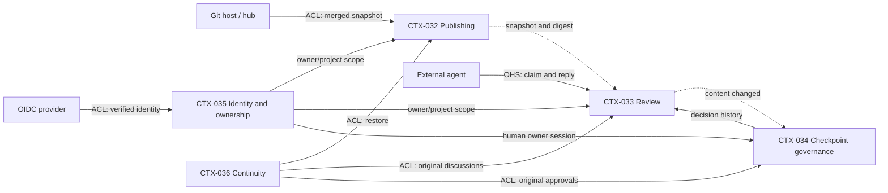

# NEXUS 재설계: 도메인 탐색

[English](rebuild.md)

상태: [설계 진행 승인](../decisions/rebuild-authorization.ko.md)에 따라 Step 9까지 작성했습니다. 실제 NEXUS 통과는 체크포인트 1만 있습니다. 새 경계와 표는 위임된 권한으로 작성한 AI 설계 결정입니다. 사용자님이 개별 검토하셨다고 기록하지 않으며 별도 단계 검토를 요청합니다.

## 1. 서비스 개요

NEXUS는 공개 서비스에서 개인이 여러 비공개 프로젝트를 관리하고 13단계 산출물을 시각적으로 검토하며, 특정 버전의 항목에 대해 외부 AI 에이전트와 대화하고 직접 체크포인트를 결정하는 제품입니다. Git 소스를 기준으로 삼습니다. 직접 그림 편집·팀·추가 연동은 후속 버전으로 정했습니다. 새 제품 QA와 데이터 복구 리허설을 통과할 때까지 기존 운영을 유지합니다.

입력: 사용자님의 2026-11-17 지시, 확인한 타임라인과 추천안 답변 두 개, 2026-11-18의 02 추천안 승인·설계 완료 지시입니다. 기존 구현과 PR 50·53·56은 참고 자료로 읽었습니다.

## 2. 이벤트 스토밍

기존 비공개 Miro 보드의 이전 프레임을 보존합니다. Step 2–9는 직전 프레임을 복사하고 외부 시스템·명령·쟁점·역할·애그리게이트·경계·정책·읽기 모델·최종 맵과 표를 추가합니다. 프레임 주소와 실제 동기화 결과는 기존 비공개 프로젝트 기록에 남깁니다. 추론한 새 메모에는 근거 수준을 표시합니다. AI는 사용자 체크포인트를 누르지 않습니다.

Legend: orange past-tense event; pink external system; blue imperative command; red open hotspot; green answered hotspot; light-yellow actor; yellow aggregate; violet policy; light-green read model. The workshop order and alternatives are preserved below. Reads and authentication are not invented as business events in those lanes; supporting identity events are explicitly separate.

## 3. 이벤트 타임라인

The order and alternatives below are transcribed from Step 1-b. Rows are independent lanes; this is not yet a user-flow or API contract. The board has 21 event candidates, copied from Step 1-a into this timeline.

| Lane | Events |
| --- | --- |
| Project connection | Project connected → First upload consent recorded → Snapshot published → Snapshot updated |
| Stage review | Stage draft written → Draft merged → Stage artifact published → Checkpoint requested → Checkpoint passed or changes requested |
| Item discussion | Item question recorded → AI response recorded → Decision recorded → Revised artifact published |
| Version review | New version published after approval → New version review requested → New version checkpoint passed |
| Data migration and release | Existing data backed up → Existing data restored → QA result recorded → New version deployed or current version kept → Previous version restored after failed validation |

The last event of the release lane is conditional on failed validation after a switch. Keeping the current production version is a deliberate release outcome, not a new deployment. Stage 02 must define which outcomes need durable audit records.

Excluded reads: opening a project list or picture, searching, and switching projects. These change no domain data by themselves. Authentication, authorization and failure responses still need requirements in stage 02; exclusion from the event timeline does not remove them from the product.

## 4. 컨텍스트와 명령 표

경계는 화면이나 타임라인 행의 개수가 아닌 일관성 규칙을 기준으로 정합니다. 첫 버전에서는 하나로 배포하는 논리 모듈이며 마이크로서비스 요구가 아닙니다. ID는 기존 컨텍스트 최대 ID·TERM-154 다음부터 이어갑니다. 기존 ID의 의미는 보존합니다.

| Context | Type | Aggregates | Responsibility |
| --- | --- | --- | --- |
| CTX-032 Publishing | core | Project, Snapshot, Publish receipt | Publication consistency |
| CTX-033 Review | core | Stage artifact, Content version, Item, Discussion, Agent claim | Versioned review |
| CTX-034 Checkpoint governance | core | Checkpoint | Human-only decisions |
| CTX-035 Identity and ownership | generic | Owner, Session, Publisher credential | Private ownership |
| CTX-036 Continuity | supporting | Migration run, Release decision | Preserved records |

### CTX-032 Publishing (core)

| Given by | Read model | Command | Aggregate | Events |
| --- | --- | --- | --- | --- |
| Publisher | Connection status | Connect project | Project | Project connected |
| Owner | First upload preview | Record first upload consent | Project | First upload consent recorded |
| Publisher | Held commit and receipt | Publish merged snapshot | Snapshot | Snapshot published or Snapshot updated |

규칙: 프로젝트는 소유자에게 속합니다. 검증한 기본 브랜치의 후속 커밋만 보유 스냅샷을 교체합니다. 최초 게시에는 프로젝트별 동의가 필요합니다. 결과에는 실제 보유 커밋을 기록합니다. 같은 키·내용의 재전송은 같은 결과를 반환하며 다른 내용은 충돌합니다.

Rule source: the public-product brief and approved stage-02 choices; transaction and authentication mechanisms are inferred design choices under the continuation instruction.

Example: Given a consented project and a held ancestor, when the publisher sends its verified main descendant twice with the same key, then one snapshot and one receipt exist, both responses name the same held commit.

### CTX-033 Review (core)

| Given by | Read model | Command | Aggregate | Events |
| --- | --- | --- | --- | --- |
| Owner | Versioned stage picture or list | Ask about item | Discussion | Item question recorded |
| Agent | Assigned project queue | Reply to item | Discussion | AI response recorded |
| Owner | Discussion and source change | Record decision | Discussion | Decision recorded |
| Publisher | Published source version | Publish revised artifact | Stage artifact | Revised artifact published |

규칙: 항목 주소는 프로젝트·부분·단계·안정적인 추적 ID·콘텐츠 버전을 포함합니다. 항목이 사라져도 답변은 원래 대화와 버전에 남습니다. 에이전트 claim에는 만료 시간이 있으며 같은 작업의 동시 처리를 막습니다. 제안만으로 소스나 사용자 승인을 바꾸지 않습니다.

Rule source: the public-product brief and approved stage-02 choices; transaction and authentication mechanisms are inferred design choices under the continuation instruction.

Example: Given an item discussion at version A and a published version B, when the agent replies to the original question, then the reply remains attached to A and never silently claims to answer B.

### CTX-034 Checkpoint governance (core)

| Given by | Read model | Command | Aggregate | Events |
| --- | --- | --- | --- | --- |
| Agent or owner | Stage readiness and content version | Request checkpoint | Checkpoint | Checkpoint requested or New version review requested |
| Owner | Exact requested content and blockers | Pass checkpoint | Checkpoint | Checkpoint passed or New version checkpoint passed |
| Owner | Exact request and history | Request changes | Checkpoint | Changes requested |
| Owner | Prior approval history | Withdraw approval | Checkpoint | Approval withdrawn |

규칙: 소유자의 사용자 세션만 결정합니다. 게시·에이전트 자격 증명은 통과·철회할 수 없습니다. 요청 콘텐츠 버전을 비교해 오래된 결정은 충돌로 처리합니다. 새 콘텐츠는 이전 승인을 이력으로 보존하며 새 요청이 필요합니다. 필수 선행 체크포인트는 완료를 막고 병렬 준비는 허용합니다.

Rule source: the public-product brief and approved stage-02 choices; transaction and authentication mechanisms are inferred design choices under the continuation instruction.

Example: Given a checkpoint requested for version A and current version B, when the owner submits a pass for A, then the service returns a stale-version conflict and creates no approval.

### CTX-035 Identity and ownership (generic)

| Given by | Read model | Command | Aggregate | Events |
| --- | --- | --- | --- | --- |
| Visitor | Sign-in result | Create owner session | Session | Owner session created |
| Owner | Project connection guide | Issue scoped credential | Publisher credential | Scoped credential issued |
| Owner | Credential list | Revoke scoped credential | Publisher credential | Scoped credential revoked |

규칙: 사용자 인증에는 OIDC authorization code와 PKCE, 서버의 불투명 세션을 사용합니다. 자격 증명은 해시로 보관하고 소유자·프로젝트별 권한을 제한합니다. 다른 소유자의 읽기는 거부합니다. 공급자는 설정으로 선택하며 실제 설정은 후속 작업입니다. 기존 Access 인증은 호환 어댑터로 분리합니다.

Rule source: the public-product brief and approved stage-02 choices; transaction and authentication mechanisms are inferred design choices under the continuation instruction.

### CTX-036 Continuity (supporting)

| Given by | Read model | Command | Aggregate | Events |
| --- | --- | --- | --- | --- |
| Operator | Consistent backup manifest | Back up existing data | Migration run | Existing data backed up |
| Operator | Isolated restore report | Restore existing data | Migration run | Existing data restored |
| Operator | Acceptance evidence | Record QA result | Migration run | QA result recorded |
| Operator | QA and recovery readiness | Switch validated release | Release decision | New version deployed or Current version kept |
| Operator | Reconciliation report | Restore previous version | Release decision | Previous version restored after failed validation |

규칙: 프로젝트·항목 ID, 작성자·순서·버전, 원래 체크포인트 결정을 보존합니다. 스냅샷 재전송은 서버 전용 대화 백업을 대체하지 않습니다. 리허설과 QA 뒤 교체하며 복구 시 확인 응답한 모든 쓰기를 대조합니다. 공개 화면의 삭제 명령이 아닌 운영 절차입니다.

Rule source: the public-product brief and approved stage-02 choices; transaction and authentication mechanisms are inferred design choices under the continuation instruction.

## 5. 정책·읽기 모델·컨텍스트 맵

| Policy | Boundary | Consequence |
| --- | --- | --- |
| When Snapshot published, Build stage review representations | CTX-032 to CTX-033 | Idempotent projection keyed by snapshot; failed render is explicit and the previous version stays identifiable |
| When Item question recorded, Queue agent work | inside CTX-033 | No model API is called by NEXUS; the configured agent claims and answers asynchronously |
| When content changes after approval, Require new checkpoint | CTX-033 to CTX-034 | Keep historical decision; a source commit changing display metadata alone retains the content digest |
| When project access is revoked, Refuse subsequent protected work | CTX-035 to all | Check ownership and credential validity at every request, including queued work |
| When QA result fails, Keep current production | inside CTX-036 | No release switch; retain rehearsal evidence |

| From | To | Kind | Pattern | Why | Data |
| --- | --- | --- | --- | --- | --- |
| Git host / hub | CTX-032 | call | anticorruption layer | Verify default-branch ancestry and normalize the existing upload contract | merged commit, snapshot, consent |
| CTX-032 | CTX-033 | event | published language | Render and review exactly the held publication | snapshot ID, content digest, item IDs |
| CTX-033 | CTX-034 | event | customer and supplier | Approval follows content, not a mutable picture | stage, content version, blockers |
| CTX-034 | CTX-033 | call | open host service | Show current versus historical approvals | checkpoint ID, decision, content version |
| CTX-035 | CTX-032 | call | shared ownership contract | Authorize machine publication | owner/project identity, allowed operations |
| CTX-035 | CTX-033 | call | shared ownership contract | Protect private review and discussion | owner/project identity, allowed operations |
| CTX-035 | CTX-034 | call | shared ownership contract | Human-only decisions | verified owner session |
| OIDC provider | CTX-035 | call | anticorruption layer | Identity claims never become unchecked project authority | issuer, subject, nonce, verified claims |
| External agent | CTX-033 | call | open host service | Bounded reads, claims and replies without approval power | scoped queue, lease, versioned reply |
| CTX-036 | CTX-032 | call | anticorruption layer | Preserve original records during import, not invent a new publication | identity mappings, held revisions |
| CTX-036 | CTX-033 | call | anticorruption layer | Restore server-only discussions and attachments | original authors/order/versions |
| CTX-036 | CTX-034 | call | anticorruption layer | Restore decisions without impersonating a new human pass | original checkpoint history |

Read models: project list (ownership and latest activity); stage overview (all thirteen stages, readiness and actual approvals); versioned picture/list (source locations and stable items); discussion thread (original version and removed-item marker); agent queue (open work and leases); publication status (held commit and retry result); migration report (record counts, mappings, checksums and acknowledged-write reconciliation). They are projections, never alternate sources of truth.

## 6. 쟁점과 대체 결정

| Hotspot | Resolution or remaining evidence |
| --- | --- |
| Public service versus the old private Access-only product | Hosted service with personal private projects selected by the maintainer's current approval. Keep production access unchanged until release. Authentication/tenant design is new work, not copied approval. |
| Direct editing, teams and more integrations | Defer after the first release. Do not carry legacy editor/workshop commitments into the new scope. |
| What invalidates approval? | Reviewable text, diagram relationships, attachments, schemas and mockup content affect the content digest. Layout positions, collapsed panels, theme and navigation state do not. Parser/render-contract changes that change meaning also invalidate. Ambiguous changes conservatively require review. |
| AI provider, key and cost | NEXUS queues work for an external configured agent; no model provider credential or server-side model call in first release. Agent absence is a visible pending state. |
| Existing push credentials and wire compatibility | Preserve the existing snapshot format and Access upload adapter; new account-scoped credentials are separately versioned. Stage 06 defines the boundary and WBS requires linked upstream changes if needed. |
| Server-only data preservation | Design requires consistent backup, isolated restore and reconciliation. Actual counts, compatibility, recovery duration and browser QA remain unverified until stages 11–12. |
| OIDC provider registration and GitHub Secrets access | External setup is not complete; account-scoped session and credential contracts can still be designed. Existing Actions Secrets 403 does not block manual hub publication. |

## 7. 용어

| ID | Term | Definition | Context | Code name | Avoid |
| --- | --- | --- | --- | --- | --- |
| TERM-155 | Project | Owner-scoped collection of parts and thirteen stages. | CTX-032 | `project` | workspace as a synonym |
| TERM-156 | Snapshot | Immutable published representation of one verified Git commit. | CTX-032 | `snapshot` | backup |
| TERM-157 | Stage artifact | Versioned source and its rendered review representation. | CTX-033 | `stage_artifact` | approved just because published |
| TERM-158 | Item | Stable trace ID within project, part and stage, bound to a source version. | CTX-033 | `item` | row number as identity |
| TERM-159 | Discussion | Ordered human and agent messages with their original item/version. | CTX-033 | `discussion` | mutable source |
| TERM-160 | Checkpoint | Human decision requested for a particular content version. | CTX-034 | `checkpoint` | read receipt |
| TERM-161 | Content version | Digest of reviewable source and attachments, independent of display metadata. | CTX-033 | `content_version` | every Git commit |
| TERM-162 | Session | Opaque, expiring human browser authentication session; agent session labels are separate. | CTX-035 | `owner_session` | service token |
| TERM-163 | Publish receipt | Durable result naming the accepted commit, digest and server revision. | CTX-032 | `publish_receipt` | green CI job |
| TERM-164 | Migration run | Manifested backup, mapping, restore and reconciliation evidence. | CTX-036 | `migration_run` | repush only |
| TERM-165 | Owner | Authenticated person who owns the private project and its decisions. | CTX-035 | `owner` | operator or agent |
| TERM-166 | Publisher credential | Revocable project-scoped machine credential; never grants human decisions. | CTX-035 | `publisher_credential` | owner session |
| TERM-167 | Agent claim | Time-limited exclusive processing lease on one queued discussion item. | CTX-033 | `agent_claim` | approval |
| TERM-168 | Release decision | Audited operator outcome after QA and restore evidence. | CTX-036 | `release_decision` | checkpoint pass alone |
| TERM-169 | Preview | Isolated representation of untrusted HTML without owner credentials. | CTX-033 | `preview` | trusted same-origin app |
| TERM-170 | Connection status | 해당 명령 전에 읽는 모델이며 소유자별 원본 기록에서 생성한 표현입니다. | CTX-032 | `connection_status` | 독립적인 원본 |
| TERM-171 | First upload preview | 해당 명령 전에 읽는 모델이며 소유자별 원본 기록에서 생성한 표현입니다. | CTX-032 | `first_upload_preview` | 독립적인 원본 |
| TERM-172 | Held commit and receipt | 해당 명령 전에 읽는 모델이며 소유자별 원본 기록에서 생성한 표현입니다. | CTX-032 | `held_commit_and_receipt` | 독립적인 원본 |
| TERM-173 | Versioned stage picture or list | 해당 명령 전에 읽는 모델이며 소유자별 원본 기록에서 생성한 표현입니다. | CTX-033 | `versioned_stage_picture_or_list` | 독립적인 원본 |
| TERM-174 | Assigned project queue | 해당 명령 전에 읽는 모델이며 소유자별 원본 기록에서 생성한 표현입니다. | CTX-033 | `assigned_project_queue` | 독립적인 원본 |
| TERM-175 | Discussion and source change | 해당 명령 전에 읽는 모델이며 소유자별 원본 기록에서 생성한 표현입니다. | CTX-033 | `discussion_and_source_change` | 독립적인 원본 |
| TERM-176 | Published source version | 해당 명령 전에 읽는 모델이며 소유자별 원본 기록에서 생성한 표현입니다. | CTX-033 | `published_source_version` | 독립적인 원본 |
| TERM-177 | Stage readiness and content version | 해당 명령 전에 읽는 모델이며 소유자별 원본 기록에서 생성한 표현입니다. | CTX-034 | `stage_readiness_and_content_version` | 독립적인 원본 |
| TERM-178 | Exact requested content and blockers | 해당 명령 전에 읽는 모델이며 소유자별 원본 기록에서 생성한 표현입니다. | CTX-034 | `exact_requested_content_and_blockers` | 독립적인 원본 |
| TERM-179 | Exact request and history | 해당 명령 전에 읽는 모델이며 소유자별 원본 기록에서 생성한 표현입니다. | CTX-034 | `exact_request_and_history` | 독립적인 원본 |
| TERM-180 | Prior approval history | 해당 명령 전에 읽는 모델이며 소유자별 원본 기록에서 생성한 표현입니다. | CTX-034 | `prior_approval_history` | 독립적인 원본 |
| TERM-181 | Sign-in result | 해당 명령 전에 읽는 모델이며 소유자별 원본 기록에서 생성한 표현입니다. | CTX-035 | `sign_in_result` | 독립적인 원본 |
| TERM-182 | Project connection guide | 해당 명령 전에 읽는 모델이며 소유자별 원본 기록에서 생성한 표현입니다. | CTX-035 | `project_connection_guide` | 독립적인 원본 |
| TERM-183 | Credential list | 해당 명령 전에 읽는 모델이며 소유자별 원본 기록에서 생성한 표현입니다. | CTX-035 | `credential_list` | 독립적인 원본 |
| TERM-184 | Consistent backup manifest | 해당 명령 전에 읽는 모델이며 소유자별 원본 기록에서 생성한 표현입니다. | CTX-036 | `consistent_backup_manifest` | 독립적인 원본 |
| TERM-185 | Isolated restore report | 해당 명령 전에 읽는 모델이며 소유자별 원본 기록에서 생성한 표현입니다. | CTX-036 | `isolated_restore_report` | 독립적인 원본 |
| TERM-186 | Acceptance evidence | 해당 명령 전에 읽는 모델이며 소유자별 원본 기록에서 생성한 표현입니다. | CTX-036 | `acceptance_evidence` | 독립적인 원본 |
| TERM-187 | QA and recovery readiness | 해당 명령 전에 읽는 모델이며 소유자별 원본 기록에서 생성한 표현입니다. | CTX-036 | `qa_and_recovery_readiness` | 독립적인 원본 |
| TERM-188 | Reconciliation report | 해당 명령 전에 읽는 모델이며 소유자별 원본 기록에서 생성한 표현입니다. | CTX-036 | `reconciliation_report` | 독립적인 원본 |

## 8. 실제 체크포인트 이력과 다음 행동

Timeline checkpoint `nk_n9aja7yrtm1q` passed at 2026-11-17T08:19:16.314Z for commit `5a19cd264b73fd2b02d8ff371e391ff5e0660bdf`. The recorded original wording remains `01단계 확인 지점 통과`. Coverage comment `nc_hvjv377v757w` and version comment `nc_ayya1yv8g3bc` approved the recommendations at 08:19:46.997Z and 08:19:50.363Z respectively; the latter repeated at 08:19:55.036Z is one decision.

The 2026-11-18 continuation instruction permits completing boundaries and tables without waiting again; it is not an actual NEXUS pass of those new artifacts. Request final domain review after main merge/push, then continue the approved design sequence. Real migration, provider setup and full product QA have not run. The Korean source and workshop text receive term-check before publication. Live Miro synchronization details are recorded after the write/reread, never inferred from a local file.

## 콘텐츠 버전 소유 컨텍스트 수정

05 게시 후 자동 대조에서 컨텍스트 불일치를 발견했습니다. TERM-161은 콘텐츠 해시를 계산·저장하는 산출물 검토(CTX-033)가 소유합니다. 체크포인트 관리(CTX-034)는 이 고정 버전을 참조하며 별도 버전 애그리게이트를 소유하지 않습니다. 기존 용어의 소유 컨텍스트를 대체하되 사용자 전용 결정과 콘텐츠 변경 시 재검토 규칙은 유지합니다.
