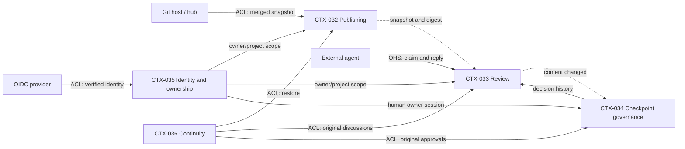

# NEXUS rebuild: domain discovery

[한국어](rebuild.ko.md)

Status: domain design authored through Step 9 under the [design continuation instruction](../decisions/rebuild-authorization.md). Only checkpoint 1 has an actual NEXUS pass. New boundaries and tables are AI design decisions under delegated authority, not fabricated human review. The source is ready for a separate stage review.

## 1. Service overview

NEXUS lets an individual manage several private projects in a publicly available service, inspect all thirteen stages visually, discuss a versioned item with an external AI agent, and personally decide checkpoints. Git source remains authoritative. First release excludes inline picture editing, shared teams and additional tool integrations. Existing production remains until rebuilt QA and rehearsed data recovery pass.

Inputs: the maintainer's 2026-11-17 brief; the verified timeline and two recommendation answers; the 2026-11-18 approval of stage-02 recommendations and instruction to finish design. Existing implementation and PRs 50, 53 and 56 were reference material only.

## 2. Event storming workshop

The existing private Miro board keeps all earlier frames. Steps 2–9 each copy the prior frame and add external systems, commands, hotspots, actors, aggregates, boundaries, policies/read models and the final map/tables. Frame links and actual synchronization receipts are in the existing private project record. New inferred notes retain their confidence labels. No user checkpoint is clicked by the agent.

Legend: orange past-tense event; pink external system; blue imperative command; red open hotspot; green answered hotspot; light-yellow actor; yellow aggregate; violet policy; light-green read model. The workshop order and alternatives are preserved below. Reads and authentication are not invented as business events in those lanes; supporting identity events are explicitly separate.

## 3. Event timeline

The order and alternatives below are transcribed from Step 1-b. Rows are independent lanes; this is not yet a user-flow or API contract. The board has 21 event candidates, copied from Step 1-a into this timeline.

| Lane | Events |
| --- | --- |
| Project connection | Project connected → First upload consent recorded → Snapshot published → Snapshot updated |
| Stage review | Stage draft written → Draft merged → Stage artifact published → Checkpoint requested → Checkpoint passed or changes requested |
| Item discussion | Item question recorded → AI response recorded → Decision recorded → Revised artifact published |
| Version review | New version published after approval → New version review requested → New version checkpoint passed |
| Data migration and release | Existing data backed up → Existing data restored → QA result recorded → New version deployed or current version kept → Previous version restored after failed validation |

The last event of the release lane is conditional on failed validation after a switch. Keeping the current production version is a deliberate release outcome, not a new deployment. Stage 02 must define which outcomes need durable audit records.

Excluded reads: opening a project list or picture, searching, and switching projects. These change no domain data by themselves. Authentication, authorization and failure responses still need requirements in stage 02; exclusion from the event timeline does not remove them from the product.

## 4. Contexts and command tables

Boundaries follow consistency rules, rather than splitting each screen or timeline lane into a service. These are logical modules in one deployable first release, not a requirement for microservices. IDs continue after the highest existing context and TERM-154; legacy IDs retain their meanings.

| Context | Type | Aggregates | Responsibility |
| --- | --- | --- | --- |
| CTX-032 Publishing | core | Project, Snapshot, Publish receipt | Publication consistency |
| CTX-033 Review | core | Stage artifact, Item, Discussion, Agent claim | Versioned review |
| CTX-034 Checkpoint governance | core | Checkpoint, Content version | Human-only decisions |
| CTX-035 Identity and ownership | generic | Owner, Session, Publisher credential | Private ownership |
| CTX-036 Continuity | supporting | Migration run, Release decision | Preserved records |

### CTX-032 Publishing (core)

| Given by | Read model | Command | Aggregate | Events |
| --- | --- | --- | --- | --- |
| Publisher | Connection status | Connect project | Project | Project connected |
| Owner | First upload preview | Record first upload consent | Project | First upload consent recorded |
| Publisher | Held commit and receipt | Publish merged snapshot | Snapshot | Snapshot published or Snapshot updated |

Rules: A project is owner-scoped. Only a verified default-branch descendant can replace its held snapshot. The first publication requires project-specific consent. A receipt names the held commit, not merely a successful job. Same idempotency key and payload returns the same receipt; a different body conflicts.

Rule source: the public-product brief and approved stage-02 choices; transaction and authentication mechanisms are inferred design choices under the continuation instruction.

Example: Given a consented project and a held ancestor, when the publisher sends its verified main descendant twice with the same key, then one snapshot and one receipt exist, both responses name the same held commit.

### CTX-033 Review (core)

| Given by | Read model | Command | Aggregate | Events |
| --- | --- | --- | --- | --- |
| Owner | Versioned stage picture or list | Ask about item | Discussion | Item question recorded |
| Agent | Assigned project queue | Reply to item | Discussion | AI response recorded |
| Owner | Discussion and source change | Record decision | Discussion | Decision recorded |
| Publisher | Published source version | Publish revised artifact | Stage artifact | Revised artifact published |

Rules: An item is addressed by project, part, stage, stable trace ID and content version. A reply keeps its original thread and version even after removal. Agent claims expire and prevent concurrent processing of the same work. A proposal never changes the source or human approval by itself.

Rule source: the public-product brief and approved stage-02 choices; transaction and authentication mechanisms are inferred design choices under the continuation instruction.

Example: Given an item discussion at version A and a published version B, when the agent replies to the original question, then the reply remains attached to A and never silently claims to answer B.

### CTX-034 Checkpoint governance (core)

| Given by | Read model | Command | Aggregate | Events |
| --- | --- | --- | --- | --- |
| Agent or owner | Stage readiness and content version | Request checkpoint | Checkpoint | Checkpoint requested or New version review requested |
| Owner | Exact requested content and blockers | Pass checkpoint | Checkpoint | Checkpoint passed or New version checkpoint passed |
| Owner | Exact request and history | Request changes | Checkpoint | Changes requested |
| Owner | Prior approval history | Withdraw approval | Checkpoint | Approval withdrawn |

Rules: Only the owning human browser session can decide. Publisher and agent credentials cannot pass or withdraw. Passing uses compare-and-swap against the request content version; stale decisions conflict. New content preserves old approvals as history and requires a new request. Required predecessor checkpoints block completion, while parallel preparation may continue.

Rule source: the public-product brief and approved stage-02 choices; transaction and authentication mechanisms are inferred design choices under the continuation instruction.

Example: Given a checkpoint requested for version A and current version B, when the owner submits a pass for A, then the service returns a stale-version conflict and creates no approval.

### CTX-035 Identity and ownership (generic)

| Given by | Read model | Command | Aggregate | Events |
| --- | --- | --- | --- | --- |
| Visitor | Sign-in result | Create owner session | Session | Owner session created |
| Owner | Project connection guide | Issue scoped credential | Publisher credential | Scoped credential issued |
| Owner | Credential list | Revoke scoped credential | Publisher credential | Scoped credential revoked |

Rules: Use OIDC authorization code with PKCE for human identity and opaque server sessions. Store credential digests, scope publisher/agent credentials to one owner and project, and deny cross-owner reads. Provider choice is configuration; provisioning is later work. Existing Access service authentication is isolated in a compatibility adapter.

Rule source: the public-product brief and approved stage-02 choices; transaction and authentication mechanisms are inferred design choices under the continuation instruction.

### CTX-036 Continuity (supporting)

| Given by | Read model | Command | Aggregate | Events |
| --- | --- | --- | --- | --- |
| Operator | Consistent backup manifest | Back up existing data | Migration run | Existing data backed up |
| Operator | Isolated restore report | Restore existing data | Migration run | Existing data restored |
| Operator | Acceptance evidence | Record QA result | Migration run | QA result recorded |
| Operator | QA and recovery readiness | Switch validated release | Release decision | New version deployed or Current version kept |
| Operator | Reconciliation report | Restore previous version | Release decision | Previous version restored after failed validation |

Rules: Keep project/item identities, authors, order, version links and original checkpoint decisions. Snapshot repush cannot substitute for server-only discussion backup. Switch only after rehearsal and QA; every acknowledged write has a reconciliation entry on rollback. This is an operator process, not a public destructive browser command.

Rule source: the public-product brief and approved stage-02 choices; transaction and authentication mechanisms are inferred design choices under the continuation instruction.

## 5. Policies, read models and context map

| Policy | Boundary | Consequence |
| --- | --- | --- |
| When Snapshot published, Build stage review representations | CTX-032 to CTX-033 | Idempotent projection keyed by snapshot; failed render is explicit and the previous version stays identifiable |
| When Item question recorded, Queue agent work | inside CTX-033 | No model API is called by NEXUS; the configured agent claims and answers asynchronously |
| When content changes after approval, Require new checkpoint | CTX-033 to CTX-034 | Keep historical decision; a source commit changing display metadata alone retains the content digest |
| When project access is revoked, Refuse subsequent protected work | CTX-035 to all | Check ownership and credential validity at every request, including queued work |
| When QA result fails, Keep current production | inside CTX-036 | No release switch; retain rehearsal evidence |

| From | To | Kind | Pattern | Why | Data |
| --- | --- | --- | --- | --- | --- |
| Git host / hub | CTX-032 | call | anticorruption layer | Verify default-branch ancestry and normalize the existing upload contract | merged commit, snapshot, consent |
| CTX-032 | CTX-033 | event | published language | Render and review exactly the held publication | snapshot ID, content digest, item IDs |
| CTX-033 | CTX-034 | event | customer and supplier | Approval follows content, not a mutable picture | stage, content version, blockers |
| CTX-034 | CTX-033 | call | open host service | Show current versus historical approvals | checkpoint ID, decision, content version |
| CTX-035 | CTX-032 | call | shared ownership contract | Authorize machine publication | owner/project identity, allowed operations |
| CTX-035 | CTX-033 | call | shared ownership contract | Protect private review and discussion | owner/project identity, allowed operations |
| CTX-035 | CTX-034 | call | shared ownership contract | Human-only decisions | verified owner session |
| OIDC provider | CTX-035 | call | anticorruption layer | Identity claims never become unchecked project authority | issuer, subject, nonce, verified claims |
| External agent | CTX-033 | call | open host service | Bounded reads, claims and replies without approval power | scoped queue, lease, versioned reply |
| CTX-036 | CTX-032 | call | anticorruption layer | Preserve original records during import, not invent a new publication | identity mappings, held revisions |
| CTX-036 | CTX-033 | call | anticorruption layer | Restore server-only discussions and attachments | original authors/order/versions |
| CTX-036 | CTX-034 | call | anticorruption layer | Restore decisions without impersonating a new human pass | original checkpoint history |

Read models: project list (ownership and latest activity); stage overview (all thirteen stages, readiness and actual approvals); versioned picture/list (source locations and stable items); discussion thread (original version and removed-item marker); agent queue (open work and leases); publication status (held commit and retry result); migration report (record counts, mappings, checksums and acknowledged-write reconciliation). They are projections, never alternate sources of truth.

## 6. Hotspots and superseded decisions

| Hotspot | Resolution or remaining evidence |
| --- | --- |
| Public service versus the old private Access-only product | Hosted service with personal private projects selected by the maintainer's current approval. Keep production access unchanged until release. Authentication/tenant design is new work, not copied approval. |
| Direct editing, teams and more integrations | Defer after the first release. Do not carry legacy editor/workshop commitments into the new scope. |
| What invalidates approval? | Reviewable text, diagram relationships, attachments, schemas and mockup content affect the content digest. Layout positions, collapsed panels, theme and navigation state do not. Parser/render-contract changes that change meaning also invalidate. Ambiguous changes conservatively require review. |
| AI provider, key and cost | NEXUS queues work for an external configured agent; no model provider credential or server-side model call in first release. Agent absence is a visible pending state. |
| Existing push credentials and wire compatibility | Preserve the existing snapshot format and Access upload adapter; new account-scoped credentials are separately versioned. Stage 06 defines the boundary and WBS requires linked upstream changes if needed. |
| Server-only data preservation | Design requires consistent backup, isolated restore and reconciliation. Actual counts, compatibility, recovery duration and browser QA remain unverified until stages 11–12. |
| OIDC provider registration and GitHub Secrets access | External setup is not complete; account-scoped session and credential contracts can still be designed. Existing Actions Secrets 403 does not block manual hub publication. |

## 7. Glossary

| ID | Term | Definition | Context | Code name | Avoid |
| --- | --- | --- | --- | --- | --- |
| TERM-155 | Project | Owner-scoped collection of parts and thirteen stages. | CTX-032 | `project` | workspace as a synonym |
| TERM-156 | Snapshot | Immutable published representation of one verified Git commit. | CTX-032 | `snapshot` | backup |
| TERM-157 | Stage artifact | Versioned source and its rendered review representation. | CTX-033 | `stage_artifact` | approved just because published |
| TERM-158 | Item | Stable trace ID within project, part and stage, bound to a source version. | CTX-033 | `item` | row number as identity |
| TERM-159 | Discussion | Ordered human and agent messages with their original item/version. | CTX-033 | `discussion` | mutable source |
| TERM-160 | Checkpoint | Human decision requested for a particular content version. | CTX-034 | `checkpoint` | read receipt |
| TERM-161 | Content version | Digest of reviewable source and attachments, independent of display metadata. | CTX-034 | `content_version` | every Git commit |
| TERM-162 | Session | Opaque, expiring human browser authentication session; agent session labels are separate. | CTX-035 | `owner_session` | service token |
| TERM-163 | Publish receipt | Durable result naming the accepted commit, digest and server revision. | CTX-032 | `publish_receipt` | green CI job |
| TERM-164 | Migration run | Manifested backup, mapping, restore and reconciliation evidence. | CTX-036 | `migration_run` | repush only |
| TERM-165 | Owner | Authenticated person who owns the private project and its decisions. | CTX-035 | `owner` | operator or agent |
| TERM-166 | Publisher credential | Revocable project-scoped machine credential; never grants human decisions. | CTX-035 | `publisher_credential` | owner session |
| TERM-167 | Agent claim | Time-limited exclusive processing lease on one queued discussion item. | CTX-033 | `agent_claim` | approval |
| TERM-168 | Release decision | Audited operator outcome after QA and restore evidence. | CTX-036 | `release_decision` | checkpoint pass alone |
| TERM-169 | Preview | Isolated representation of untrusted HTML without owner credentials. | CTX-033 | `preview` | trusted same-origin app |
| TERM-170 | Connection status | Read model used before the corresponding command; a projection of the owner-scoped source records. | CTX-032 | `connection_status` | independent source of truth |
| TERM-171 | First upload preview | Read model used before the corresponding command; a projection of the owner-scoped source records. | CTX-032 | `first_upload_preview` | independent source of truth |
| TERM-172 | Held commit and receipt | Read model used before the corresponding command; a projection of the owner-scoped source records. | CTX-032 | `held_commit_and_receipt` | independent source of truth |
| TERM-173 | Versioned stage picture or list | Read model used before the corresponding command; a projection of the owner-scoped source records. | CTX-033 | `versioned_stage_picture_or_list` | independent source of truth |
| TERM-174 | Assigned project queue | Read model used before the corresponding command; a projection of the owner-scoped source records. | CTX-033 | `assigned_project_queue` | independent source of truth |
| TERM-175 | Discussion and source change | Read model used before the corresponding command; a projection of the owner-scoped source records. | CTX-033 | `discussion_and_source_change` | independent source of truth |
| TERM-176 | Published source version | Read model used before the corresponding command; a projection of the owner-scoped source records. | CTX-033 | `published_source_version` | independent source of truth |
| TERM-177 | Stage readiness and content version | Read model used before the corresponding command; a projection of the owner-scoped source records. | CTX-034 | `stage_readiness_and_content_version` | independent source of truth |
| TERM-178 | Exact requested content and blockers | Read model used before the corresponding command; a projection of the owner-scoped source records. | CTX-034 | `exact_requested_content_and_blockers` | independent source of truth |
| TERM-179 | Exact request and history | Read model used before the corresponding command; a projection of the owner-scoped source records. | CTX-034 | `exact_request_and_history` | independent source of truth |
| TERM-180 | Prior approval history | Read model used before the corresponding command; a projection of the owner-scoped source records. | CTX-034 | `prior_approval_history` | independent source of truth |
| TERM-181 | Sign-in result | Read model used before the corresponding command; a projection of the owner-scoped source records. | CTX-035 | `sign_in_result` | independent source of truth |
| TERM-182 | Project connection guide | Read model used before the corresponding command; a projection of the owner-scoped source records. | CTX-035 | `project_connection_guide` | independent source of truth |
| TERM-183 | Credential list | Read model used before the corresponding command; a projection of the owner-scoped source records. | CTX-035 | `credential_list` | independent source of truth |
| TERM-184 | Consistent backup manifest | Read model used before the corresponding command; a projection of the owner-scoped source records. | CTX-036 | `consistent_backup_manifest` | independent source of truth |
| TERM-185 | Isolated restore report | Read model used before the corresponding command; a projection of the owner-scoped source records. | CTX-036 | `isolated_restore_report` | independent source of truth |
| TERM-186 | Acceptance evidence | Read model used before the corresponding command; a projection of the owner-scoped source records. | CTX-036 | `acceptance_evidence` | independent source of truth |
| TERM-187 | QA and recovery readiness | Read model used before the corresponding command; a projection of the owner-scoped source records. | CTX-036 | `qa_and_recovery_readiness` | independent source of truth |
| TERM-188 | Reconciliation report | Read model used before the corresponding command; a projection of the owner-scoped source records. | CTX-036 | `reconciliation_report` | independent source of truth |

## 8. Verified checkpoint history and next action

Timeline checkpoint `nk_n9aja7yrtm1q` passed at 2026-11-17T08:19:16.314Z for commit `5a19cd264b73fd2b02d8ff371e391ff5e0660bdf`. The recorded original wording remains `01단계 확인 지점 통과`. Coverage comment `nc_hvjv377v757w` and version comment `nc_ayya1yv8g3bc` approved the recommendations at 08:19:46.997Z and 08:19:50.363Z respectively; the latter repeated at 08:19:55.036Z is one decision.

The 2026-11-18 continuation instruction permits completing boundaries and tables without waiting again; it is not an actual NEXUS pass of those new artifacts. Request final domain review after main merge/push, then continue the approved design sequence. Real migration, provider setup and full product QA have not run. The Korean source and workshop text receive term-check before publication. Live Miro synchronization details are recorded after the write/reread, never inferred from a local file.
