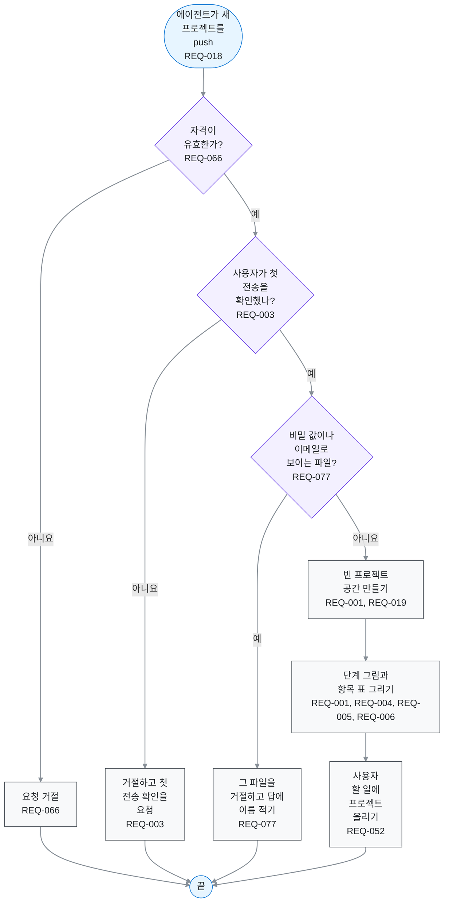

# FL-001 프로젝트를 NEXUS에 올리기

[English](FL-001-put-a-project-on-nexus.md)

이 문서는 [FL-001-put-a-project-on-nexus.md](FL-001-put-a-project-on-nexus.md)의 한국어 사본입니다. 원본은 영어입니다.

목표: 에이전트가 프로젝트의 첫 스냅숏을 보내고, 사용자는 그려진 프로젝트를 봅니다.

근거 요구사항: REQ-001, REQ-003, REQ-004, REQ-005, REQ-006, REQ-018, REQ-019, REQ-052, REQ-066, REQ-077

| 모양 | 뜻 |
| --- | --- |
| 둥근 상자 | 흐름이 시작하거나 끝나는 곳 |
| 사각형 | 한 단계 |
| 마름모 | 결정. 분기마다 이름이 있음 |

## 실패 경로

- 요청 거절 (REQ-066)
- 거절하고 첫 전송 확인을 요청 (REQ-003)
- 그 파일을 거절하고 답에 이름 적기 (REQ-077)
