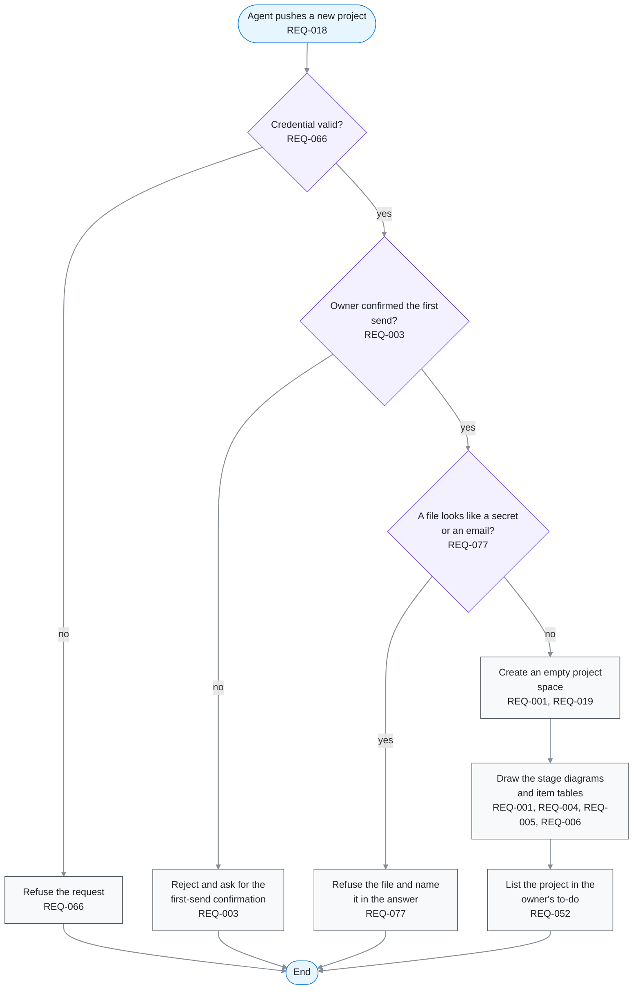

# FL-001 Put a project on NEXUS

[한국어](FL-001-put-a-project-on-nexus.ko.md)

Goal: An agent sends a project's first snapshot, and the owner finds the project drawn.

Serves: REQ-001, REQ-003, REQ-004, REQ-005, REQ-006, REQ-018, REQ-019, REQ-052, REQ-066, REQ-077

| Shape | Means |
| --- | --- |
| Rounded box | Where the flow starts or ends |
| Rectangle | A step |
| Diamond | A decision; each branch is labelled |

## Failure paths

- Refuse the request (REQ-066)
- Reject and ask for the first-send confirmation (REQ-003)
- Refuse the file and name it in the answer (REQ-077)
