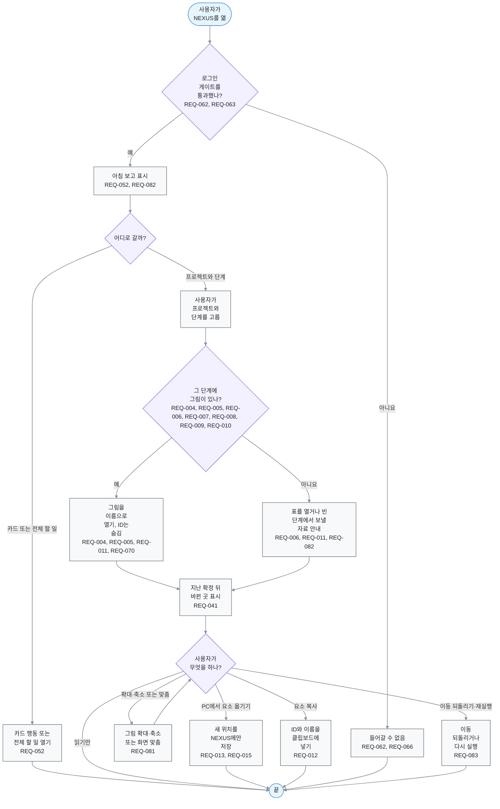

# FL-002 할 일에서 단계 읽기

[English](FL-002-read-a-stage-from-the-to-do.md)

이 문서는 [FL-002-read-a-stage-from-the-to-do.md](FL-002-read-a-stage-from-the-to-do.md)의 한국어 사본입니다. 원본은 영어입니다.

목표: 사용자가 아침 보고에서 카드의 행동을 하거나 전체 할 일 또는 프로젝트와 단계를 엽니다.

근거 요구사항: REQ-004, REQ-005, REQ-006, REQ-007, REQ-008, REQ-009, REQ-010, REQ-011, REQ-012, REQ-013, REQ-015, REQ-041, REQ-052, REQ-062, REQ-063, REQ-066, REQ-070, REQ-081, REQ-082, REQ-083

| 모양 | 뜻 |
| --- | --- |
| 둥근 상자 | 흐름이 시작하거나 끝나는 곳 |
| 사각형 | 한 단계 |
| 마름모 | 결정. 분기마다 이름이 있음 |

## 실패 경로

- 들어갈 수 없음 (REQ-062, REQ-066)
