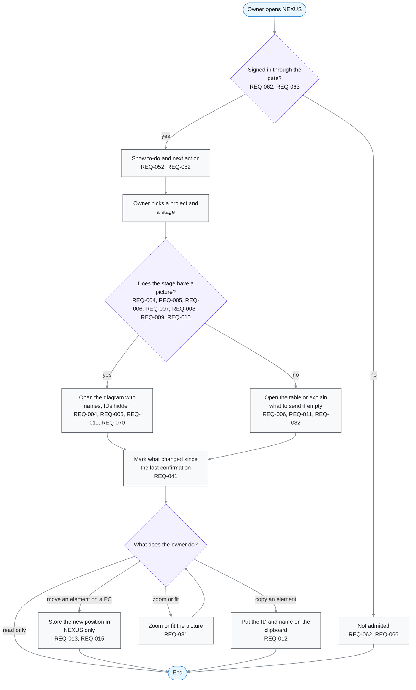

# FL-002 Read a stage from the to-do

[한국어](FL-002-read-a-stage-from-the-to-do.ko.md)

Goal: The owner opens NEXUS, picks a stage from the to-do and reads its diagram or item table.

Serves: REQ-004, REQ-005, REQ-006, REQ-007, REQ-008, REQ-009, REQ-010, REQ-011, REQ-012, REQ-013, REQ-015, REQ-041, REQ-052, REQ-062, REQ-063, REQ-066, REQ-070, REQ-081, REQ-082

| Shape | Means |
| --- | --- |
| Rounded box | Where the flow starts or ends |
| Rectangle | A step |
| Diamond | A decision; each branch is labelled |

## Failure paths

- Not admitted (REQ-062, REQ-066)
