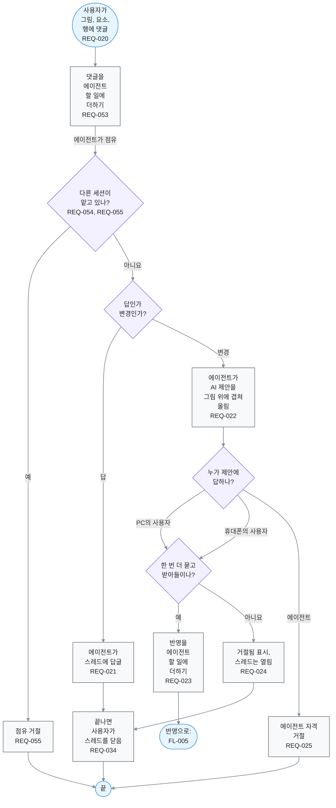

# FL-003 댓글을 달고 AI 제안에 답하기

[English](FL-003-comment-and-answer-an-ai-proposal.md)

이 문서는 [FL-003-comment-and-answer-an-ai-proposal.md](FL-003-comment-and-answer-an-ai-proposal.md)의 한국어 사본입니다. 원본은 영어입니다.

목표: 사용자가 그림에 댓글을 달고, 에이전트가 답하거나 변경을 제안하고, 사용자가 받아들이거나 거절합니다.

근거 요구사항: REQ-020, REQ-021, REQ-022, REQ-023, REQ-024, REQ-025, REQ-034, REQ-053, REQ-054, REQ-055, REQ-068

| 모양 | 뜻 |
| --- | --- |
| 둥근 상자 | 흐름이 시작하거나 끝나는 곳 |
| 사각형 | 한 단계 |
| 마름모 | 결정. 분기마다 이름이 있음 |

## 실패 경로

- 점유 거절 (REQ-055)
- 에이전트 자격 거절 (REQ-025)
