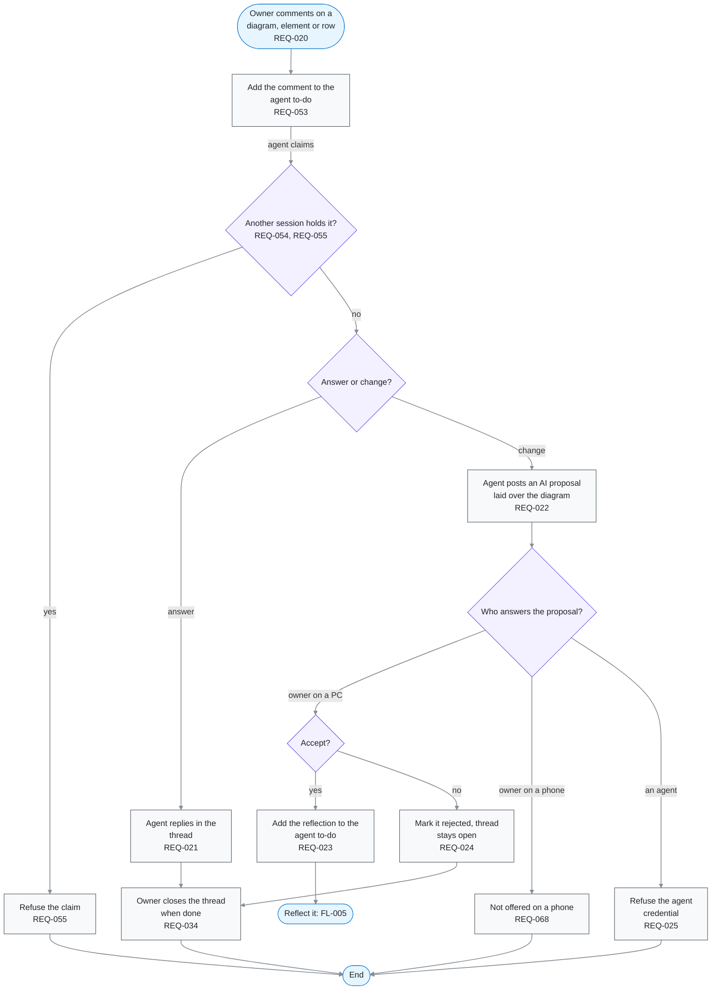

# FL-003 Comment and answer an AI proposal

[한국어](FL-003-comment-and-answer-an-ai-proposal.ko.md)

Goal: The owner comments on a diagram, an agent answers or proposes a change, and the owner accepts or rejects it.

Serves: REQ-020, REQ-021, REQ-022, REQ-023, REQ-024, REQ-025, REQ-034, REQ-053, REQ-054, REQ-055, REQ-068

Screens (stage 07): SCR-142, SCR-145

| Shape | Means |
| --- | --- |
| Rounded box | Where the flow starts or ends |
| Rectangle | A step |
| Diamond | A decision; each branch is labelled |

## Failure paths

- Refuse the claim (REQ-055)
- Not offered on a phone (REQ-068)
- Refuse the agent credential (REQ-025)
