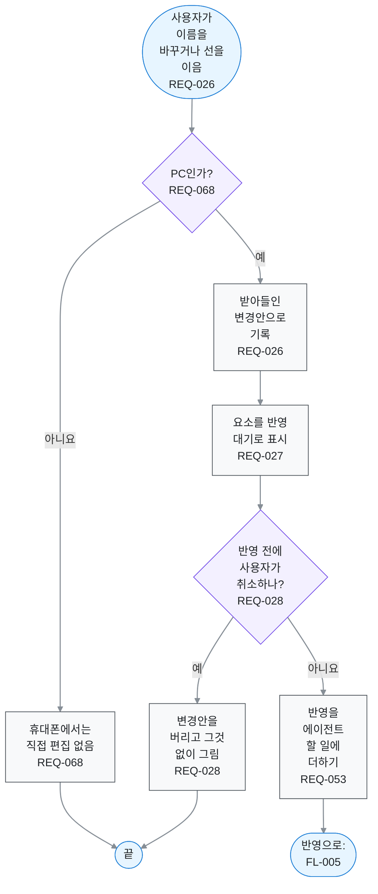

# FL-004 그림을 직접 고치기

[English](FL-004-edit-a-diagram-directly.md)

이 문서는 [FL-004-edit-a-diagram-directly.md](FL-004-edit-a-diagram-directly.md)의 한국어 사본입니다. 원본은 영어입니다.

목표: 사용자가 PC에서 요소 이름을 바꾸거나 두 요소를 잇고, 그 편집이 Git 반영을 기다립니다.

근거 요구사항: REQ-026, REQ-027, REQ-028, REQ-053, REQ-068

| 모양 | 뜻 |
| --- | --- |
| 둥근 상자 | 흐름이 시작하거나 끝나는 곳 |
| 사각형 | 한 단계 |
| 마름모 | 결정. 분기마다 이름이 있음 |

## 실패 경로

- 휴대폰에서는 직접 편집 없음 (REQ-068)
