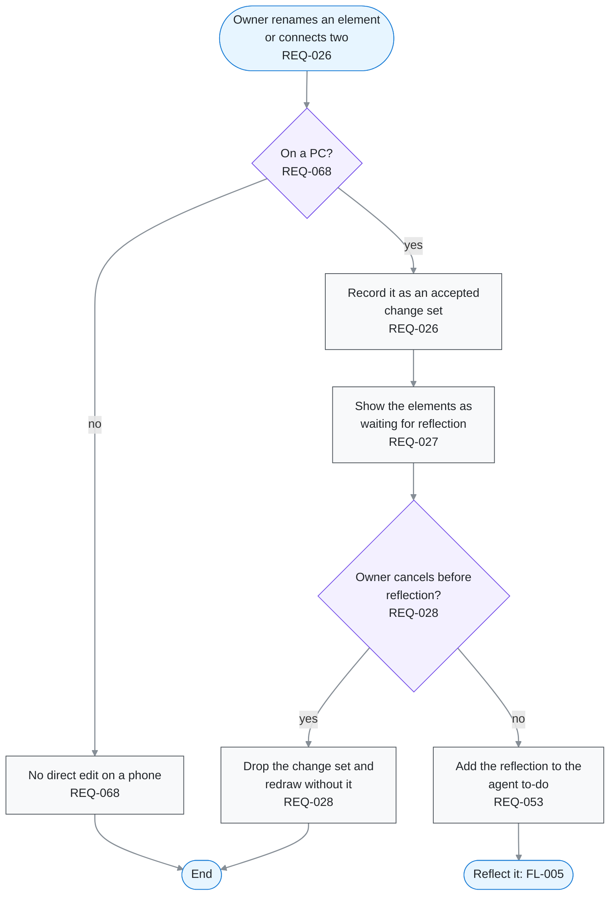

# FL-004 Edit a diagram directly

[한국어](FL-004-edit-a-diagram-directly.ko.md)

Goal: The owner renames an element or connects two on a PC, and the edit waits to be reflected into Git.

Serves: REQ-026, REQ-027, REQ-028, REQ-053, REQ-068

Screens (stage 07): SCR-145, SCR-146

| Shape | Means |
| --- | --- |
| Rounded box | Where the flow starts or ends |
| Rectangle | A step |
| Diamond | A decision; each branch is labelled |

## Failure paths

- No direct edit on a phone (REQ-068)
