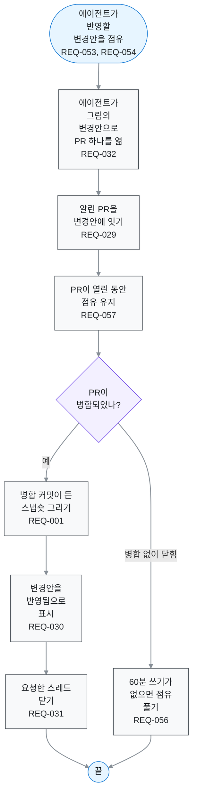

# FL-005 받아들인 변경을 Git에 반영하기

[English](FL-005-reflect-accepted-changes-into-git.md)

이 문서는 [FL-005-reflect-accepted-changes-into-git.md](FL-005-reflect-accepted-changes-into-git.md)의 한국어 사본입니다. 원본은 영어입니다.

목표: 에이전트가 그림의 받아들인 변경안을 PR 하나로 단계 문서에 넣습니다.

근거 요구사항: REQ-001, REQ-029, REQ-030, REQ-031, REQ-032, REQ-053, REQ-054, REQ-056, REQ-057

화면(07단계): SCR-145

| 모양 | 뜻 |
| --- | --- |
| 둥근 상자 | 흐름이 시작하거나 끝나는 곳 |
| 사각형 | 한 단계 |
| 마름모 | 결정. 분기마다 이름이 있음 |

## 실패 경로

- 60분 쓰기가 없으면 점유 풀기 (REQ-056)
