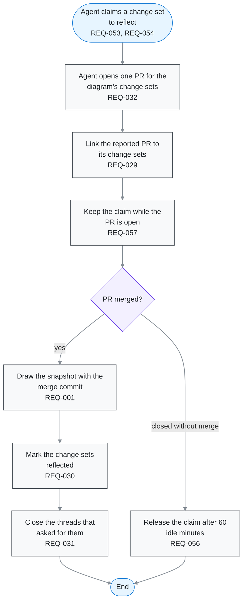

# FL-005 Reflect accepted changes into Git

[한국어](FL-005-reflect-accepted-changes-into-git.ko.md)

Goal: An agent carries a diagram's accepted change sets into the stage document through one pull request.

Serves: REQ-001, REQ-029, REQ-030, REQ-031, REQ-032, REQ-053, REQ-054, REQ-056, REQ-057

| Shape | Means |
| --- | --- |
| Rounded box | Where the flow starts or ends |
| Rectangle | A step |
| Diamond | A decision; each branch is labelled |

## Failure paths

- Release the claim after 60 idle minutes (REQ-056)
