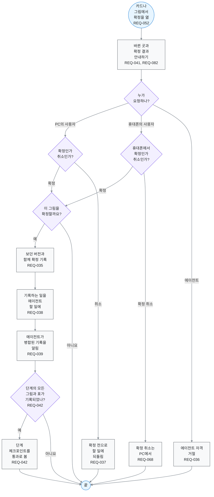

# FL-006 그림 확정하기

[English](FL-006-confirm-a-diagram.md)

이 문서는 [FL-006-confirm-a-diagram.md](FL-006-confirm-a-diagram.md)의 한국어 사본입니다. 원본은 영어입니다.

목표: 사용자가 PC나 휴대폰에서 한 번 더 확인한 뒤 그림이나 항목 표를 확정하고, 에이전트가 기록하고, 모두 기록되면 단계가 통과합니다.

근거 요구사항: REQ-035, REQ-036, REQ-037, REQ-038, REQ-039, REQ-041, REQ-042, REQ-052, REQ-068, REQ-082

| 모양 | 뜻 |
| --- | --- |
| 둥근 상자 | 흐름이 시작하거나 끝나는 곳 |
| 사각형 | 한 단계 |
| 마름모 | 결정. 분기마다 이름이 있음 |

## 실패 경로

- 확정 취소는 PC에서 (REQ-068)
- 에이전트 자격 거절 (REQ-036)
