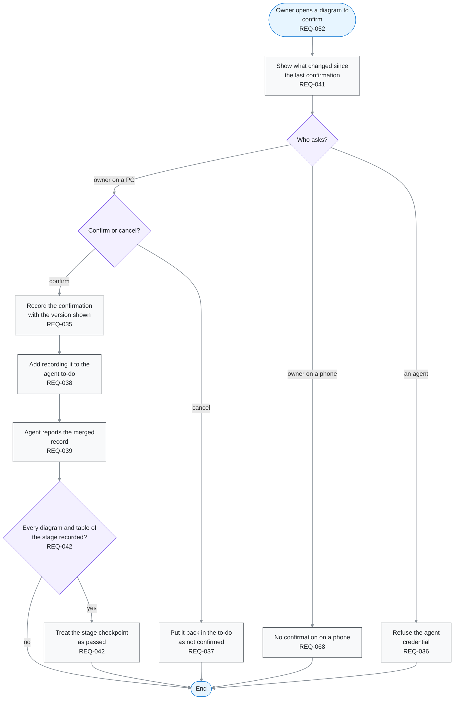

# FL-006 Confirm a diagram

[한국어](FL-006-confirm-a-diagram.ko.md)

Goal: The owner confirms a diagram or an item table on a PC, an agent records it, and the stage passes once all are recorded.

Serves: REQ-035, REQ-036, REQ-037, REQ-038, REQ-039, REQ-041, REQ-042, REQ-052, REQ-068

| Shape | Means |
| --- | --- |
| Rounded box | Where the flow starts or ends |
| Rectangle | A step |
| Diamond | A decision; each branch is labelled |

## Failure paths

- No confirmation on a phone (REQ-068)
- Refuse the agent credential (REQ-036)
