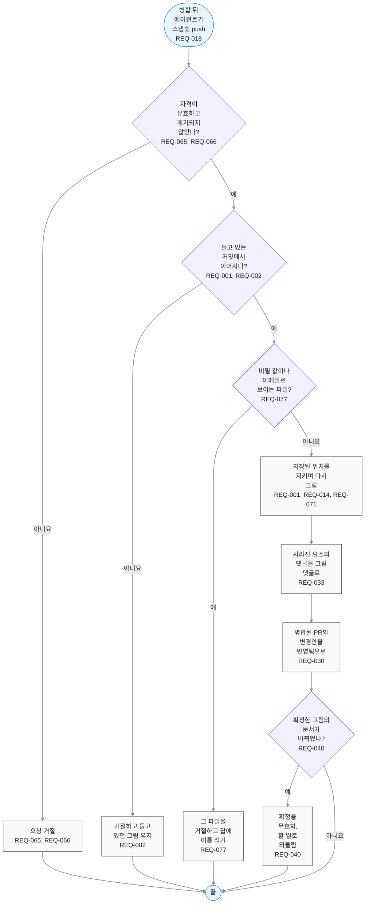

# FL-007 새 스냅숏 그리기

[English](FL-007-draw-a-new-snapshot.md)

이 문서는 [FL-007-draw-a-new-snapshot.md](FL-007-draw-a-new-snapshot.md)의 한국어 사본입니다. 원본은 영어입니다.

목표: 병합 뒤 에이전트가 스냅숏을 보내면, NEXUS가 레이아웃과 댓글을 지키며 다시 그립니다.

근거 요구사항: REQ-001, REQ-002, REQ-014, REQ-018, REQ-030, REQ-033, REQ-040, REQ-065, REQ-066, REQ-071, REQ-077

| 모양 | 뜻 |
| --- | --- |
| 둥근 상자 | 흐름이 시작하거나 끝나는 곳 |
| 사각형 | 한 단계 |
| 마름모 | 결정. 분기마다 이름이 있음 |

## 실패 경로

- 요청 거절 (REQ-065, REQ-066)
- 거절하고 들고 있던 그림 유지 (REQ-002)
- 그 파일을 거절하고 답에 이름 적기 (REQ-077)
