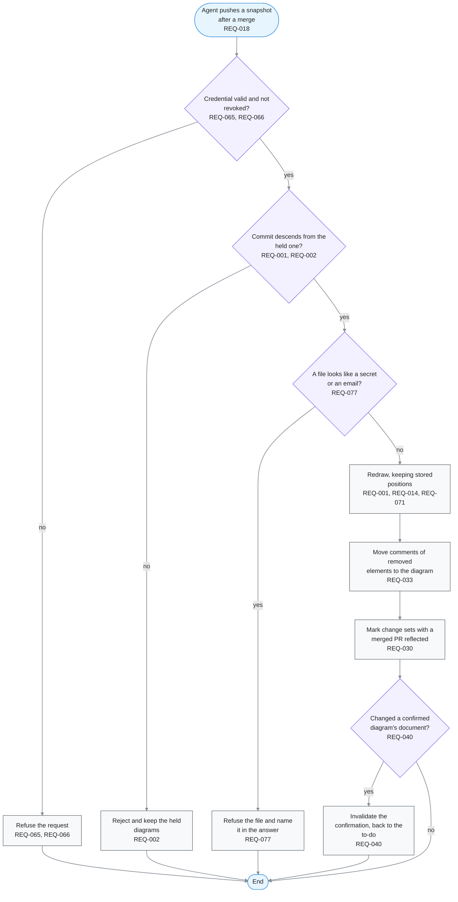

# FL-007 Draw a new snapshot

[한국어](FL-007-draw-a-new-snapshot.ko.md)

Goal: After a merge, an agent sends a snapshot and NEXUS redraws the project, keeping layouts and comments.

Serves: REQ-001, REQ-002, REQ-014, REQ-018, REQ-030, REQ-033, REQ-040, REQ-065, REQ-066, REQ-071, REQ-077

Screens (stage 07): SCR-142, SCR-145

| Shape | Means |
| --- | --- |
| Rounded box | Where the flow starts or ends |
| Rectangle | A step |
| Diamond | A decision; each branch is labelled |

## Failure paths

- Refuse the request (REQ-065, REQ-066)
- Reject and keep the held diagrams (REQ-002)
- Refuse the file and name it in the answer (REQ-077)
