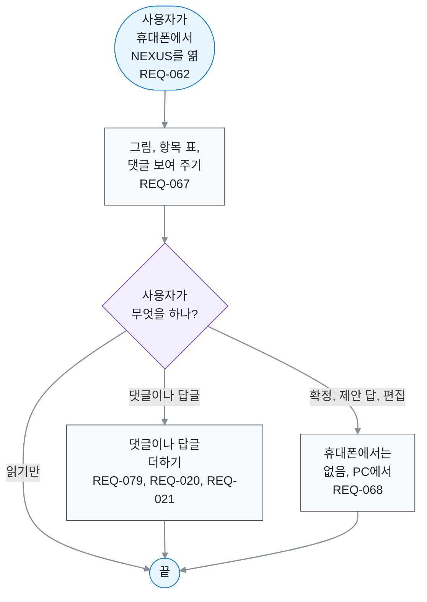

# FL-008 휴대폰에서 읽고 댓글 달기

[English](FL-008-read-and-comment-on-a-phone.md)

이 문서는 [FL-008-read-and-comment-on-a-phone.md](FL-008-read-and-comment-on-a-phone.md)의 한국어 사본입니다. 원본은 영어입니다.

목표: 사용자가 휴대폰에서 그림과 댓글을 읽고 댓글을 답니다. 결정은 PC에서 합니다.

근거 요구사항: REQ-020, REQ-021, REQ-062, REQ-067, REQ-068, REQ-079

화면(07단계): SCR-142, SCR-145

| 모양 | 뜻 |
| --- | --- |
| 둥근 상자 | 흐름이 시작하거나 끝나는 곳 |
| 사각형 | 한 단계 |
| 마름모 | 결정. 분기마다 이름이 있음 |

## 실패 경로

- 휴대폰에서는 없음, PC에서 (REQ-068)
