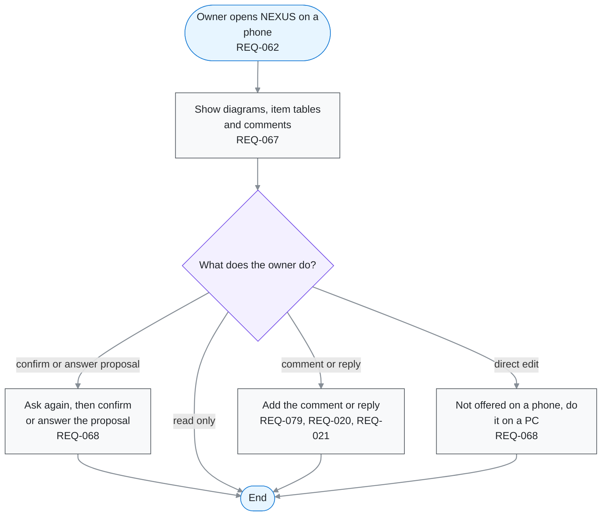

# FL-008 Read and comment on a phone

[한국어](FL-008-read-and-comment-on-a-phone.ko.md)

Goal: The owner reads diagrams and comments on a phone and leaves comments; confirmation and proposal decisions ask once more, while direct edits wait for a PC.

Serves: REQ-020, REQ-021, REQ-062, REQ-067, REQ-068, REQ-079

| Shape | Means |
| --- | --- |
| Rounded box | Where the flow starts or ends |
| Rectangle | A step |
| Diamond | A decision; each branch is labelled |

## Failure paths

- Not offered on a phone, do it on a PC (REQ-068)
