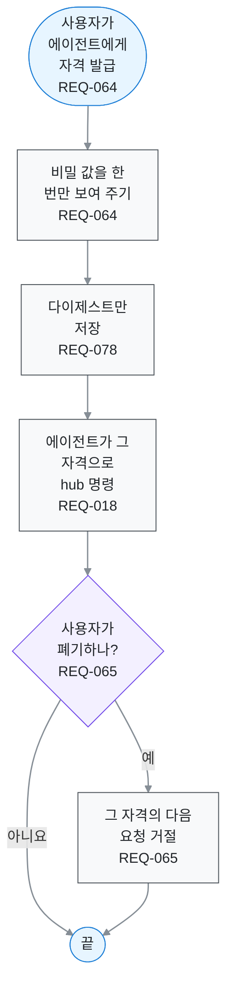

# FL-009 에이전트 자격 발급·폐기하기

[English](FL-009-issue-and-revoke-agent-access.md)

이 문서는 [FL-009-issue-and-revoke-agent-access.md](FL-009-issue-and-revoke-agent-access.md)의 한국어 사본입니다. 원본은 영어입니다.

목표: 사용자가 에이전트에게 hub 명령용 자격을 주고, 다시 거둘 수 있습니다.

근거 요구사항: REQ-018, REQ-064, REQ-065, REQ-078

| 모양 | 뜻 |
| --- | --- |
| 둥근 상자 | 흐름이 시작하거나 끝나는 곳 |
| 사각형 | 한 단계 |
| 마름모 | 결정. 분기마다 이름이 있음 |

## 실패 경로

- 그 자격의 다음 요청 거절 (REQ-065)
