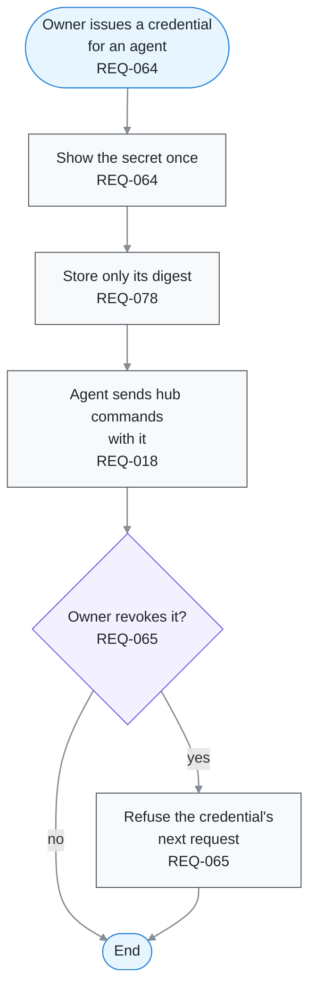

# FL-009 Issue and revoke an agent credential

[한국어](FL-009-issue-and-revoke-agent-access.ko.md)

Goal: The owner gives an agent a credential for hub commands and can take it back.

Serves: REQ-018, REQ-064, REQ-065, REQ-078

Screens (stage 07): SCR-143

| Shape | Means |
| --- | --- |
| Rounded box | Where the flow starts or ends |
| Rectangle | A step |
| Diamond | A decision; each branch is labelled |

## Failure paths

- Refuse the credential's next request (REQ-065)
