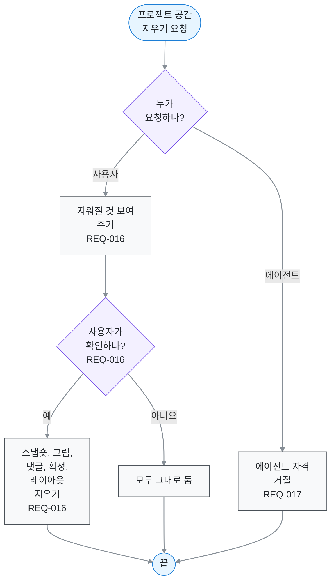

# FL-010 프로젝트 공간 지우기

[English](FL-010-delete-a-project-space.md)

이 문서는 [FL-010-delete-a-project-space.md](FL-010-delete-a-project-space.md)의 한국어 사본입니다. 원본은 영어입니다.

목표: 사용자가 함께 지워질 것을 본 뒤 NEXUS에서 프로젝트를 지웁니다.

근거 요구사항: REQ-016, REQ-017

화면(07단계): SCR-144

| 모양 | 뜻 |
| --- | --- |
| 둥근 상자 | 흐름이 시작하거나 끝나는 곳 |
| 사각형 | 한 단계 |
| 마름모 | 결정. 분기마다 이름이 있음 |

## 실패 경로

- 에이전트 자격 거절 (REQ-017)
