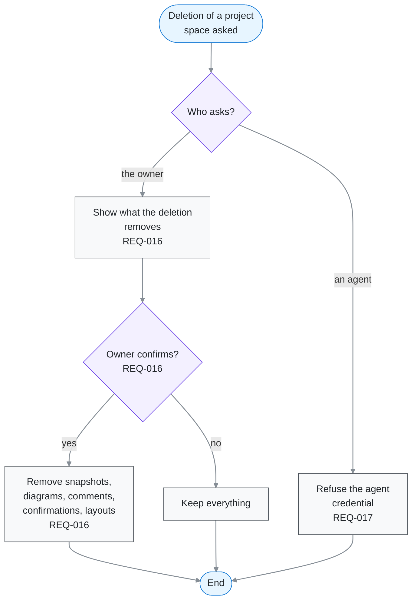

# FL-010 Delete a project space

[한국어](FL-010-delete-a-project-space.ko.md)

Goal: The owner removes a project from NEXUS after seeing what goes with it.

Serves: REQ-016, REQ-017

Screens (stage 07): SCR-144

| Shape | Means |
| --- | --- |
| Rounded box | Where the flow starts or ends |
| Rectangle | A step |
| Diamond | A decision; each branch is labelled |

## Failure paths

- Refuse the agent credential (REQ-017)
