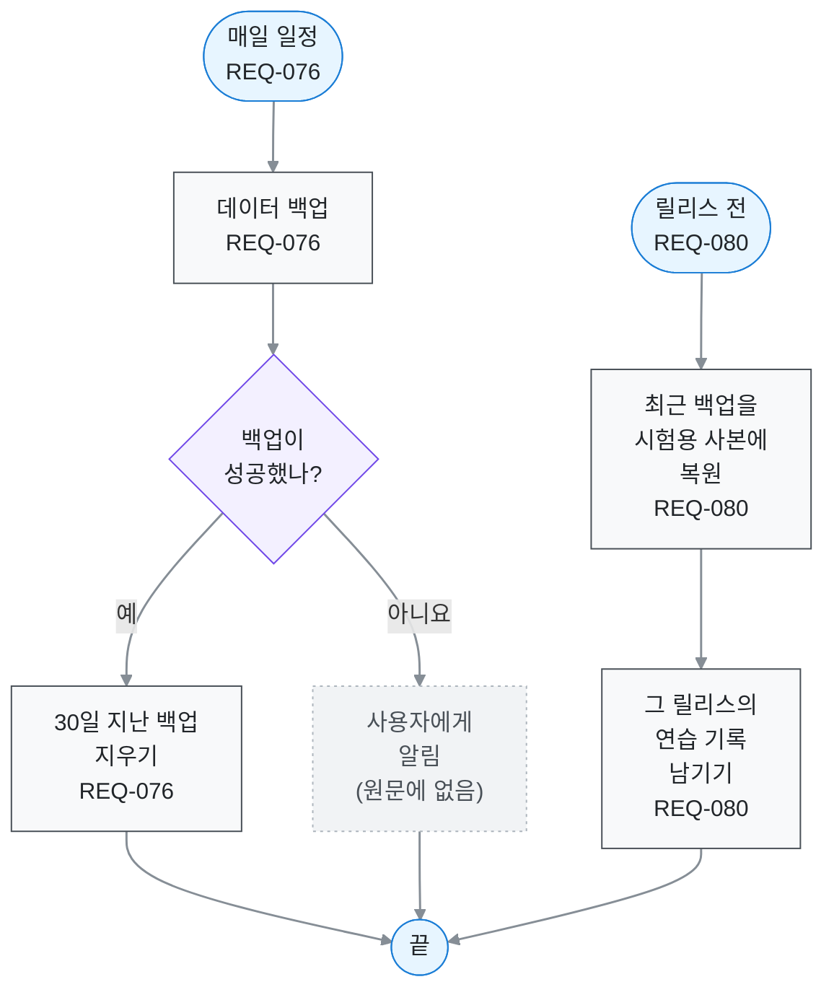

# FL-011 백업하고 복원 연습하기

[English](FL-011-back-up-and-rehearse-a-restore.md)

이 문서는 [FL-011-back-up-and-rehearse-a-restore.md](FL-011-back-up-and-rehearse-a-restore.md)의 한국어 사본입니다. 원본은 영어입니다.

목표: NEXUS가 매일 데이터를 백업하고, 릴리스마다 그 전에 복원을 연습합니다.

근거 요구사항: REQ-076, REQ-080

화면(07단계): SCR-142

| 모양 | 뜻 |
| --- | --- |
| 둥근 상자 | 흐름이 시작하거나 끝나는 곳 |
| 사각형 | 한 단계 |
| 마름모 | 결정. 분기마다 이름이 있음 |
| 회색 점선 상자 | 요구사항에 없는 단계. 흐름이 끊기지 않게 그림 |

## 실패 경로

- 사용자에게 알림(원문에 없음)
