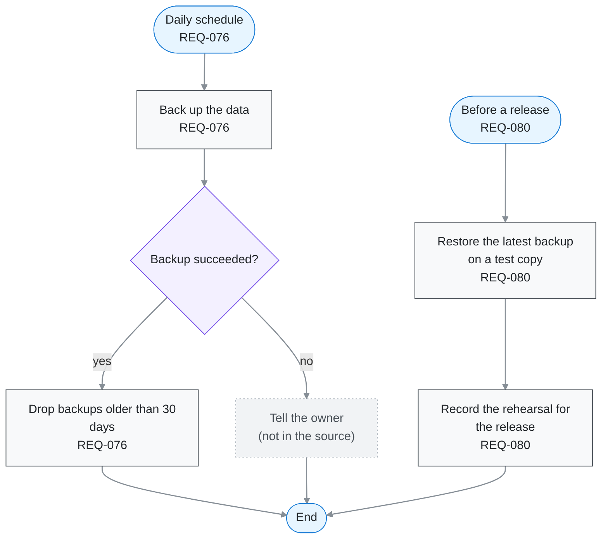

# FL-011 Back up and rehearse a restore

[한국어](FL-011-back-up-and-rehearse-a-restore.ko.md)

Goal: NEXUS backs up its data every day, and a restore is rehearsed before each release.

Serves: REQ-076, REQ-080

| Shape | Means |
| --- | --- |
| Rounded box | Where the flow starts or ends |
| Rectangle | A step |
| Diamond | A decision; each branch is labelled |
| Grey dotted box | A step the requirements do not describe, drawn so the flow stays whole |

## Failure paths

- Tell the owner (not in the source)
