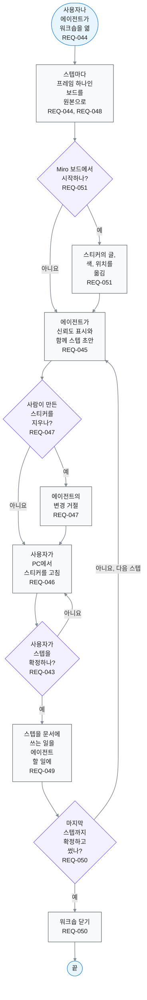

# FL-012 이벤트 스토밍 워크숍 하기

[English](FL-012-run-an-event-storming-workshop.md)

이 문서는 [FL-012-run-an-event-storming-workshop.md](FL-012-run-an-event-storming-workshop.md)의 한국어 사본입니다. 원본은 영어입니다.

목표: 사용자와 에이전트가 자유 캔버스에서 도메인 설계를 스텝마다 만들고, 확정한 스텝은 도메인 문서로 들어갑니다.

근거 요구사항: REQ-043, REQ-044, REQ-045, REQ-046, REQ-047, REQ-048, REQ-049, REQ-050, REQ-051

화면(07단계): SCR-145

| 모양 | 뜻 |
| --- | --- |
| 둥근 상자 | 흐름이 시작하거나 끝나는 곳 |
| 사각형 | 한 단계 |
| 마름모 | 결정. 분기마다 이름이 있음 |

## 실패 경로

- 에이전트의 변경 거절 (REQ-047)
