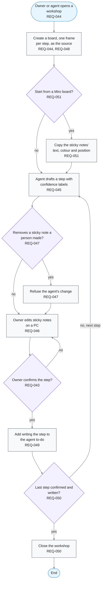

# FL-012 Run an event storming workshop

[한국어](FL-012-run-an-event-storming-workshop.ko.md)

Goal: The owner and an agent build the domain design step by step on a free canvas, and each confirmed step goes into the domain document.

Serves: REQ-043, REQ-044, REQ-045, REQ-046, REQ-047, REQ-048, REQ-049, REQ-050, REQ-051

Screens (stage 07): SCR-145

| Shape | Means |
| --- | --- |
| Rounded box | Where the flow starts or ends |
| Rectangle | A step |
| Diamond | A decision; each branch is labelled |

## Failure paths

- Refuse the agent's change (REQ-047)
