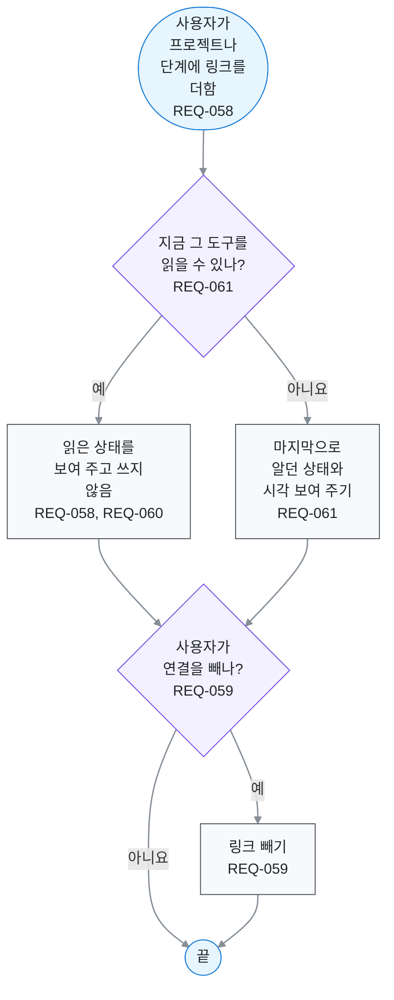

# FL-013 Notion 페이지나 Jira 프로젝트 연결하기

[English](FL-013-link-a-notion-page-or-jira-project.md)

이 문서는 [FL-013-link-a-notion-page-or-jira-project.md](FL-013-link-a-notion-page-or-jira-project.md)의 한국어 사본입니다. 원본은 영어입니다.

목표: 사용자가 프로젝트나 단계에 다른 도구를 연결하고, 그 상태를 단계 옆에서 읽기만 합니다.

근거 요구사항: REQ-058, REQ-059, REQ-060, REQ-061

| 모양 | 뜻 |
| --- | --- |
| 둥근 상자 | 흐름이 시작하거나 끝나는 곳 |
| 사각형 | 한 단계 |
| 마름모 | 결정. 분기마다 이름이 있음 |

## 실패 경로

- 마지막으로 알던 상태와 시각 보여 주기 (REQ-061)
