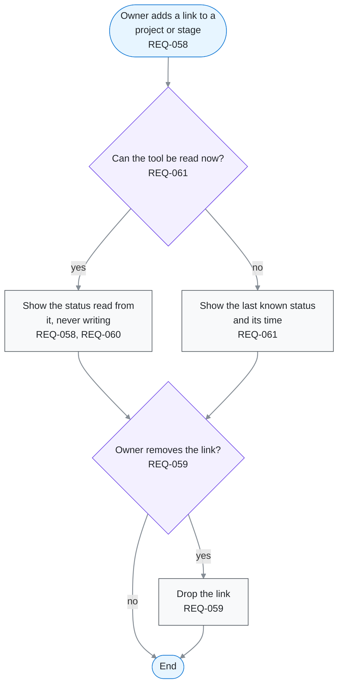

# FL-013 Link a Notion page or a Jira project

[한국어](FL-013-link-a-notion-page-or-jira-project.ko.md)

Goal: The owner links another tool to a project or a stage and sees its status beside the stage, read only.

Serves: REQ-058, REQ-059, REQ-060, REQ-061

| Shape | Means |
| --- | --- |
| Rounded box | Where the flow starts or ends |
| Rectangle | A step |
| Diamond | A decision; each branch is labelled |

## Failure paths

- Show the last known status and its time (REQ-061)
