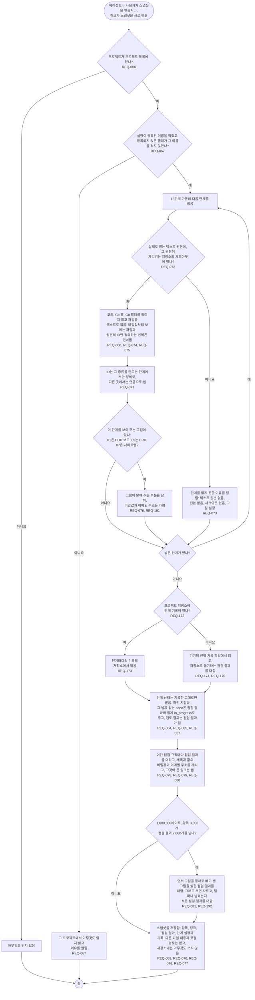

# FL-101 프로젝트를 스냅샷으로 읽기

[English](FL-101-read-a-project.md)

다루는 요구사항: REQ-066, REQ-067, REQ-068, REQ-069, REQ-070, REQ-071, REQ-072, REQ-073, REQ-074, REQ-075, REQ-076, REQ-077, REQ-078, REQ-079, REQ-080, REQ-081, REQ-084, REQ-085, REQ-087, REQ-173, REQ-174, REQ-175, REQ-191, REQ-192

맥락: CTX-006 읽기, 그리고 CTX-007 단계 진행의 단계 기록. 에이전트나 사용자가 프로젝트의 스냅샷을 만들 때, 또는 허브가 허브 페이지를 만들거나 보내기 전에 스냅샷을 새로 만들 때 시작합니다. 1차에서 만들었고, NEXUS 0.2가 그림이 보여 주는 단계별 원본의 부분(REQ-076, REQ-191, REQ-192)과 저장소의 단계 기록(REQ-173\~REQ-175)을 더합니다.

스냅샷에는 저장소마다 커밋, 브랜치, 커밋하지 않은 변경이 있는지가 적힙니다. 이 가운데 어느 것에서 그림을 그려도 되는지는 [README](README.ko.md#기능-명세에서-정할-것)의 2번, 여러 부분으로 된 프로젝트가 단계 기록을 어떻게 둘지는 4번입니다.
