# FL-101 Read a project into a snapshot

[한국어](FL-101-read-a-project.ko.md)

Serves: REQ-066, REQ-067, REQ-068, REQ-069, REQ-070, REQ-071, REQ-072, REQ-073, REQ-074, REQ-075, REQ-076, REQ-077, REQ-078, REQ-079, REQ-080, REQ-081, REQ-084, REQ-085, REQ-087, REQ-173, REQ-174, REQ-175, REQ-191, REQ-192

Context: CTX-006 Reading, with the stage records of CTX-007 Stage progress. Starts when the agent or the user takes a snapshot of a project, or the hub refreshes one to build the hub page or before a push. Built in phase 1; NEXUS 0.2 adds the parts of the stage sources that pictures show (REQ-076, REQ-191, REQ-192) and the stage records in the repository (REQ-173 to REQ-175).

```mermaid
flowchart TD
  A(["The agent or the user takes a snapshot,<br/>or the hub refreshes one"]) --> B{"Is the project in the project list?<br/>REQ-066"}
  B -->|no| B1["Read nothing"]
  B1 --> Z(["End"])
  B -->|yes| C{"Do its settings give its registered name,<br/>with no unregistered folder giving it?<br/>REQ-067"}
  C -->|no| C1["Read nothing for the project, and say why<br/>REQ-067"]
  C1 --> Z
  C -->|yes| D["Take the next of the 13 stages"]
  D --> E{"Has the stage a text source that exists,<br/>in a checkout of the repository it names?<br/>REQ-072"}
  E -->|no| E1["Say why the stage was not read: no text source,<br/>a missing source, no checkout or settings to fix<br/>REQ-073"]
  E -->|yes| F["Read its files as text, without running code,<br/>Git hooks or Git filters, and skip files that look<br/>like secrets and translations that define<br/>only their original's IDs<br/>REQ-068, REQ-074, REQ-075"]
  F --> G["Count each ID as defined only in the stage<br/>that creates its kind, and as a mention elsewhere<br/>REQ-071"]
  G --> H{"Does a picture show this stage:<br/>01 the DDD board, 05 the ERD<br/>or 07 the sitemap?"}
  H -->|yes| H1["Keep the parts that the picture shows,<br/>with secrets and email addresses redacted<br/>REQ-076, REQ-191"]
  H -->|no| I{"Another stage left?"}
  H1 --> I
  E1 --> I
  I -->|yes| D
  I -->|no| J{"Does the project's repository<br/>hold stage records?<br/>REQ-173"}
  J -->|yes| J1["Read each stage's record<br/>from the repository<br/>REQ-173"]
  J -->|no| J2["Read them from the device's status file,<br/>with a check that they should move<br/>to the repository<br/>REQ-174, REQ-175"]
  J1 --> K["Take each stage's state only as recorded: done<br/>without a checkpoint and its date stays in_progress<br/>with a check, and review findings become checks<br/>REQ-084, REQ-085, REQ-087"]
  J2 --> K
  K --> L["Add a check for each broken check rule,<br/>redact secrets and email addresses in titles<br/>and fields, and leave out links that hold one<br/>REQ-078, REQ-079, REQ-080"]
  L --> M{"Over 1,000,000 bytes, 3,000 items<br/>or 2,000 checks?"}
  M -->|yes| M1["Leave out whole pictures first, with a check<br/>that names them; if it is still too large, cut it<br/>with a check that says how much was kept<br/>REQ-081, REQ-192"]
  M -->|no| N["Save the snapshot: items, links, checks, stage settings<br/>and records, with no other file contents and no<br/>local paths; nothing is written into the repository<br/>REQ-069, REQ-070, REQ-076, REQ-077"]
  M1 --> N
  N --> Z
```

The snapshot records each repository's commit, its branch and whether it has uncommitted changes. Which of them may give pictures is point 2 of the [README](README.md#points-for-the-functional-spec), and how a project with several parts keeps its stage records is point 4.
