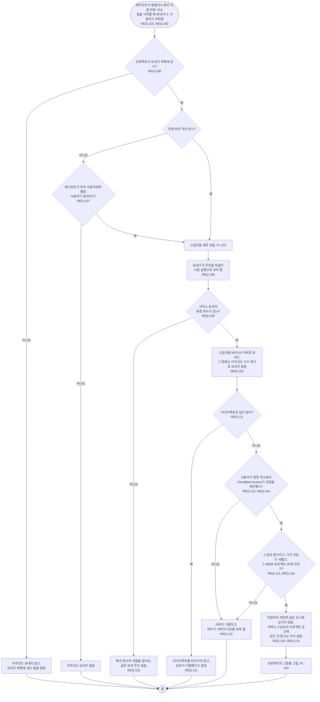

# FL-102 프로젝트를 NEXUS 서버로 보내기

[English](FL-102-push-a-project.md)

다루는 요구사항: REQ-105, REQ-106, REQ-107, REQ-108, REQ-109, REQ-110, REQ-111, REQ-112, REQ-113, REQ-114, REQ-115, REQ-116, REQ-118, REQ-119, REQ-125, REQ-193

맥락: CTX-009 함께 보기. 에이전트가 단계 작업이 병합되거나 확인 지점이 기록된 뒤에(REQ-125), 일을 시작할 때 단계별 원본이 보낸 스냅샷보다 새로우면(REQ-193, FL-108), 또는 사용자가 부탁할 때 시작합니다. 1차에서 만들었고, NEXUS 0.2가 REQ-125와 REQ-193의 보내기, 그리고 저장한 스냅샷에서 이어지는 그림(FL-103)을 더합니다.

서비스 토큰은 환경 변수에만 있습니다. 허브는 그것을 파일, 로그, 메시지에 쓰지 않습니다(REQ-110). 정답키나 학생 기록처럼 보호할 자료가 있는 프로젝트는 보내기 목록에 넣지 않습니다. 두 기기가 같은 프로젝트를 보낼 때 어느 스냅샷을 새것으로 볼지는 [README](README.ko.md#기능-명세에서-정할-것)의 3번입니다.
