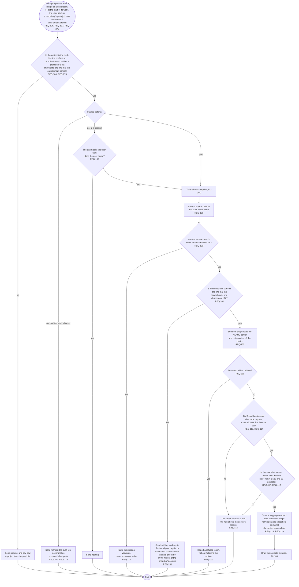

# FL-102 Push a project to the NEXUS server

[한국어](FL-102-push-a-project.ko.md)

Serves: REQ-105, REQ-106, REQ-107, REQ-108, REQ-109, REQ-110, REQ-111, REQ-112, REQ-113, REQ-114, REQ-115, REQ-116, REQ-118, REQ-119, REQ-125, REQ-193, REQ-201, REQ-275, REQ-276

Context: CTX-009 Sharing. Starts when the agent pushes after stage work is merged or a checkpoint is recorded (REQ-125), at the start of its work when a stage source is newer than the pushed snapshot (REQ-193, FL-108), when the user asks, or, where a project's repository runs the push job, when a commit reaches its default branch (REQ-276, open under D16 of stage 02). Built in phase 1; NEXUS 0.2 adds the pushes of REQ-125 and REQ-193 and the pictures that a stored snapshot leads to (FL-103); the design revision of 2026-11-11 adds the push job, the push list that a session's environment names (REQ-275) and the check of REQ-201, which the flow had left to the functional spec.

The service token stays in the environment variables: the hub never writes it to a file, a log or a message (REQ-110). Projects with protected data, such as answer keys or student records, are never in the push list. Which snapshot counts as newer when two devices push the same project is point 3 of the [README](README.md#points-for-the-functional-spec), which REQ-201 answers with the commits' descent. The push job is the hub at a pinned commit, run in the repository's own CI with the service token as the repository's secret (REQ-277, TERM-153); it sends only a project that the server already holds, so a project's first push is always agreed in a session (REQ-107). The push job is open under D16 of stage 02. What the environment holds, and how a device without the hub's own files learns whether a project was pushed before, are points 25 and 26.
