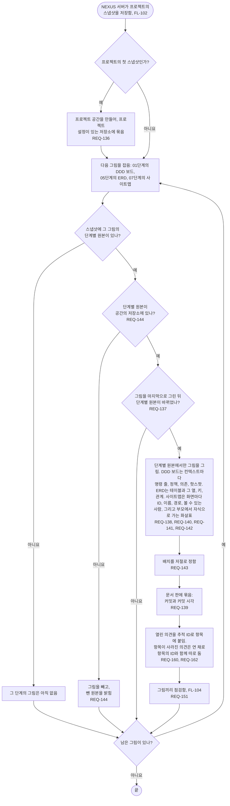

# FL-103 프로젝트의 그림 그리기

[English](FL-103-draw-the-pictures.md)

다루는 요구사항: REQ-136, REQ-137, REQ-138, REQ-139, REQ-140, REQ-141, REQ-142, REQ-143, REQ-144, REQ-151, REQ-160, REQ-162

맥락: CTX-012 그림. NEXUS 서버가 프로젝트의 스냅샷을 저장할 때(FL-102) 시작합니다. NEXUS 0.2에서 새로 더합니다.

그림은 NEXUS만 그립니다. 에이전트가 손으로 그림을 그리지 않습니다. 그리기와 배치를 서버에서 할지 그림 보기에서 할지는 [README](README.ko.md#기능-명세에서-정할-것)의 1번, 보드가 01단계 양식에서 무엇을 필요로 하는지는 5번, 크기 때문에 뺀 그림은 8번입니다. 편집을 넣으면 사용자가 옮긴 자리는 공간에 남습니다(FL-115).
