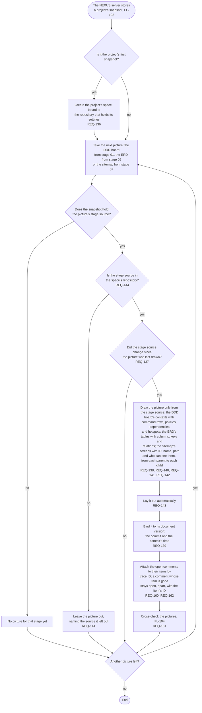

# FL-103 Draw a project's pictures

[한국어](FL-103-draw-the-pictures.ko.md)

Serves: REQ-136, REQ-137, REQ-138, REQ-139, REQ-140, REQ-141, REQ-142, REQ-143, REQ-144, REQ-151, REQ-160, REQ-162

Context: CTX-012 Pictures. Starts when the NEXUS server stores a project's snapshot (FL-102). New in NEXUS 0.2.

Only NEXUS draws: the agent never draws a picture by hand. Where the drawing and the layout run, on the server or in the picture view, is point 1 of the [README](README.md#points-for-the-functional-spec); what the board needs from the stage 01 template is point 5, and a picture left out for size is point 8. Where editing is included, the positions that the user moved stay in the space (FL-115).
