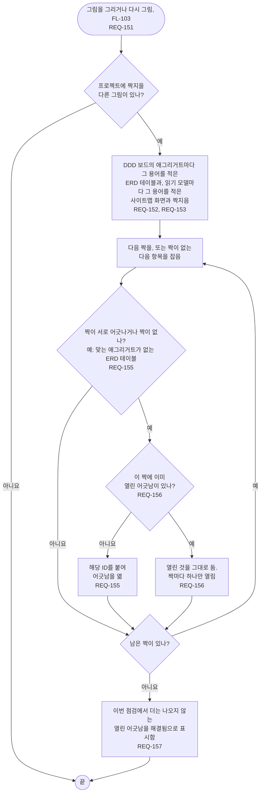

# FL-104 그림끼리 점검하기

[English](FL-104-cross-check-the-pictures.md)

다루는 요구사항: REQ-151, REQ-152, REQ-153, REQ-155, REQ-156, REQ-157

맥락: CTX-013 점검. 그림을 그리거나 다시 그릴 때(FL-103) 시작합니다. NEXUS 0.2에서 새로 더합니다.

테이블과 화면에 용어가 적히는 것은 05단계와 07단계 스킬이 에이전트에게 그것을 쓰게 하기 때문입니다(FL-112). 어떤 용어도 나타내지 않는 테이블과 화면, 그리고 짝마다 어긋난다는 것이 무엇이며 어긋남이 얼마나 심각한지는 [README](README.ko.md#기능-명세에서-정할-것)의 6번과 7번입니다.
