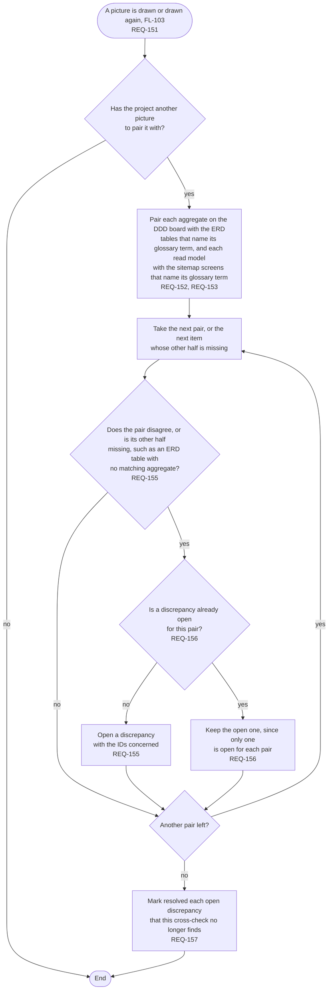

# FL-104 Cross-check the pictures

[한국어](FL-104-cross-check-the-pictures.ko.md)

Serves: REQ-151, REQ-152, REQ-153, REQ-155, REQ-156, REQ-157

Context: CTX-013 Cross-checking. Starts when a picture is drawn or drawn again (FL-103). New in NEXUS 0.2.

The tables and the screens name their terms because the stage 05 and 07 skills have the agent write them (FL-112). The tables and screens that stand for no term, and what disagreeing means for each pair and how serious a discrepancy is, are points 6 and 7 of the [README](README.md#points-for-the-functional-spec).
