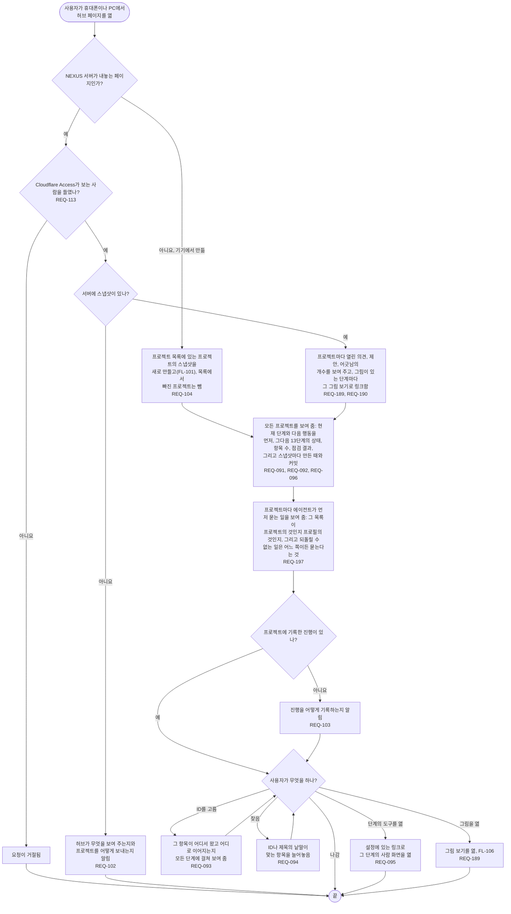

# FL-105 프로젝트마다 어디쯤인지 보기

[English](FL-105-see-the-hub-page.md)

다루는 요구사항: REQ-091, REQ-092, REQ-093, REQ-094, REQ-095, REQ-096, REQ-097, REQ-098, REQ-099, REQ-100, REQ-101, REQ-102, REQ-103, REQ-104, REQ-113, REQ-189, REQ-190, REQ-197

맥락: CTX-008 한눈에 보기. 사용자가 휴대폰이나 PC에서 허브 페이지를 열 때 시작합니다. 허브 페이지는 기기에서 만들거나 NEXUS 서버가 내놓습니다. 1차에서 만들었고, NEXUS 0.2가 빈 서버의 안내와 그림의 링크와 개수(REQ-102, REQ-189, REQ-190)를, 2026-11-02의 R4가 프로젝트마다 먼저 물을 일(REQ-197)을 더합니다.

어느 길에서나 페이지는 네트워크에서 아무것도 불러오지 않고, 프로젝트의 글을 글로만 보여 주며, 프로필의 언어와 시스템의 밝은·어두운 모드를 따르고, 320\~1440픽셀의 모든 폭에서 옆으로 스크롤하지 않고 쓸 수 있습니다(REQ-097, REQ-098, REQ-099, REQ-100, REQ-101).

먼저 물을 일은 스냅샷에 담긴 그대로 보여 주고, NEXUS는 그 가운데 아무것도 강제하지 않습니다. 기능 명세에서 정할 것은 [README](README.ko.md#기능-명세에서-정할-것)의 18번입니다.
