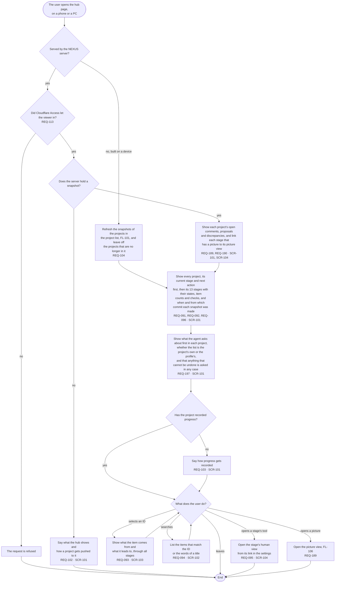

# FL-105 See where the projects stand

[한국어](FL-105-see-the-hub-page.ko.md)

Serves: REQ-091, REQ-092, REQ-093, REQ-094, REQ-095, REQ-096, REQ-097, REQ-098, REQ-099, REQ-100, REQ-101, REQ-102, REQ-103, REQ-104, REQ-113, REQ-189, REQ-190, REQ-197

Context: CTX-008 Overview. Starts when the user opens the hub page, built on a device or served by the NEXUS server, on a phone or a PC. Built in phase 1; NEXUS 0.2 adds the explanation on an empty server and the pictures' links and counts (REQ-102, REQ-189, REQ-190), and R4 of 2026-11-02 adds each project's actions to ask about first (REQ-197).

On every path the page loads nothing from the network, shows the projects' text only as text, follows the profile's language and the system's light or dark mode, and works at every width from 320 to 1440 pixels without sideways scrolling (REQ-097, REQ-098, REQ-099, REQ-100, REQ-101).

The actions to ask about first are shown as the snapshot holds them, and NEXUS enforces none of them; what the spec decides about them is point 18 of the [README](README.md#points-for-the-functional-spec).
