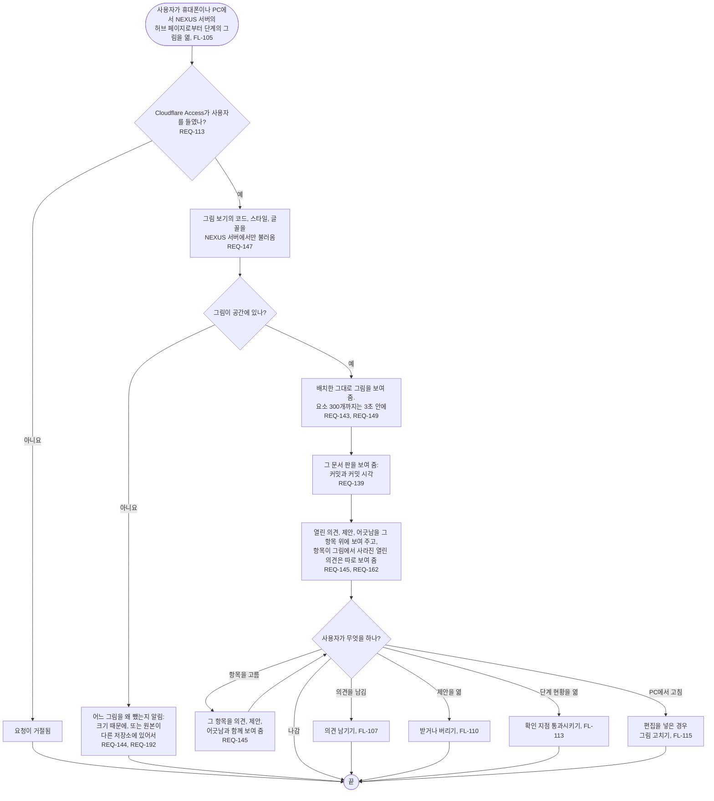

# FL-106 그림 살펴보기

[English](FL-106-look-at-a-picture.md)

다루는 요구사항: REQ-113, REQ-139, REQ-143, REQ-144, REQ-145, REQ-146, REQ-147, REQ-148, REQ-149, REQ-150, REQ-162, REQ-192

맥락: CTX-012 그림, 그리고 그 위에 얹힌 CTX-014 논의. 사용자가 휴대폰이나 PC에서 NEXUS 서버의 허브 페이지(FL-105)로부터 단계의 그림을 열 때 시작합니다. NEXUS 0.2에서 새로 더합니다.

그림 보기는 프로젝트의 글과 의견을 글로만 보여 주고, 프로필의 언어를 따르며, 320\~1440픽셀의 모든 폭에서 페이지를 옆으로 스크롤하지 않고 쓸 수 있습니다(REQ-146, REQ-148, REQ-150). 화면보다 큰 그림은 제 틀 안에서 움직입니다.
