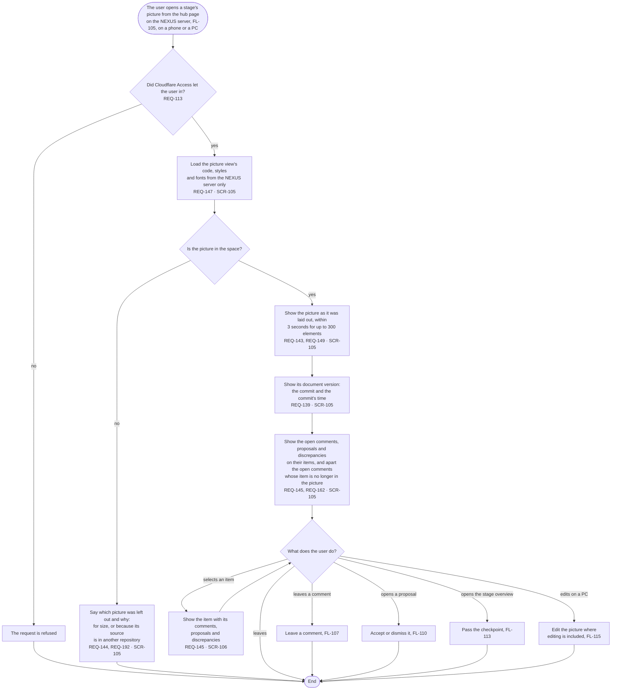

# FL-106 Look at a picture

[한국어](FL-106-look-at-a-picture.ko.md)

Serves: REQ-113, REQ-139, REQ-143, REQ-144, REQ-145, REQ-146, REQ-147, REQ-148, REQ-149, REQ-150, REQ-162, REQ-192

Context: CTX-012 Pictures, with the discussion of CTX-014 on them. Starts when the user opens a stage's picture from the hub page on the NEXUS server (FL-105), on a phone or a PC. New in NEXUS 0.2.

The view shows the projects' text and the comments only as text, follows the profile's language, and works at every width from 320 to 1440 pixels without sideways scrolling of the page (REQ-146, REQ-148, REQ-150); a picture larger than the screen moves inside its own frame.
