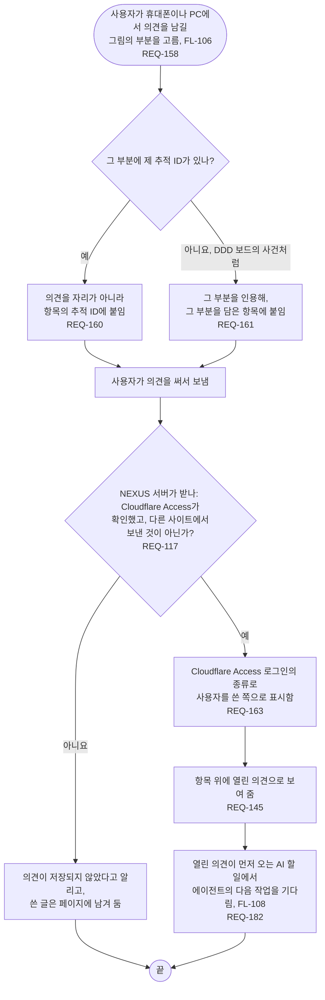

# FL-107 그림에 의견 남기기

[English](FL-107-leave-a-comment.md)

다루는 요구사항: REQ-117, REQ-145, REQ-158, REQ-160, REQ-161, REQ-163, REQ-182

맥락: CTX-014 논의. 사용자가 휴대폰이나 PC의 그림 보기(FL-106)에서 의견을 남길 그림의 부분을 고를 때 시작합니다. 에이전트는 허브를 거쳐 의견을 남깁니다(FL-109). NEXUS 0.2에서 새로 더합니다.

에이전트는 일을 시작할 때만 의견을 읽으므로, 급한 것은 대화로 말합니다(01단계의 핫스팟 6). 의견을 저장하지 못했을 때 무엇을 남길지는 [README](README.ko.md#기능-명세에서-정할-것)의 14번입니다.
