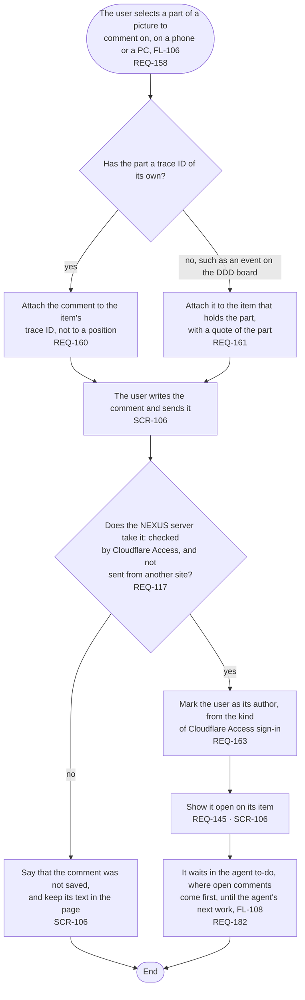

# FL-107 Leave a comment on a picture

[한국어](FL-107-leave-a-comment.ko.md)

Serves: REQ-117, REQ-145, REQ-158, REQ-160, REQ-161, REQ-163, REQ-182

Context: CTX-014 Discussion. Starts when the user selects a part of a picture in the picture view (FL-106) to comment on it, on a phone or a PC. The agent leaves its comments through the hub (FL-109). New in NEXUS 0.2.

The agent reads comments only when its work starts, so anything urgent goes in the conversation instead (hotspot 6 of stage 01). What is kept when a comment cannot be saved is point 14 of the [README](README.md#points-for-the-functional-spec).
