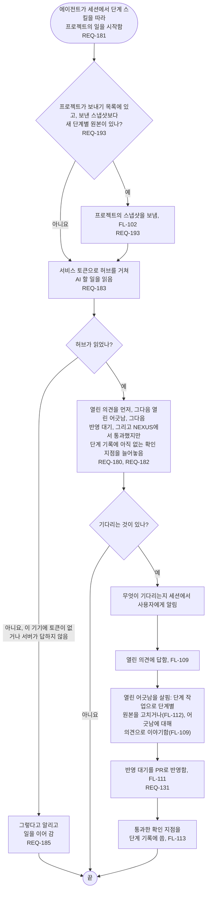

# FL-108 에이전트가 프로젝트에서 일을 시작하기

[English](FL-108-start-the-agents-work.md)

다루는 요구사항: REQ-131, REQ-180, REQ-181, REQ-182, REQ-183, REQ-185, REQ-193

맥락: AI 할 일을 내놓는 CTX-007 단계 진행, 그리고 CTX-014 논의와 CTX-010 편집. 에이전트가 세션에서 단계 스킬을 따라 프로젝트의 일을 시작할 때 시작합니다. NEXUS 0.2에서 새로 더합니다.

NEXUS 서버에 없는 프로젝트에는 AI 할 일이 없고, 클라우드 세션처럼 서비스 토큰이 없는 기기는 그것을 읽을 수 없습니다. 두 에이전트가 한 프로젝트에서 함께 일을 시작할 때, 그리고 무엇을 에이전트의 일 시작으로 볼지와 AI 할 일이 세션에서 사용자가 부탁한 것과 어떻게 만나는지는 [README](README.ko.md#기능-명세에서-정할-것)의 12번과 13번입니다.
