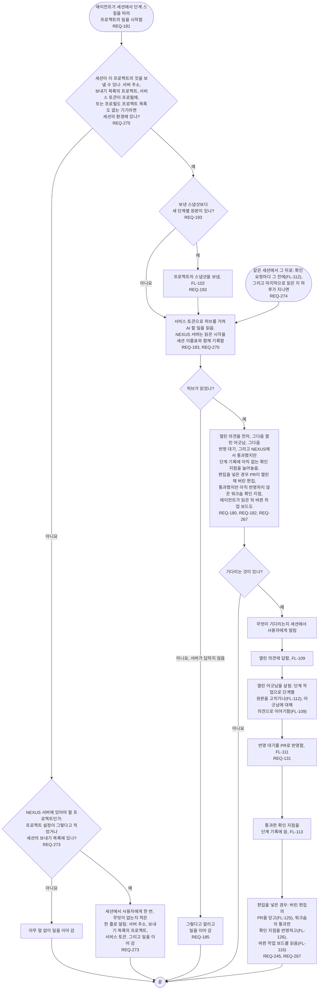

# FL-108 에이전트가 프로젝트에서 일을 시작하기

[English](FL-108-start-the-agents-work.md)

다루는 요구사항: REQ-131, REQ-180, REQ-181, REQ-182, REQ-183, REQ-185, REQ-193, REQ-245, REQ-267, REQ-270, REQ-273, REQ-274, REQ-275

맥락: AI 할 일을 내놓는 CTX-007 단계 진행, 그리고 CTX-014 논의, CTX-010 편집, 편집을 넣은 경우 CTX-016 워크숍. 에이전트가 세션에서 단계 스킬을 따라 프로젝트의 일을 시작할 때, 그리고 같은 세션에서 확인 요청마다 그 전과 마지막으로 읽은 지 하루가 지났을 때 다시 시작합니다(REQ-274). NEXUS 0.2에서 새로 더했고, 2026-11-11의 설계 수정이 세션이 보낼 수 있는지의 확인, 읽은 시각의 기록, 처음 뒤의 다시 읽기를 더했습니다.

NEXUS 서버에 없는 프로젝트에는 AI 할 일이 없습니다. 서버에 있어야 할 프로젝트의 것을 보낼 수 없는 세션은 한 번 그렇다고 알립니다(REQ-273). 2026-11-11의 설계 수정 전의 규칙은 에이전트가 말없이 넘어가게 했고, 끝나면 기기의 파일이 사라지는 클라우드 세션은 그래서 AI 할 일을 한 번도 읽지 않았는데 그것이 어디에도 보이지 않았습니다. 그런 세션도 환경에 서버 주소와 보내기 목록이 적히면 보낼 수 있습니다(REQ-275). 그것을 넣는 일은 사용자 자신의 일이고 에이전트가 하지 않습니다. 서버가 읽을 때마다 기록하는 시각(REQ-270)이 첫 화면과 작업 공간이 에이전트의 마지막 읽음으로 보여 주는 것입니다(FL-117, FL-118). 두 에이전트가 한 프로젝트에서 함께 일을 시작할 때, 그리고 무엇을 에이전트의 일 시작으로 볼지와 AI 할 일이 세션에서 사용자가 부탁한 것과 어떻게 만나는지는 [README](README.ko.md#기능-명세에서-정할-것)의 12번과 13번이고, 프로젝트가 서버에 있어야 한다는 것을 세션이 무엇으로 아는지와 환경에 무엇을 두는지는 24번과 25번입니다.
