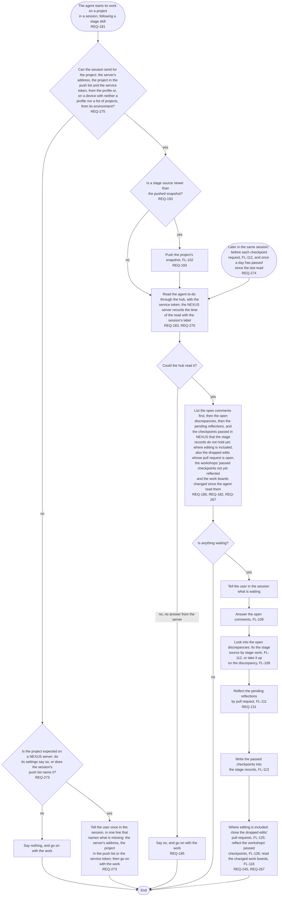

# FL-108 Start the agent's work on a project

[한국어](FL-108-start-the-agents-work.ko.md)

Serves: REQ-131, REQ-180, REQ-181, REQ-182, REQ-183, REQ-185, REQ-193, REQ-245, REQ-267, REQ-270, REQ-273, REQ-274, REQ-275

Context: CTX-007 Stage progress, which serves the agent to-do, with CTX-014 Discussion, CTX-010 Editing and, where editing is included, CTX-016 Workshops. Starts when the agent starts its work on a project in a session, following a stage skill, and again in the same session before each checkpoint request and once a day has passed since its last read (REQ-274). New in NEXUS 0.2; the design revision of 2026-11-11 added the check of whether the session can send, the recorded read and the reads that follow the first.

A project that is not on the NEXUS server has no agent to-do. A session that cannot send for a project that is expected there says so once (REQ-273), where the rule before the design revision of 2026-11-11 had the agent go on in silence: a cloud session, which loses the device's files when it ends, then never read the to-do, and nothing showed it. Such a session can send once its environment names the server's address and the push list (REQ-275); putting them there is the user's own step, never the agent's. The time that the server records with each read (REQ-270) is what the first page and the workspace show as the agent's last read (FL-117, FL-118). Two agents that start on one project at once, and what counts as the start of the agent's work and how the to-do meets what the user asked in the session, are points 12 and 13 of the [README](README.md#points-for-the-functional-spec); what tells a session that a project is expected on a server, and what its environment holds, are points 24 and 25.
