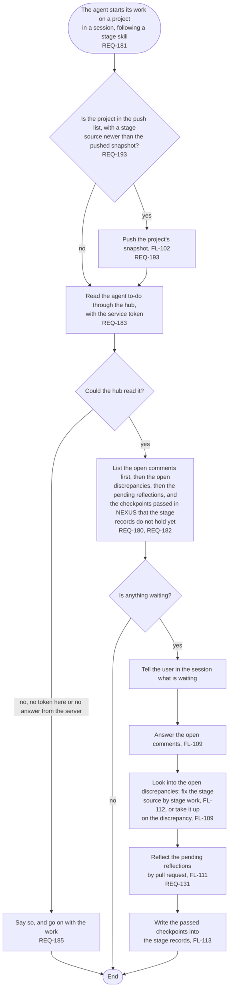

# FL-108 Start the agent's work on a project

[한국어](FL-108-start-the-agents-work.ko.md)

Serves: REQ-131, REQ-180, REQ-181, REQ-182, REQ-183, REQ-185, REQ-193

Context: CTX-007 Stage progress, which serves the agent to-do, with CTX-014 Discussion and CTX-010 Editing. Starts when the agent starts its work on a project in a session, following a stage skill. New in NEXUS 0.2.

A project that is not on the NEXUS server has no agent to-do, and a device without the service token, such as a cloud session, cannot read it. Two agents that start on one project at once, and what counts as the start of the agent's work and how the to-do meets what the user asked in the session, are points 12 and 13 of the [README](README.md#points-for-the-functional-spec).
