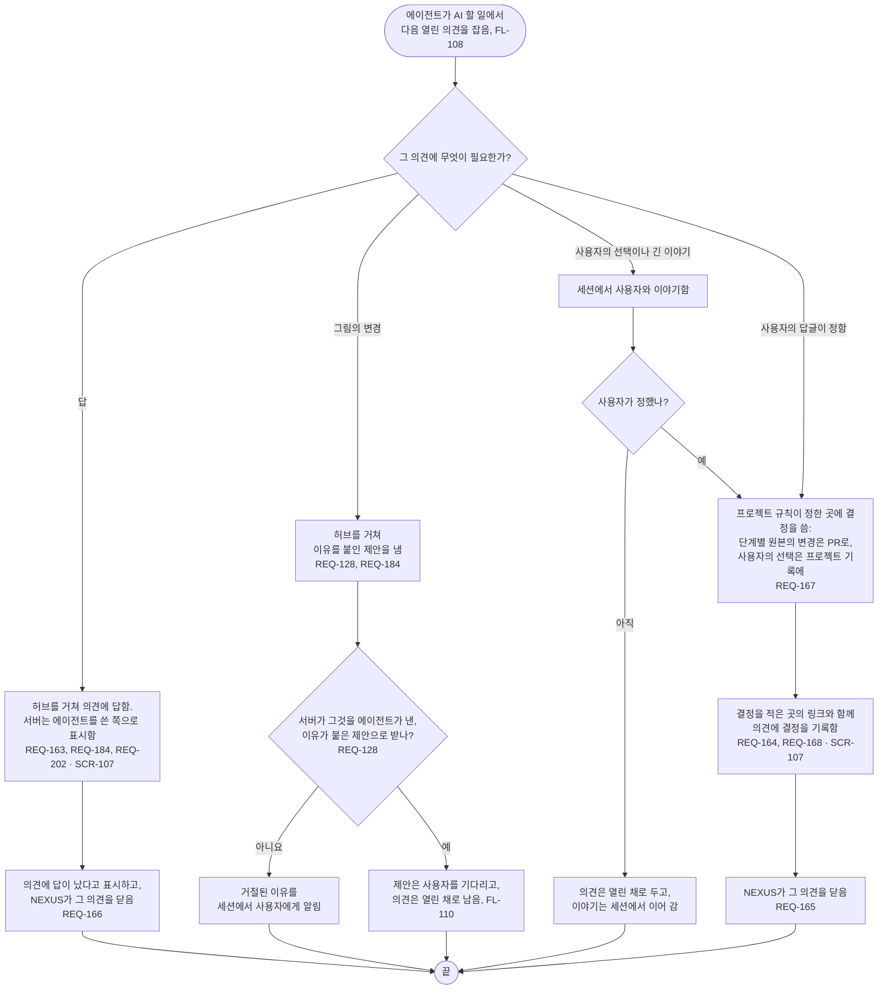

# FL-109 의견에 답하기

[English](FL-109-answer-a-comment.md)

다루는 요구사항: REQ-128, REQ-163, REQ-164, REQ-165, REQ-166, REQ-167, REQ-168, REQ-184, REQ-202

맥락: CTX-014 논의. 에이전트가 AI 할 일(FL-108)에서 열린 의견을 하나 잡을 때 시작합니다. 사용자가 세션에서 의견을 꺼낼 수도 있습니다. NEXUS 0.2에서 새로 더합니다.

에이전트가 스스로 남기는 의견, 예를 들어 어긋남에 대해 묻는 의견도 같은 길로 허브를 거치고 에이전트를 쓴 쪽으로 지닙니다. 의견의 답글, 그리고 에이전트가 답이 났다고 표시한 의견을 사용자가 다시 열 수 있는지는 [README](README.ko.md#기능-명세에서-정할-것)의 9번입니다.
